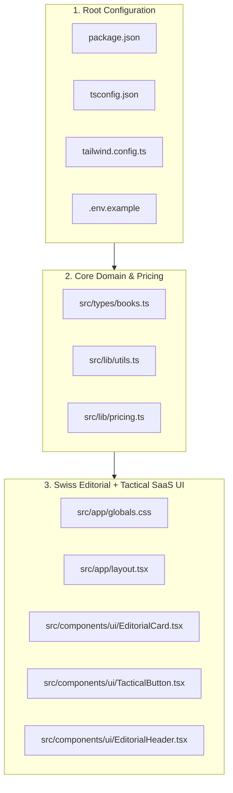

# Design Document — Spec 01: Project Scaffold & Swiss Editorial Design System

## 1. Architecture Overview



---

## 2. Exact File Blueprints (Copy Verbatim)

### 2.1 `package.json`
```json
{
  "name": "aiossan",
  "version": "2.0.0",
  "private": true,
  "scripts": {
    "dev": "next dev",
    "build": "npx tsx scripts/generate-illustrations.ts && next build",
    "start": "next start",
    "lint": "next lint",
    "generate:art": "npx tsx scripts/generate-illustrations.ts",
    "generate:ai-art": "npx tsx scripts/generate-ai-illustrations.ts"
  },
  "dependencies": {
    "@aws-sdk/client-s3": "^3.750.0",
    "@aws-sdk/s3-request-presigner": "^3.750.0",
    "@supabase/ssr": "^0.5.2",
    "@supabase/supabase-js": "^2.49.1",
    "clsx": "^2.1.1",
    "lucide-react": "^0.475.0",
    "mermaid": "^11.4.1",
    "next": "14.2.24",
    "react": "^18.3.1",
    "react-dom": "^18.3.1",
    "react-markdown": "^9.0.3",
    "rehype-raw": "^7.0.0",
    "remark-gfm": "^4.0.0",
    "tailwind-merge": "^3.0.1"
  },
  "devDependencies": {
    "@types/node": "^20.17.19",
    "@types/react": "^18.3.18",
    "@types/react-dom": "^18.3.5",
    "autoprefixer": "^10.4.20",
    "postcss": "^8.5.2",
    "tailwindcss": "^3.4.17",
    "tsx": "^4.19.2",
    "typescript": "^5.7.3"
  }
}
```

### 2.2 `tsconfig.json`
```json
{
  "compilerOptions": {
    "lib": ["dom", "dom.iterable", "esnext"],
    "allowJs": true,
    "skipLibCheck": true,
    "strict": true,
    "noEmit": true,
    "esModuleInterop": true,
    "module": "esnext",
    "moduleResolution": "bundler",
    "resolveJsonModule": true,
    "isolatedModules": true,
    "jsx": "preserve",
    "incremental": true,
    "plugins": [
      {
        "name": "next"
      }
    ],
    "paths": {
      "@/*": ["./src/*"]
    }
  },
  "include": ["next-env.d.ts", "**/*.ts", "**/*.tsx", ".next/types/**/*.ts"],
  "exclude": ["node_modules"]
}
```

### 2.3 `next.config.mjs`
```javascript
/** @type {import('next').NextConfig} */
const nextConfig = {
  reactStrictMode: true,
  images: {
    unoptimized: true,
  },
};

export default nextConfig;
```

### 2.4 `postcss.config.mjs`
```javascript
/** @type {import('postcss-load-config').Config} */
const config = {
  plugins: {
    tailwindcss: {},
    autoprefixer: {},
  },
};

export default config;
```

### 2.5 `tailwind.config.ts`
```typescript
import type { Config } from 'tailwindcss';

const config: Config = {
  content: [
    './src/pages/**/*.{js,ts,jsx,tsx,mdx}',
    './src/components/**/*.{js,ts,jsx,tsx,mdx}',
    './src/app/**/*.{js,ts,jsx,tsx,mdx}',
  ],
  theme: {
    extend: {
      colors: {
        editorial: {
          bg: '#FBF9F5',
          surface: '#FFFFFF',
          subtle: '#F3F0E8',
          ink: '#111113',
          slate: '#52525B',
          muted: '#71717A',
          border: '#E4E2DD',
          strong: '#18181B',
          orange: '#EA580C',
          cobalt: '#1D4ED8',
          emerald: '#0F766E',
          amber: '#FDE68A',
        },
      },
      fontFamily: {
        serif: ['var(--font-serif)', 'Georgia', 'serif'],
        sans: ['var(--font-sans)', 'system-ui', 'sans-serif'],
        mono: ['var(--font-mono)', 'monospace'],
      },
    },
  },
  plugins: [],
};

export default config;
```

### 2.6 `.env.example` & `.gitignore`
**File `.env.example`:**
```ini
NEXT_PUBLIC_SITE_URL=http://localhost:3000
NEXT_PUBLIC_SUPABASE_URL=https://your-project.supabase.co
NEXT_PUBLIC_SUPABASE_ANON_KEY=your-anon-key
SUPABASE_SERVICE_ROLE_KEY=your-service-role-key
MAYAR_API_URL=https://api.mayar.id
MAYAR_API_KEY=your-mayar-api-key
MAYAR_WEBHOOK_SECRET=your-mayar-webhook-secret
R2_ACCOUNT_ID=your-r2-account-id
R2_ACCESS_KEY_ID=your-r2-access-key-id
R2_SECRET_ACCESS_KEY=your-r2-secret-access-key
R2_BUCKET_NAME=aiossan-ebook-assets
R2_ENDPOINT=https://your-r2-account-id.r2.cloudflarestorage.com
GEMINI_API_KEY=
OPENAI_API_KEY=
```

**File `.gitignore`:**
```gitignore
node_modules/
.next/
out/
.env
.env.local
.env.*.local
.DS_Store
*.tsbuildinfo
next-env.d.ts
```

### 2.7 `src/types/books.ts`
```typescript
export type BookId = 'book-1' | 'book-2' | 'book-3';
export type BookLang = 'id-kasual' | 'id-standar' | 'en';
export type ReaderTheme = 'paper' | 'sepia' | 'night';

export interface ChapterMeta {
  index: number;          // 0 = Intro, 1..13 = Chapters, 14 = Appendix
  slug: string;           // 'ch-0' .. 'ch-14'
  title: string;
  isFreeSample: boolean;  // true when index <= 1
}

export interface ChapterData extends ChapterMeta {
  content: string;
}

export interface BookCatalogItem {
  id: BookId;
  number: 1 | 2 | 3;
  volumeCode: string;
  priceIdr: number;
  accentHex: string;
  titles: Record<BookLang, string>;
  subtitles: Record<BookLang, string>;
  targetRole: Record<BookLang, string>;
  keyFrameworks: Record<BookLang, string[]>;
}

export const BOOK_CATALOG: BookCatalogItem[] = [
  {
    id: 'book-1',
    number: 1,
    volumeCode: 'VOL. 01',
    priceIdr: 49000,
    accentHex: '#1D4ED8',
    titles: {
      'id-kasual': 'Mahir Memimpin Tim',
      'id-standar': 'Mahir Memimpin Tim',
      en: 'Practical Team Leadership',
    },
    subtitles: {
      'id-kasual': 'Strategi Bikin Tim Jadi Mandiri',
      'id-standar': 'Strategi Menciptakan Tim yang Mandiri',
      en: 'Developing Autonomous Teams',
    },
    targetRole: {
      'id-kasual': 'First-Time Leader, Supervisor & Tech Lead Baru',
      'id-standar': 'Pemimpin Tim Baru, Supervisor & Koordinator',
      en: 'First-Time Team Leads, Supervisors & Tech Leads',
    },
    keyFrameworks: {
      'id-kasual': [
        'Kerangka Kerja 4x4 (4 Obrolan Inti & 4 Skill Komunikasi)',
        'Rumus 3K (Keluaran, Kriteria Sukses, Kalender)',
        'Kalibrasi Kesiapan L1–L4 & Simulasi 4 Minggu',
      ],
      'id-standar': [
        'Kerangka Kerja 4x4 (4 Obrolan Inti & 4 Keterampilan)',
        'Rumus 3K (Keluaran, Kriteria Sukses, Kalender)',
        'Kalibrasi Kesiapan Tim L1–L4 & Simulasi 4 Pekan',
      ],
      en: [
        'The 4x4 Framework (4 Core Conversations & 4 Skills)',
        'The 3D Brief (Deliverable, Definition of Done, Deadline)',
        'L1–L4 Situational Readiness & 4-Week Coaching Simulation',
      ],
    },
  },
  {
    id: 'book-2',
    number: 2,
    priceIdr: 49000,
    volumeCode: 'VOL. 02',
    accentHex: '#EA580C',
    titles: {
      'id-kasual': 'Napas Panjang Memimpin Tim',
      'id-standar': 'Napas Panjang Memimpin Tim',
      en: 'Sustaining Your Leadership',
    },
    subtitles: {
      'id-kasual': 'Strategi Atasi Jenuh dan Bangun Sistem Kerja Otomatis',
      'id-standar': 'Strategi Mengatasi Kejenuhan dan Membangun Sistem Kerja Mandiri',
      en: 'Practical Strategies to Beat Burnout and Build Self-Running Teams',
    },
    targetRole: {
      'id-kasual': 'Leader yang Kewalahan, Sering Lembur & Hampir Burnout',
      'id-standar': 'Pemimpin Tim yang Kewalahan Operasional & Rentan Jenuh',
      en: 'Overwhelmed Leads Stuck in Daily Firefighting',
    },
    keyFrameworks: {
      'id-kasual': [
        'Audit Kalender 3P & Protokol Detachment Jam 6 Sore',
        'Anti-Monkey Management (Stop Ambil Alih Tugas Anak Tim)',
        'Cetak Biru Kaderisasi Tangan Kanan & Job Crafting 30/70',
      ],
      'id-standar': [
        'Audit Kalender 3P & Protokol Pemutusan Pikiran Jam 18.00',
        'Manajemen Anti-Ambil Alih Tugas & Negosiasi Kapasitas',
        'Kaderisasi Pelapis Kedua & Perancangan Peran 30/70',
      ],
      en: [
        '3R Weekly Calendar Audit & 6 PM Detachment Protocol',
        'Anti-Monkey Management & Data-Backed Capacity Negotiation',
        'Second-in-Command Bench Strength & 30/70 Job Crafting',
      ],
    },
  },
  {
    id: 'book-3',
    number: 3,
    priceIdr: 99000,
    volumeCode: 'VOL. 03',
    accentHex: '#0F766E',
    titles: {
      'id-kasual': 'Memimpin Para Leader',
      'id-standar': 'Memimpin Para Leader',
      en: 'Leading Other Leaders',
    },
    subtitles: {
      'id-kasual': 'Strategi Naik Kelas dari Mengatur Tim ke Menggerakkan Divisi',
      'id-standar': 'Strategi Naik Kelas dari Mengarahkan Tim ke Menggerakkan Divisi',
      en: 'Practical Strategies for Moving from Team Lead to Manager of Managers',
    },
    targetRole: {
      'id-kasual': 'Head of Dept, Engineering Manager, VP & Manajer Divisi',
      'id-standar': 'Kepala Divisi, Manajer Senior & Pemimpin Lintas Tim',
      en: 'Department Heads, Senior Managers & Directors',
    },
    keyFrameworks: {
      'id-kasual': [
        'Coaching the Coach & Jaga Wibawa Komando (Anti-Skip-Level)',
        'Piagam Sasaran Bersama 3S & Mediasi Silo 15 Menit',
        'Audit 1-on-1 Level Manajer (4P) & Cetak Biru 90 Hari',
      ],
      'id-standar': [
        'Membina Pemimpin Tim & Menjaga Rantai Komando (Anti-Skip-Level)',
        'Piagam Penyelarasan Lintas Tim 3S & Mediasi Gesekan Silo',
        'Bedah Sistem 4P & Cetak Biru Transisi Divisi 90 Hari',
      ],
      en: [
        'Coaching the Coach & Anti-Skip-Level Authority Guardrails',
        '3S Cross-Team Shared Charter & 15-Minute Seam Mediation',
        '4P System Audit & 90-Day Divisional Transition Blueprint',
      ],
    },
  },
];
```

### 2.8 `src/lib/utils.ts` & `src/lib/pricing.ts`
**File `src/lib/utils.ts`:**
```typescript
import { clsx, type ClassValue } from 'clsx';
import { twMerge } from 'tailwind-merge';

export function cn(...inputs: ClassValue[]) {
  return twMerge(clsx(inputs));
}

export function formatIDR(amount: number): string {
  return 'Rp ' + amount.toLocaleString('id-ID');
}
```

**File `src/lib/pricing.ts`:**
```typescript
import { BookId } from '@/types/books';

export type TierId =
  | 'book-1'
  | 'book-2'
  | 'book-3'
  | 'bundle-1-2'
  | 'bundle-2-3'
  | 'bundle-trilogy';

export interface PricingTier {
  id: TierId;
  nameId: string;
  nameEn: string;
  priceIdr: number;
  strikePriceIdr?: number;
  priceUsd: number;
  includedBooks: BookId[];
  badgeId?: string;
  badgeEn?: string;
  isBestValue?: boolean;
}

export const PRICING_TIERS: PricingTier[] = [
  {
    id: 'book-1',
    nameId: 'Buku 1: Mahir Memimpin Tim',
    nameEn: 'Book 1: Practical Team Leadership',
    priceIdr: 49000,
    priceUsd: 4.99,
    includedBooks: ['book-1'],
    badgeId: 'VOL. 01 • First-Time Lead',
    badgeEn: 'VOL. 01 • First-Time Lead',
  },
  {
    id: 'book-2',
    nameId: 'Buku 2: Napas Panjang Memimpin Tim',
    nameEn: 'Book 2: Sustaining Your Leadership',
    priceIdr: 49000,
    priceUsd: 4.99,
    includedBooks: ['book-2'],
    badgeId: 'VOL. 02 • Anti-Burnout',
    badgeEn: 'VOL. 02 • Beat Burnout',
  },
  {
    id: 'book-3',
    nameId: 'Buku 3: Memimpin Para Leader',
    nameEn: 'Book 3: Leading Other Leaders',
    priceIdr: 99000,
    priceUsd: 9.99,
    includedBooks: ['book-3'],
    badgeId: 'VOL. 03 • Manager of Managers',
    badgeEn: 'VOL. 03 • Manager of Managers',
  },
  {
    id: 'bundle-1-2',
    nameId: 'Bundel 2 Buku (Volume 01 & 02)',
    nameEn: '2-Book Bundle (Volumes 01 & 02)',
    priceIdr: 79000,
    strikePriceIdr: 98000,
    priceUsd: 7.99,
    includedBooks: ['book-1', 'book-2'],
    badgeId: 'Hemat Rp 19.000',
    badgeEn: 'Save 19%',
  },
  {
    id: 'bundle-2-3',
    nameId: 'Bundel 2 Buku (Volume 02 & 03)',
    nameEn: '2-Book Bundle (Volumes 02 & 03)',
    priceIdr: 129000,
    strikePriceIdr: 148000,
    priceUsd: 12.99,
    includedBooks: ['book-2', 'book-3'],
    badgeId: 'Hemat Rp 19.000',
    badgeEn: 'Save Rp 19,000',
  },
  {
    id: 'bundle-trilogy',
    nameId: 'Complete Trilogy Box Set (Volume 01, 02 & 03)',
    nameEn: 'Complete 3-Book Trilogy Box Set (Vol. 01, 02 & 03)',
    priceIdr: 149000,
    strikePriceIdr: 197000,
    priceUsd: 14.99,
    includedBooks: ['book-1', 'book-2', 'book-3'],
    badgeId: 'BEST VALUE • Hemat Rp 48.000',
    badgeEn: 'BEST VALUE • Save 25%',
    isBestValue: true,
  },
];

export function getTier(tierId: TierId): PricingTier | undefined {
  return PRICING_TIERS.find((t) => t.id === tierId);
}
```

### 2.9 `src/app/globals.css` & `src/app/layout.tsx`
**File `src/app/globals.css`:**
```css
@tailwind base;
@tailwind components;
@tailwind utilities;

:root {
  color-scheme: light only;
  --bg-canvas: #FBF9F5;
  --bg-surface: #FFFFFF;
  --bg-subtle: #F3F0E8;
  --ink-primary: #111113;
  --ink-secondary: #52525B;
  --ink-muted: #71717A;
  --border-subtle: #E4E2DD;
  --border-strong: #18181B;
  --accent-orange: #EA580C;
  --accent-cobalt: #1D4ED8;
  --accent-emerald: #0F766E;
}

[data-reader-theme="paper"] {
  --reader-bg: #FBF9F5;
  --reader-surface: #FFFFFF;
  --reader-subtle: #F3F0E8;
  --reader-ink: #111113;
  --reader-muted: #52525B;
  --reader-border: #E4E2DD;
}

[data-reader-theme="sepia"] {
  --reader-bg: #F1ECE1;
  --reader-surface: #FAF6ED;
  --reader-subtle: #E6DFD1;
  --reader-ink: #26221E;
  --reader-muted: #5C554C;
  --reader-border: #D5CBB8;
}

[data-reader-theme="night"] {
  --reader-bg: #090D16;
  --reader-surface: #111827;
  --reader-subtle: #1E293B;
  --reader-ink: #F3F4F6;
  --reader-muted: #9CA3AF;
  --reader-border: #1F2937;
}

html,
body {
  background-color: var(--bg-canvas);
  color: var(--ink-primary);
  font-family: var(--font-sans), system-ui, sans-serif;
  color-scheme: light only;
}

/* Subtle Swiss architectural grid background */
.swiss-grid-bg {
  background-size: 32px 32px;
  background-image: 
    linear-gradient(to right, rgba(24, 24, 27, 0.04) 1px, transparent 1px),
    linear-gradient(to bottom, rgba(24, 24, 27, 0.04) 1px, transparent 1px);
}

/* Editorial Highlighter Marker */
mark {
  background: linear-gradient(180deg, transparent 55%, #FDE68A 55%);
  color: inherit;
  padding: 0 0.15em;
  border-radius: 2px;
}
```

**File `src/app/layout.tsx`:**
```tsx
import type { Metadata } from 'next';
import { Newsreader, Plus_Jakarta_Sans, JetBrains_Mono } from 'next/font/google';
import './globals.css';

const fontSerif = Newsreader({
  subsets: ['latin'],
  weight: ['400', '500', '600', '700'],
  style: ['normal', 'italic'],
  variable: '--font-serif',
  display: 'swap',
});

const fontSans = Plus_Jakarta_Sans({
  subsets: ['latin'],
  weight: ['400', '500', '600', '700', '800'],
  variable: '--font-sans',
  display: 'swap',
});

const fontMono = JetBrains_Mono({
  subsets: ['latin'],
  weight: ['400', '500', '600', '700'],
  variable: '--font-mono',
  display: 'swap',
});

export const metadata: Metadata = {
  title: 'aiossan.com — Tactical Leadership Playbook Trilogy (Interactive Web & A5 PDF)',
  description:
    'Field-tested leadership playbooks for first-time team leads, overwhelmed managers, and department heads. Available in Casual Indonesian, Formal Indonesian, and Global English.',
  other: {
    'color-scheme': 'light only',
    'darkreader-lock': 'true',
  },
};

export default function RootLayout({ children }: { children: React.ReactNode }) {
  return (
    <html
      lang="id"
      style={{ colorScheme: 'light' }}
      className={`${fontSerif.variable} ${fontSans.variable} ${fontMono.variable}`}
    >
      <head>
        <meta name="color-scheme" content="light only" />
        <meta name="darkreader-lock" />
      </head>
      <body className="min-h-screen bg-[#FBF9F5] text-[#111113] antialiased selection:bg-[#FDE68A] selection:text-[#111113]">
        {children}
      </body>
    </html>
  );
}
```

### 2.10 `src/components/ui/EditorialCard.tsx`, `TacticalButton.tsx`, & `EditorialHeader.tsx`
**File `src/components/ui/EditorialCard.tsx`:**
```tsx
import React from 'react';
import { cn } from '@/lib/utils';

export interface EditorialCardProps extends React.HTMLAttributes<HTMLDivElement> {
  variant?: 'surface' | 'subtle' | 'dark' | 'featured';
  indexLabel?: string;
  badgeText?: string;
  accentColor?: 'cobalt' | 'orange' | 'emerald' | 'neutral';
}

export function EditorialCard({
  children,
  className,
  variant = 'surface',
  indexLabel,
  badgeText,
  accentColor = 'neutral',
  ...props
}: EditorialCardProps) {
  const variantClasses = {
    surface: 'bg-white border border-[#E4E2DD] shadow-[0_2px_12px_-4px_rgba(17,17,19,0.05)]',
    subtle: 'bg-[#F3F0E8]/70 border border-[#E4E2DD]',
    dark: 'bg-[#111113] text-white border border-[#27272A]',
    featured:
      'bg-white border-2 border-[#111113] shadow-[0_12px_32px_-8px_rgba(17,17,19,0.12)]',
  }[variant];

  const badgeColors = {
    cobalt: 'bg-[#EFF6FF] text-[#1D4ED8] border-[#BFDBFE]',
    orange: 'bg-[#FFF7ED] text-[#EA580C] border-[#FED7AA]',
    emerald: 'bg-[#F0FDFA] text-[#0F766E] border-[#99F6E4]',
    neutral: 'bg-[#F3F0E8] text-[#111113] border-[#D4D0C8]',
  }[accentColor];

  return (
    <div
      className={cn('rounded-xl overflow-hidden transition-all', variantClasses, className)}
      {...props}
    >
      {(indexLabel || badgeText) && (
        <div
          className={cn(
            'flex items-center justify-between px-5 py-2.5 border-b text-[11px] font-mono uppercase tracking-wider',
            variant === 'dark'
              ? 'border-[#27272A] bg-[#18181B] text-[#A1A1AA]'
              : 'border-[#E4E2DD] bg-[#FBF9F5]/80 text-[#52525B]'
          )}
        >
          <span className="font-semibold">{indexLabel || 'AIOSSAN // PLAYBOOK'}</span>
          {badgeText && (
            <span
              className={cn(
                'px-2 py-0.5 rounded border font-bold text-[10px]',
                badgeColors
              )}
            >
              {badgeText}
            </span>
          )}
        </div>
      )}
      <div className="p-6 sm:p-7">{children}</div>
    </div>
  );
}
```

**File `src/components/ui/TacticalButton.tsx`:**
```tsx
import React from 'react';
import { cn } from '@/lib/utils';

export interface TacticalButtonProps
  extends React.ButtonHTMLAttributes<HTMLButtonElement> {
  variant?: 'primary' | 'accent' | 'secondary' | 'ghost';
  size?: 'sm' | 'md' | 'lg';
}

export function TacticalButton({
  children,
  className,
  variant = 'primary',
  size = 'md',
  ...props
}: TacticalButtonProps) {
  const variantStyles = {
    primary:
      'bg-[#111113] text-white hover:bg-[#27272A] border border-[#111113] shadow-sm',
    accent:
      'bg-[#EA580C] text-white hover:bg-[#C2410C] border border-[#C2410C] shadow-sm',
    secondary:
      'bg-white text-[#111113] hover:bg-[#F3F0E8] border border-[#D4D0C8] shadow-xs',
    ghost:
      'bg-transparent text-[#52525B] hover:text-[#111113] hover:bg-[#F3F0E8]/60 border border-transparent',
  }[variant];

  const sizeStyles = {
    sm: 'px-3.5 py-1.5 text-xs min-h-[34px] rounded-lg',
    md: 'px-4.5 py-2.5 text-sm min-h-[42px] rounded-lg',
    lg: 'px-6 py-3.5 text-sm sm:text-base min-h-[48px] rounded-xl',
  }[size];

  return (
    <button
      className={cn(
        'inline-flex items-center justify-center gap-2 font-sans font-semibold tracking-tight transition-all duration-150 active:scale-[0.99] disabled:opacity-50 cursor-pointer',
        variantStyles,
        sizeStyles,
        className
      )}
      {...props}
    >
      {children}
    </button>
  );
}
```

**File `src/components/ui/EditorialHeader.tsx`:**
```tsx
'use client';

import React, { useState } from 'react';
import Link from 'next/link';
import { BookLang } from '@/types/books';
import { TacticalButton } from './TacticalButton';
import { BookOpen, User, Menu, X, Globe, Sparkles } from 'lucide-react';

interface EditorialHeaderProps {
  lang?: BookLang;
  onLangChange?: (lang: BookLang) => void;
}

export function EditorialHeader({
  lang = 'id-kasual',
  onLangChange,
}: EditorialHeaderProps) {
  const [mobileOpen, setMobileOpen] = useState(false);
  const isEn = lang === 'en';

  return (
    <header className="sticky top-0 z-40 bg-[#FBF9F5]/90 backdrop-blur-md border-b border-[#E4E2DD]">
      {/* Top Micro Editorial Bar (Language Register Selector) */}
      <div className="border-b border-[#E4E2DD] bg-[#F3F0E8]/70 px-4 py-1.5">
        <div className="max-w-7xl mx-auto flex flex-col sm:flex-row items-center justify-between gap-1.5 text-[11px] font-mono">
          <div className="flex items-center gap-2 text-[#52525B]">
            <span className="w-1.5 h-1.5 rounded-full bg-[#EA580C]" />
            <span className="uppercase tracking-wider font-semibold">
              {isEn
                ? 'SWISS EDITORIAL EDITION // 3 LANGUAGE REGISTERS INCLUDED'
                : 'EDISI SWISS EDITORIAL // TERMASUK 3 GAYA BAHASA SEKALIGUS'}
            </span>
          </div>

          {onLangChange && (
            <div className="flex items-center gap-1">
              <Globe className="w-3.5 h-3.5 text-[#52525B] mr-1" />
              {(
                [
                  { id: 'id-kasual', label: 'ID Kasual (Gue/Lo)' },
                  { id: 'id-standar', label: 'ID Standar (Saya/Kamu)' },
                  { id: 'en', label: 'EN (Global)' },
                ] as { id: BookLang; label: string }[]
              ).map((item) => (
                <button
                  key={item.id}
                  type="button"
                  onClick={() => onLangChange(item.id)}
                  className={`px-2 py-0.5 rounded text-[11px] transition-colors cursor-pointer ${
                    lang === item.id
                      ? 'bg-[#111113] text-white font-bold'
                      : 'text-[#52525B] hover:text-[#111113] hover:bg-white/60'
                  }`}
                >
                  {item.label}
                </button>
              ))}
            </div>
          )}
        </div>
      </div>

      {/* Main Navigation Row */}
      <div className="max-w-7xl mx-auto px-4 h-16 flex items-center justify-between">
        <Link href="/" className="flex items-center gap-3 group">
          <div className="w-8 h-8 rounded-lg bg-[#111113] text-white flex items-center justify-center font-mono text-xs font-bold tracking-tighter group-hover:bg-[#EA580C] transition-colors">
            A//O
          </div>
          <div className="flex flex-col">
            <span className="font-serif text-xl font-bold tracking-tight text-[#111113] leading-none">
              aiossan<span className="text-[#EA580C]">.com</span>
            </span>
            <span className="font-mono text-[9px] uppercase tracking-widest text-[#71717A] mt-0.5">
              Leadership Playbook Press
            </span>
          </div>
        </Link>

        {/* Desktop Nav */}
        <nav className="hidden md:flex items-center gap-7 text-sm font-sans font-medium text-[#52525B]">
          <Link href="/#books" className="hover:text-[#111113] transition-colors">
            {isEn ? 'The Trilogy (3 Volumes)' : 'Katalog 3 Buku'}
          </Link>
          <Link href="/#scripts" className="hover:text-[#111113] transition-colors">
            {isEn ? 'Interactive 1-on-1 Scripts' : 'Simulasi Skrip 1-on-1'}
          </Link>
          <Link href="/#pricing" className="hover:text-[#111113] transition-colors">
            {isEn ? 'Box Set & Pricing' : 'Paket & Harga'}
          </Link>
          <div className="h-4 w-[1px] bg-[#E4E2DD]" />
          <Link href="/dashboard">
            <TacticalButton variant="secondary" size="sm">
              <User className="w-3.5 h-3.5" />
              <span>{isEn ? 'Reader Library' : 'Perpustakaan Akun'}</span>
            </TacticalButton>
          </Link>
          <Link href={`/read/book-1/${lang}/ch-0`}>
            <TacticalButton variant="primary" size="sm">
              <BookOpen className="w-3.5 h-3.5" />
              <span>{isEn ? 'Read Free Sample' : 'Baca Sampel Gratis'}</span>
            </TacticalButton>
          </Link>
        </nav>

        {/* Mobile Menu Trigger */}
        <button
          type="button"
          onClick={() => setMobileOpen(!mobileOpen)}
          aria-label="Toggle Menu"
          className="md:hidden p-2 rounded-lg border border-[#E4E2DD] bg-white text-[#111113]"
        >
          {mobileOpen ? <X className="w-5 h-5" /> : <Menu className="w-5 h-5" />}
        </button>
      </div>

      {/* Mobile Dropdown */}
      {mobileOpen && (
        <div className="md:hidden border-t border-[#E4E2DD] bg-white px-4 py-4 space-y-3">
          <Link
            href="/#books"
            onClick={() => setMobileOpen(false)}
            className="block py-2 text-sm font-semibold text-[#111113]"
          >
            {isEn ? 'The Trilogy (3 Volumes)' : 'Katalog 3 Buku'}
          </Link>
          <Link
            href="/#scripts"
            onClick={() => setMobileOpen(false)}
            className="block py-2 text-sm font-semibold text-[#111113]"
          >
            {isEn ? 'Interactive 1-on-1 Scripts' : 'Simulasi Skrip 1-on-1'}
          </Link>
          <Link
            href="/#pricing"
            onClick={() => setMobileOpen(false)}
            className="block py-2 text-sm font-semibold text-[#111113]"
          >
            {isEn ? 'Box Set & Pricing' : 'Paket & Harga'}
          </Link>
          <div className="pt-2 flex flex-col gap-2">
            <Link href="/dashboard" onClick={() => setMobileOpen(false)}>
              <TacticalButton variant="secondary" size="md" className="w-full">
                <User className="w-4 h-4" />
                <span>{isEn ? 'Reader Library' : 'Perpustakaan Akun'}</span>
              </TacticalButton>
            </Link>
            <Link
              href={`/read/book-1/${lang}/ch-0`}
              onClick={() => setMobileOpen(false)}
            >
              <TacticalButton variant="primary" size="md" className="w-full">
                <BookOpen className="w-4 h-4" />
                <span>{isEn ? 'Read Free Sample' : 'Baca Sampel Gratis'}</span>
              </TacticalButton>
            </Link>
          </div>
        </div>
      )}
    </header>
  );
}
```
