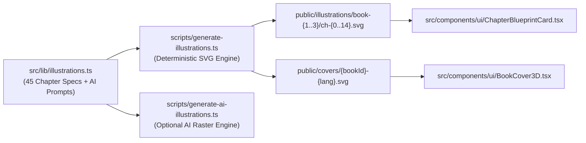

# Design Document — Spec 02: Automated Chapter Illustrations & 3D Book Cover Generator

## 1. Architecture & Generation Pipeline



---

## 2. Exact File Blueprints

### 2.1 `src/lib/illustrations.ts` (Complete 45-Chapter Registry + AI Prompts)
Create `src/lib/illustrations.ts` with all 45 chapters across Book 1, Book 2, and Book 3:

```typescript
import { BookId } from '@/types/books';

export type SchematicMotif =
  | 'compass'
  | 'gears'
  | 'matrix'
  | 'waveform'
  | 'key'
  | 'lens'
  | 'battery'
  | 'target'
  | 'spotlight'
  | 'trajectory'
  | 'telescope'
  | 'podium'
  | 'calibration'
  | 'cadence'
  | 'toolbox'
  | 'shield'
  | 'fire'
  | 'balance'
  | 'switch'
  | 'calendar'
  | 'relay'
  | 'gateway'
  | 'blueprint'
  | 'equilibrium'
  | 'gauge'
  | 'pacemaker'
  | 'lighthouse'
  | 'bridge';

export interface ChapterIllustrationMeta {
  bookId: BookId;
  chapterIndex: number;
  slug: string;
  figCode: string;
  svgPath: string;
  webpPath: string;
  motif: SchematicMotif;
  captionId: string;
  captionEn: string;
  aiPrompt: string;
}

const STYLE_PREFIX =
  'Swiss editorial technical illustration in the style of Monocle Magazine and Stripe Press, clean architectural vector lines, isometric diagramming, warm alabaster paper background (#FBF9F5), deep carbon ink (#111113) linework, minimal geometric focal subject, no clutter, no random text: ';

function makeChapters(
  bookId: BookId,
  volNum: number,
  accentName: string,
  items: {
    motif: SchematicMotif;
    captionId: string;
    captionEn: string;
    scenePrompt: string;
  }[]
): Record<string, ChapterIllustrationMeta> {
  const out: Record<string, ChapterIllustrationMeta> = {};
  items.forEach((item, idx) => {
    const slug = `ch-${idx}`;
    const figCode = `FIG. 0${volNum}.${idx < 10 ? `0${idx}` : idx}`;
    out[`${bookId}:${slug}`] = {
      bookId,
      chapterIndex: idx,
      slug,
      figCode,
      svgPath: `/illustrations/${bookId}/${slug}.svg`,
      webpPath: `/illustrations/${bookId}/${slug}.webp`,
      motif: item.motif,
      captionId: item.captionId,
      captionEn: item.captionEn,
      aiPrompt: `${STYLE_PREFIX} ${item.scenePrompt}. Accent color: ${accentName}.`,
    };
  });
  return out;
}

export const CHAPTER_ILLUSTRATIONS: Record<string, ChapterIllustrationMeta> = {
  ...makeChapters('book-1', 1, 'Editorial Cobalt Blue (#1D4ED8)', [
    {
      motif: 'compass',
      captionId: 'Kompas kepemimpinan pertama: beralih dari keraguan menuju arah yang terukur dan penuh empati.',
      captionEn: 'The first leadership compass: moving from early hesitation to calibrated, empathetic direction.',
      scenePrompt: 'A precision brass-and-cobalt architectural compass resting on an isometric grid desk next to a star badge',
    },
    {
      motif: 'gears',
      captionId: 'Beralih dari memutar semua roda gigi sendirian menjadi konduktor yang menjaga sinkronisasi sistem tim.',
      captionEn: 'Transitioning from frantic solo gear-turning to orchestrating a synchronized multi-gear system.',
      scenePrompt: 'An isometric mechanical diagram showing one master gear smoothly driving four synchronized smaller gears',
    },
    {
      motif: 'matrix',
      captionId: 'Cetak biru Kerangka Kerja 4x4: empat momen percakapan inti berpadu dengan empat keterampilan komunikasi.',
      captionEn: 'The 4x4 Framework Blueprint: four core conversation cadences intersecting with four communication skills.',
      scenePrompt: 'A clean 4x4 architectural matrix grid with glowing cobalt intersection nodes and technical callout lines',
    },
    {
      motif: 'waveform',
      captionId: 'Menyimak aktif: menyaring kebisingan asumsi menjadi gelombang masalah yang jernih dan utuh.',
      captionEn: 'Active listening: filtering noisy assumptions into a clear, focused signal wave.',
      scenePrompt: 'Tangled chaotic lines entering a precision acoustic lens and emerging as a clean harmonic sine wave',
    },
    {
      motif: 'key',
      captionId: 'Pertanyaan pemantik solusi: menyerahkan kunci agar anggota tim membuka pintu pemecahan masalahnya sendiri.',
      captionEn: 'Solution-focused questions: handing over the architectural key so teammates unlock their own solutions.',
      scenePrompt: 'A geometric minimal key shaped like a question mark unlocking an isometric structural mechanism',
    },
    {
      motif: 'lens',
      captionId: 'Kaca pembesar objektif: membedah fakta dan dampak pekerjaan di atas meja tanpa menyerang pribadi.',
      captionEn: 'The objective lens: examining workflow facts and impact on the table without personal blame.',
      scenePrompt: 'An optical precision loupe magnifying a data chart on a blueprint grid, crisp geometric shadows',
    },
    {
      motif: 'battery',
      captionId: 'Menanamkan keyakinan terukur agar anggota tim berani mengambil keputusan mandiri di level berikutnya.',
      captionEn: 'Instilling calibrated confidence so teammates step up to autonomous decision-making.',
      scenePrompt: 'Four ascending architectural steps with an energy core charging the top platform',
    },
    {
      motif: 'target',
      captionId: 'Rumus Delegasi 3K: menyamakan bidikan pada wujud hasil yang Kongkret, Kriteria selesai, dan Kapan waktunya.',
      captionEn: 'The 3C Delegation Brief: aligning three concentric rings—Concrete outcome, Clear criteria, and Clock.',
      scenePrompt: 'Three concentric alignment rings locking into a single crisp bullseye vector on an engineering drafting table',
    },
    {
      motif: 'spotlight',
      captionId: 'Apresiasi tepat sasaran: menyalakan sorot pengakuan spesifik saat kontribusi tim masih hangat.',
      captionEn: 'Timely recognition: casting a focused beam on the exact puzzle piece completed with excellence.',
      scenePrompt: 'An architectural desk lamp casting a sharp geometric spotlight onto a newly fitted keystone block',
    },
    {
      motif: 'trajectory',
      captionId: 'Koreksi empat mata: meluruskan lintasan kerja yang melenceng secara privat, tenang, dan bermartabat.',
      captionEn: 'Private course correction: recalibrating an off-track trajectory behind closed doors with zero drama.',
      scenePrompt: 'A flight trajectory diagram showing a dotted deviation line smoothly guided back onto the main vector',
    },
    {
      motif: 'telescope',
      captionId: 'Evaluasi tanpa kejutan: 30% meninjau cermin spion masa lalu, 70% meneropong pertumbuhan ke depan.',
      captionEn: 'No-surprise reviews: 30% rearview reflection paired with 70% forward-looking growth.',
      scenePrompt: 'Split-ratio 30/70 horizon diagram with a precision telescope pointing toward an ascending grid',
    },
    {
      motif: 'podium',
      captionId: 'Simulasi 4 pekan: peta latihan bertahap dari minggu pertama hingga ritme kepemimpinan terbentuk otomatis.',
      captionEn: 'The 4-week simulation track: week-by-week tactical milestones from orientation to team flow.',
      scenePrompt: 'Four sequential milestone checkpoints connected by a crisp isometric track on a drafting board',
    },
    {
      motif: 'calibration',
      captionId: 'Kalibrasi L1–L4 ke G1–G4: menyesuaikan porsi arahan dan otonomi sesuai kesiapan spesifik tiap tugas.',
      captionEn: 'Situational calibration (L1–L4 to G1–G4): matching leadership support to task-specific readiness.',
      scenePrompt: 'A four-quadrant dial and slider instrument calibrating guidance vs autonomy levels',
    },
    {
      motif: 'cadence',
      captionId: 'Ritme kebiasaan 30 hari: membangun konsistensi pemimpin lewat langkah kecil yang terukur setiap pekan.',
      captionEn: 'The 30-day habit cadence: building leadership consistency through small, repeatable weekly rituals.',
      scenePrompt: 'A modular 30-day perforated habit grid card beside a fountain pen and espresso cup',
    },
    {
      motif: 'toolbox',
      captionId: 'Kotak perkakas meja kerja: kumpulan skrip komunikasi, lembar persiapan 1-on-1, dan rujukan riset primer.',
      captionEn: 'The Desk Reference Toolbox: conversation scripts, 1-on-1 prep sheets, and primary research citations.',
      scenePrompt: 'An open multi-compartment Swiss modular organizer case holding neatly indexed reference cards',
    },
  ]),

  ...makeChapters('book-2', 2, 'International Terracotta Orange (#EA580C)', [
    {
      motif: 'fire',
      captionId: 'Titik balik kejenuhan: berhenti menjadi pemadam kebakaran harian dan mulai menata ulang arsitektur kerja.',
      captionEn: 'The burnout inflection point: retiring the daily firehose to rebuild sustainable workflow architecture.',
      scenePrompt: 'An overloaded stack of folders transforming into a clean, self-running isometric conveyor system',
    },
    {
      motif: 'blueprint',
      captionId: 'Dari penyelamat darurat menjadi perancang sistem: membangun alur yang tetap berjalan tenang tanpa intervensi konstan.',
      captionEn: 'From emergency rescuer to system architect: designing workflows that run smoothly without constant intervention.',
      scenePrompt: 'Architectural blueprint comparing a chaotic tangled knot with a clean parallel pipeline',
    },
    {
      motif: 'shield',
      captionId: '4 Penataan Struktural & 4 Keterampilan Energi: perisai ganda untuk menjaga stamina kepemimpinan jangka panjang.',
      captionEn: '4 Structural Resets & 4 Energy Skills: a dual shield protecting long-term leadership stamina.',
      scenePrompt: 'Four interlocking structural rings surrounding a protected central core on a technical grid',
    },
    {
      motif: 'lens',
      captionId: 'Memisahkan masalah kerja dari beban emosi: menyaring badai kepanikan menjadi tiga fakta objektif yang bisa dieksekusi.',
      captionEn: 'Separating work problems from emotional load: filtering storm clouds into three actionable objective blocks.',
      scenePrompt: 'A geometric prism splitting a turbulent dark wave into three neat, structured cubes',
    },
    {
      motif: 'key',
      captionId: 'Anti-Monkey Management: menahan refleks mengambil alih tugas agar tanggung jawab tetap berada di tangan pemiliknya.',
      captionEn: 'Anti-Monkey Management: resisting the rescue reflex so problem ownership stays with the teammate.',
      scenePrompt: 'A directional vector barrier deflecting incoming task arrows back into organized team lanes',
    },
    {
      motif: 'balance',
      captionId: 'Negosiasi kapasitas berbasis data: menyajikan matriks beban kerja dan opsi trade-off secara tenang kepada atasan.',
      captionEn: 'Data-backed capacity negotiation: presenting objective workload trade-offs calmly to stakeholders.',
      scenePrompt: 'A precision architectural balance scale weighing project blocks with a clear capacity threshold line',
    },
    {
      motif: 'switch',
      captionId: 'Protokol Detachment jam 6 sore: mematikan saklar pikiran kerja agar pemulihan mental berlangsung utuh.',
      captionEn: 'The 6 PM Detachment Protocol: flipping the mental breaker switch for complete after-hours recovery.',
      scenePrompt: 'A minimalist Braun-inspired mechanical toggle switch set to OFF at 18:00 with calm horizon lines',
    },
    {
      motif: 'calendar',
      captionId: 'Audit Kalender 3P (Pangkas, Padatkan, Pindahkan): merebut kembali blok waktu fokus strategis dari rapat yang mubazir.',
      captionEn: 'The 3R Calendar Audit: reclaiming deep-focus blocks from fragmented, low-value status meetings.',
      scenePrompt: 'A weekly schedule grid where cluttered small blocks are consolidated into bold protected focus zones',
    },
    {
      motif: 'relay',
      captionId: 'Mencetak tangan kanan (Second-in-Command): menyiapkan pelapis tepercaya agar tim tidak lumpuh saat kamu cuti.',
      captionEn: 'Building bench strength: grooming a capable second-in-command so operations never bottleneck on you.',
      scenePrompt: 'Two synchronized parallel tracks passing a glowing relay baton seamlessly across checkpoints',
    },
    {
      motif: 'gateway',
      captionId: 'Menata ulang batas ekspektasi: mengubah interupsi dadakan menjadi antrean kerja yang tertib dan terukur.',
      captionEn: 'Resetting boundary expectations: channeling chaotic ad-hoc interruptions into an orderly intake gate.',
      scenePrompt: 'An architectural funnel and sluice gate organizing scattered arrows into a single disciplined stream',
    },
    {
      motif: 'blueprint',
      captionId: 'Job Crafting 30/70: mendelegasikan 70% rutinitas operasional demi membuka 30% ruang pertumbuhan strategis.',
      captionEn: '30/70 Job Crafting: delegating routine maintenance to unlock a 30% strategic growth portfolio.',
      scenePrompt: 'A precision architectural proportion block divided into a 70% automated base and 30% elevated tower',
    },
    {
      motif: 'equilibrium',
      captionId: 'Simulasi 4 pekan pemulihan sistem: langkah bertahap keluar dari kemelut lembur menuju ritme kerja berkelanjutan.',
      captionEn: '4-week system recovery simulation: step-by-step progression from chronic overtime to sustainable flow.',
      scenePrompt: 'Four progressive stages showing a tilted structure returning to perfect horizontal equilibrium',
    },
    {
      motif: 'gauge',
      captionId: 'Barometer kelelahan L1–L4: mendeteksi dini gejala letih sesaat, jenuh rutinitas, hingga kelelahan sistemik.',
      captionEn: 'The L1–L4 Fatigue Barometer: early detection from post-sprint tiredness to systemic overload.',
      scenePrompt: 'An analog precision dial gauge with four distinct zones and calibration markers',
    },
    {
      motif: 'pacemaker',
      captionId: 'Ritme kepemimpinan maraton: menjaga konsistensi napas panjang tanpa mengorbankan kesehatan dan keluarga.',
      captionEn: 'Marathon leadership pacing: maintaining high-output longevity without sacrificing health or life.',
      scenePrompt: 'A steady rhythmic pulse wave running across a long-distance architectural elevation chart',
    },
    {
      motif: 'toolbox',
      captionId: 'Kotak P3K ketahanan kerja: template negosiasi prioritas, ceklis tutup kantor, dan rujukan riset psikologi kerja.',
      captionEn: 'Resilience First-Aid Kit: priority trade-off scripts, shutdown checklists, and occupational research citations.',
      scenePrompt: 'A structured emergency field kit with neatly labeled modular cards and brass latches',
    },
  ]),

  ...makeChapters('book-3', 3, 'Deep Alpine Emerald (#0F766E)', [
    {
      motif: 'lighthouse',
      captionId: 'Naik kelas menjadi pemimpin para leader: berhenti menyetir satu perahu, mulai memandu seluruh armada divisi.',
      captionEn: 'Stepping up to manager of managers: stop steering one boat and start guiding the entire fleet.',
      scenePrompt: 'An architectural lighthouse projecting alignment vectors toward three synchronized vessels on a grid sea',
    },
    {
      motif: 'compass',
      captionId: 'Pergeseran ukuran sukses: bukan lagi seberapa cepat kamu turun tangan, melainkan seberapa mandiri para team lead-mu.',
      captionEn: 'The new success metric: measured not by your solo rescues, but by the autonomy of your team leads.',
      scenePrompt: 'A central command table surrounded by three autonomous sub-nodes operating in harmony',
    },
    {
      motif: 'bridge',
      captionId: '4 Forum Penyelarasan & 4 Keterampilan Pembinaan Leader: jembatan kokoh penghubung strategi dan eksekusi lintas tim.',
      captionEn: '4 Alignment Forums & 4 Leader-Coaching Skills: the structural bridge connecting strategy and multi-team execution.',
      scenePrompt: 'An isometric suspension bridge connecting three distinct architectural towers on a blueprint',
    },
    {
      motif: 'key',
      captionId: 'Coaching the Coach: melatih para team lead menyelesaikan masalah anggota timnya sendiri tanpa kamu ambil alih.',
      captionEn: 'Coaching the Coach: equipping team leads to solve their own people challenges without your takeover.',
      scenePrompt: 'A cascading two-tier coaching diagram showing knowledge transfer from node A to node B to node C',
    },
    {
      motif: 'shield',
      captionId: 'Aturan Anti-Skip-Level: menjaga wibawa dan rantai komando para leader di hadapan anggota tim mereka.',
      captionEn: 'Anti-Skip-Level Guardrails: protecting your team leads authority and chain of command.',
      scenePrompt: 'An architectural hierarchy shield reinforcing the structural link between a team lead and their team',
    },
    {
      motif: 'telescope',
      captionId: 'Penerjemah strategi eksekutif: mengubah target abstrak ruang direksi menjadi sasaran kuartalan yang konkret.',
      captionEn: 'Executive strategy translator: converting high-level boardroom goals into concrete quarterly team missions.',
      scenePrompt: 'An optical prism translating a single high-altitude beam into three clear actionable project tracks',
    },
    {
      motif: 'balance',
      captionId: 'Mengelola ke atas dan ke samping (Managing Up & Across): mengamankan dukungan sumber daya lintas departemen.',
      captionEn: 'Managing Up & Across: securing executive buy-in and frictionless peer-department partnerships.',
      scenePrompt: 'A multi-axis organizational compass aligning vertical and horizontal vectors in equilibrium',
    },
    {
      motif: 'matrix',
      captionId: 'Piagam Penyelarasan 3S (Sasaran Bersama, Syarat Serah-Terima, Sinyal Eskalasi): mengakhiri konflik abu-abu antar-tim.',
      captionEn: 'The 3S Alignment Charter:Shared Outcome, Seam SLA, and Escalation Signal across sub-teams.',
      scenePrompt: 'Three interlocking hexagonal modules forming a unified structural seal on an engineering sheet',
    },
    {
      motif: 'lens',
      captionId: 'Bedah 1-on-1 Level Manajer (Kerangka 4P): membedah Progres sistem, People, Proses lintas tim, dan Pertumbuhan leader.',
      captionEn: 'Manager-to-Leader 1-on-1s (The 4P Audit): inspecting Progress, People, Cross-Team Process, and Personal Growth.',
      scenePrompt: 'A four-panel diagnostic dashboard inspecting structural health indicators',
    },
    {
      motif: 'bridge',
      captionId: 'Mediasi gesekan silo 15 menit: menghentikan aksi saling tunjuk dan mengunci perbaikan titik serah-terima.',
      captionEn: '15-Minute Silo Seam Mediation: stopping finger-pointing and locking in concrete handoff upgrades.',
      scenePrompt: 'Two separated structural plates being joined cleanly by a precision interlocking dovetail joint',
    },
    {
      motif: 'gauge',
      captionId: 'Skip-Level & Kalibrasi Budaya: menangkap denyut jujur lapangan tanpa merusak kepercayaan para team lead.',
      captionEn: 'Skip-Level & Culture Calibration: reading the ground-truth pulse while honoring team lead trust.',
      scenePrompt: 'A multi-layer acoustic sonar diagram reading deep organizational signals cleanly',
    },
    {
      motif: 'podium',
      captionId: 'Simulasi 4 pekan penataan divisi: mengubah tiga tim yang berjalan sendiri-sendiri menjadi satu kesatuan yang solid.',
      captionEn: '4-week divisional alignment simulation: turning fragmented sub-teams into a cohesive department.',
      scenePrompt: 'Three diverging arrows progressively aligning into a single powerful forward formation over four stages',
    },
    {
      motif: 'calibration',
      captionId: 'Kalibrasi kematangan para leader (L1–L4): dari leader baru promosi hingga pemimpin strategis pengganda dampak.',
      captionEn: 'Calibrating leader maturity (L1–L4): from newly promoted leads to autonomous multiplier leaders.',
      scenePrompt: 'Four ascending architectural columns showing increasing structural span and autonomy',
    },
    {
      motif: 'cadence',
      captionId: 'Cetak Biru 90 Hari Kepala Divisi: peta jalan 30-60-90 hari dari observasi sistem hingga akselerasi strategis.',
      captionEn: 'The 90-Day Divisional Blueprint: a structured 30-60-90 day roadmap from diagnosis to strategic velocity.',
      scenePrompt: 'A three-phase architectural master timeline (Day 30 / Day 60 / Day 90) with milestone flags',
    },
    {
      motif: 'toolbox',
      captionId: 'Playbook Eksekutif Divisi: piagam 3S siap pakai, ceklis audit 4P, panduan skip-level, dan rujukan riset organisasi.',
      captionEn: 'The Divisional Executive Toolbox: 3S charter templates, 4P audit sheets, skip-level guides, and research citations.',
      scenePrompt: 'An executive architectural portfolio binder open to precision templates and structural charts',
    },
  ]),
};

export function getChapterIllustration(
  bookId: BookId,
  chapterSlug: string
): ChapterIllustrationMeta | undefined {
  return CHAPTER_ILLUSTRATIONS[`${bookId}:${chapterSlug}`];
}
```

### 2.2 `scripts/generate-illustrations.ts` (Deterministic SVG Generator for 45 Illustrations + 9 Covers)
Create `scripts/generate-illustrations.ts`:

```typescript
import fs from 'fs';
import path from 'path';
import { CHAPTER_ILLUSTRATIONS, SchematicMotif } from '../src/lib/illustrations';
import { BOOK_CATALOG, BookLang } from '../src/types/books';

const PUBLIC_DIR = path.join(process.cwd(), 'public');

function escapeXml(unsafe: string): string {
  return unsafe
    .replace(/&/g, '&amp;')
    .replace(/</g, '&lt;')
    .replace(/>/g, '&gt;')
    .replace(/"/g, '&quot;')
    .replace(/'/g, '&apos;');
}

function renderMotifVector(motif: SchematicMotif, accent: string): string {
  switch (motif) {
    case 'compass':
    case 'lighthouse':
      return `
        <circle cx="400" cy="195" r="78" fill="#FFFFFF" stroke="#111113" stroke-width="2.5"/>
        <circle cx="400" cy="195" r="64" fill="none" stroke="${accent}" stroke-width="1.5" stroke-dasharray="4 4"/>
        <polygon points="400,125 418,195 400,182 382,195" fill="${accent}" stroke="#111113" stroke-width="2"/>
        <polygon points="400,265 418,195 400,208 382,195" fill="#E4E2DD" stroke="#111113" stroke-width="2"/>
        <circle cx="400" cy="195" r="7" fill="#111113"/>
      `;
    case 'gears':
    case 'calibration':
    case 'gauge':
      return `
        <circle cx="355" cy="195" r="56" fill="#FFFFFF" stroke="#111113" stroke-width="2.5"/>
        <circle cx="355" cy="195" r="24" fill="${accent}" fill-opacity="0.18" stroke="${accent}" stroke-width="2"/>
        <circle cx="455" cy="195" r="42" fill="#FFFFFF" stroke="#111113" stroke-width="2.5"/>
        <circle cx="455" cy="195" r="16" fill="#111113"/>
        <line x1="280" y1="195" x2="520" y2="195" stroke="#111113" stroke-width="1.5" stroke-dasharray="5 5"/>
      `;
    case 'matrix':
    case 'calendar':
    case 'cadence':
      return `
        <rect x="290" y="125" width="220" height="140" rx="8" fill="#FFFFFF" stroke="#111113" stroke-width="2.5"/>
        <line x1="290" y1="170" x2="510" y2="170" stroke="#111113" stroke-width="1.5"/>
        <line x1="290" y1="215" x2="510" y2="215" stroke="#111113" stroke-width="1.5"/>
        <line x1="365" y1="125" x2="365" y2="265" stroke="#111113" stroke-width="1.5"/>
        <line x1="435" y1="125" x2="435" y2="265" stroke="#111113" stroke-width="1.5"/>
        <rect x="302" y="135" width="50" height="24" rx="4" fill="${accent}"/>
        <rect x="377" y="180" width="46" height="24" rx="4" fill="${accent}" fill-opacity="0.25" stroke="${accent}" stroke-width="1.5"/>
        <rect x="447" y="225" width="50" height="24" rx="4" fill="#111113"/>
      `;
    case 'bridge':
    case 'relay':
    case 'gateway':
      return `
        <rect x="260" y="155" width="70" height="95" rx="6" fill="#FFFFFF" stroke="#111113" stroke-width="2.5"/>
        <rect x="470" y="155" width="70" height="95" rx="6" fill="#FFFFFF" stroke="#111113" stroke-width="2.5"/>
        <path d="M 330 185 Q 400 130 470 185" fill="none" stroke="${accent}" stroke-width="4"/>
        <line x1="330" y1="205" x2="470" y2="205" stroke="#111113" stroke-width="3"/>
        <circle cx="400" cy="205" r="14" fill="${accent}" stroke="#111113" stroke-width="2"/>
      `;
    default:
      return `
        <rect x="285" y="125" width="230" height="140" rx="12" fill="#FFFFFF" stroke="#111113" stroke-width="2.5"/>
        <circle cx="400" cy="195" r="46" fill="${accent}" fill-opacity="0.14" stroke="${accent}" stroke-width="2.5"/>
        <circle cx="400" cy="195" r="18" fill="${accent}" stroke="#111113" stroke-width="2"/>
        <line x1="250" y1="195" x2="335" y2="195" stroke="#111113" stroke-width="2"/>
        <line x1="465" y1="195" x2="550" y2="195" stroke="#111113" stroke-width="2"/>
      `;
  }
}

function generateChapterSvg(meta: (typeof CHAPTER_ILLUSTRATIONS)[string]): string {
  const accent =
    meta.bookId === 'book-1'
      ? '#1D4ED8'
      : meta.bookId === 'book-2'
      ? '#EA580C'
      : '#0F766E';
  const volLabel = meta.bookId.toUpperCase().replace('-', ' ');

  return `<?xml version="1.0" encoding="UTF-8"?>
<svg xmlns="http://www.w3.org/2000/svg" viewBox="0 0 800 380" width="100%" height="100%">
  <defs>
    <pattern id="swiss-grid-${meta.bookId}-${meta.slug}" width="24" height="24" patternUnits="userSpaceOnUse">
      <path d="M 24 0 L 0 0 0 24" fill="none" stroke="#E4E2DD" stroke-width="1"/>
    </pattern>
  </defs>

  <!-- Canvas Background -->
  <rect width="800" height="380" rx="16" fill="#FBF9F5" stroke="#111113" stroke-width="2"/>
  <rect x="16" y="48" width="768" height="276" fill="url(#swiss-grid-${meta.bookId}-${meta.slug})" stroke="#E4E2DD" stroke-width="1"/>

  <!-- Top Swiss Editorial Header Bar -->
  <line x1="0" y1="48" x2="800" y2="48" stroke="#111113" stroke-width="1.5"/>
  <rect x="18" y="12" width="110" height="24" rx="4" fill="${accent}"/>
  <text x="73" y="28" font-family="monospace" font-size="11" font-weight="bold" fill="#FFFFFF" text-anchor="middle">${escapeXml(meta.figCode)}</text>
  <text x="144" y="28" font-family="monospace" font-size="11" font-weight="bold" fill="#52525B">${escapeXml(volLabel)} // ARCHITECTURAL SCHEMATIC</text>
  <text x="780" y="28" font-family="monospace" font-size="11" fill="#71717A" text-anchor="end">AIOSSAN PRESS</text>

  <!-- Left & Right Technical Reference Annotations -->
  <g opacity="0.88">
    <rect x="44" y="140" width="160" height="96" rx="8" fill="#FFFFFF" stroke="#111113" stroke-width="1.5"/>
    <rect x="56" y="154" width="48" height="8" rx="2" fill="${accent}"/>
    <rect x="56" y="172" width="120" height="6" rx="2" fill="#E4E2DD"/>
    <rect x="56" y="186" width="96" height="6" rx="2" fill="#E4E2DD"/>
    <rect x="56" y="208" width="72" height="12" rx="3" fill="#F3F0E8"/>
    <line x1="204" y1="190" x2="285" y2="190" stroke="#111113" stroke-width="1.5" stroke-dasharray="4 4"/>
  </g>

  <g opacity="0.88">
    <rect x="596" y="140" width="160" height="96" rx="8" fill="#FFFFFF" stroke="#111113" stroke-width="1.5"/>
    <rect x="608" y="154" width="56" height="8" rx="2" fill="#111113"/>
    <rect x="608" y="172" width="124" height="6" rx="2" fill="#E4E2DD"/>
    <rect x="608" y="186" width="104" height="6" rx="2" fill="#E4E2DD"/>
    <rect x="608" y="208" width="84" height="12" rx="3" fill="${accent}" fill-opacity="0.2"/>
    <line x1="515" y1="190" x2="596" y2="190" stroke="#111113" stroke-width="1.5" stroke-dasharray="4 4"/>
  </g>

  <!-- Center Schematic Vector Motif -->
  ${renderMotifVector(meta.motif, accent)}

  <!-- Bottom Caption Strip -->
  <line x1="0" y1="324" x2="800" y2="324" stroke="#111113" stroke-width="1.5"/>
  <text x="400" y="356" font-family="Georgia, serif" font-style="italic" font-size="14" fill="#111113" text-anchor="middle">${escapeXml(meta.captionId.slice(0, 95))}${meta.captionId.length > 95 ? '...' : ''}</text>
</svg>`;
}

function generateBookCoverSvg(bookId: 'book-1' | 'book-2' | 'book-3', lang: BookLang): string {
  const book = BOOK_CATALOG.find((b) => b.id === bookId)!;
  const title = book.titles[lang];
  const subtitle = book.subtitles[lang];
  const accent = book.accentHex;

  return `<?xml version="1.0" encoding="UTF-8"?>
<svg xmlns="http://www.w3.org/2000/svg" viewBox="0 0 480 680" width="100%" height="100%">
  <rect width="480" height="680" rx="12" fill="#FBF9F5" stroke="#111113" stroke-width="4"/>
  <rect x="0" y="0" width="36" height="680" fill="${accent}" stroke="#111113" stroke-width="2"/>
  <line x1="36" y1="90" x2="480" y2="90" stroke="#111113" stroke-width="1.5"/>
  <text x="64" y="56" font-family="monospace" font-size="16" font-weight="bold" fill="${accent}">${escapeXml(book.volumeCode)} // AIOSSAN PRESS</text>
  <text x="64" y="160" font-family="Georgia, serif" font-size="34" font-weight="bold" fill="#111113">${escapeXml(title)}</text>
  <text x="64" y="205" font-family="sans-serif" font-size="15" fill="#52525B">${escapeXml(subtitle.slice(0, 52))}</text>
  <rect x="64" y="260" width="360" height="260" rx="12" fill="#FFFFFF" stroke="#111113" stroke-width="2"/>
  <circle cx="244" cy="390" r="76" fill="${accent}" fill-opacity="0.15" stroke="${accent}" stroke-width="3"/>
  <circle cx="244" cy="390" r="28" fill="${accent}"/>
  <line x1="36" y1="580" x2="480" y2="580" stroke="#111113" stroke-width="1.5"/>
  <text x="64" y="630" font-family="monospace" font-size="13" font-weight="bold" fill="#111113">15 CHAPTERS • INTERACTIVE WEB + A5 PDF</text>
</svg>`;
}

function main() {
  let illCount = 0;
  for (const key of Object.keys(CHAPTER_ILLUSTRATIONS)) {
    const meta = CHAPTER_ILLUSTRATIONS[key];
    const targetPath = path.join(PUBLIC_DIR, meta.svgPath);
    fs.mkdirSync(path.dirname(targetPath), { recursive: true });
    fs.writeFileSync(targetPath, generateChapterSvg(meta), 'utf-8');
    illCount++;
  }

  let covCount = 0;
  const langs: BookLang[] = ['id-kasual', 'id-standar', 'en'];
  for (const book of BOOK_CATALOG) {
    for (const lang of langs) {
      const covPath = path.join(PUBLIC_DIR, 'covers', `${book.id}-${lang}.svg`);
      fs.mkdirSync(path.dirname(covPath), { recursive: true });
      fs.writeFileSync(covPath, generateBookCoverSvg(book.id, lang), 'utf-8');
      covCount++;
    }
  }

  console.log(`[generate-illustrations] Generated ${illCount} chapter SVGs and ${covCount} cover SVGs.`);
}

main();
```

### 2.3 `scripts/generate-ai-illustrations.ts` (Optional AI Raster Illustration Pipeline)
Create `scripts/generate-ai-illustrations.ts` so the developer or agent can inspect or batch-generate `.webp` illustrations from the 45 prompts whenever `GEMINI_API_KEY` or `OPENAI_API_KEY` is configured:

```typescript
import fs from 'fs';
import path from 'path';
import { CHAPTER_ILLUSTRATIONS } from '../src/lib/illustrations';

async function main() {
  const entries = Object.values(CHAPTER_ILLUSTRATIONS);
  const manifestPath = path.join(process.cwd(), 'public', 'illustrations', 'prompt-manifest.json');
  fs.mkdirSync(path.dirname(manifestPath), { recursive: true });
  fs.writeFileSync(manifestPath, JSON.stringify(entries, null, 2), 'utf-8');

  console.log(`[generate-ai-illustrations] Exported 45 Swiss Editorial AI prompts to ${manifestPath}`);

  if (!process.env.GEMINI_API_KEY && !process.env.OPENAI_API_KEY) {
    console.log(
      '[generate-ai-illustrations] No GEMINI_API_KEY or OPENAI_API_KEY detected. Using deterministic Swiss Editorial SVG schematics (0 errors).'
    );
    return;
  }
}

main().catch((err) => {
  console.error(err);
  process.exit(1);
});
```

### 2.4 `src/components/ui/BookCover3D.tsx` & `src/components/ui/ChapterBlueprintCard.tsx`
**File `src/components/ui/BookCover3D.tsx`:**
```tsx
import React from 'react';
import { BookId, BookLang, BOOK_CATALOG } from '@/types/books';
import { Compass, Flame, Shield } from 'lucide-react';

interface BookCover3DProps {
  bookId: BookId;
  lang?: BookLang;
  size?: 'sm' | 'md' | 'lg';
  className?: string;
}

export function BookCover3D({
  bookId,
  lang = 'id-kasual',
  size = 'md',
  className = '',
}: BookCover3DProps) {
  const book = BOOK_CATALOG.find((b) => b.id === bookId) || BOOK_CATALOG[0];

  const palette = {
    'book-1': {
      spine: 'bg-[#1D4ED8]',
      badge: 'bg-[#EFF6FF] text-[#1D4ED8] border-[#BFDBFE]',
      ring: 'border-[#1D4ED8]/30 bg-[#EFF6FF]/60',
      icon: <Compass className="w-6 h-6 text-[#1D4ED8]" />,
    },
    'book-2': {
      spine: 'bg-[#EA580C]',
      badge: 'bg-[#FFF7ED] text-[#EA580C] border-[#FED7AA]',
      ring: 'border-[#EA580C]/30 bg-[#FFF7ED]/60',
      icon: <Flame className="w-6 h-6 text-[#EA580C]" />,
    },
    'book-3': {
      spine: 'bg-[#0F766E]',
      badge: 'bg-[#F0FDFA] text-[#0F766E] border-[#99F6E4]',
      ring: 'border-[#0F766E]/30 bg-[#F0FDFA]/60',
      icon: <Shield className="w-6 h-6 text-[#0F766E]" />,
    },
  }[bookId];

  const sizeClasses = {
    sm: 'w-44 h-60',
    md: 'w-56 h-76',
    lg: 'w-64 h-88',
  }[size];

  return (
    <div className={`relative select-none group mx-auto ${sizeClasses} ${className}`}>
      {/* Hardcover Page Fore-Edge Stack */}
      <div className="absolute inset-0 translate-x-2.5 translate-y-2.5 rounded-r-xl rounded-l-sm bg-[#E4E2DD] border border-[#111113]/80 shadow-[0_14px_28px_-8px_rgba(17,17,19,0.22)]" />
      <div className="absolute inset-0 translate-x-1.5 translate-y-1.5 rounded-r-xl rounded-l-sm bg-[#FBF9F5] border border-[#111113]/60" />

      {/* Front Cover */}
      <div className="relative h-full w-full rounded-r-xl rounded-l-sm bg-white border-[1.5px] border-[#111113] flex overflow-hidden transition-transform duration-200 group-hover:-translate-y-1">
        {/* Cloth Spine */}
        <div
          className={`w-5 sm:w-6 h-full ${palette.spine} border-r border-[#111113] flex flex-col items-center justify-between py-3 shrink-0`}
        >
          <span
            className="font-mono text-[8px] font-bold text-white/90 tracking-widest rotate-180 uppercase"
            style={{ writingMode: 'vertical-rl' }}
          >
            AIOSSAN PRESS • {book.volumeCode}
          </span>
          <span className="w-1.5 h-1.5 rounded-full bg-white/80" />
        </div>

        {/* Swiss Editorial Cover Layout */}
        <div className="flex-1 flex flex-col justify-between p-4 bg-[#FBF9F5] swiss-grid-bg">
          {/* Top Index Header */}
          <div className="flex items-center justify-between border-b border-[#111113]/15 pb-2">
            <span
              className={`font-mono text-[10px] font-bold px-1.5 py-0.5 rounded border ${palette.badge}`}
            >
              {book.volumeCode}
            </span>
            <span className="font-mono text-[9px] uppercase tracking-wider text-[#71717A]">
              15 CH • A5 PDF
            </span>
          </div>

          {/* Title & Subtitle */}
          <div className="my-2">
            <h4 className="font-serif text-base sm:text-lg font-bold text-[#111113] leading-snug mb-1">
              {book.titles[lang]}
            </h4>
            <p className="font-sans text-[11px] text-[#52525B] line-clamp-2 leading-relaxed">
              {book.subtitles[lang]}
            </p>
          </div>

          {/* Geometric Emblem Window */}
          <div
            className={`rounded-lg border ${palette.ring} p-3 flex items-center justify-center my-1`}
          >
            <div className="w-11 h-11 rounded-full bg-white border border-[#111113]/20 flex items-center justify-center shadow-xs">
              {palette.icon}
            </div>
          </div>

          {/* Footer Publisher Colophon */}
          <div className="pt-2 border-t border-[#111113]/15 flex items-center justify-between font-mono text-[9px] text-[#71717A]">
            <span>AIOSSAN EDITION</span>
            <span className="font-bold text-[#111113]">3 REGISTERS</span>
          </div>
        </div>
      </div>
    </div>
  );
}
```

**File `src/components/ui/ChapterBlueprintCard.tsx`:**
```tsx
'use client';

import React from 'react';
import { BookId, BookLang } from '@/types/books';
import { getChapterIllustration } from '@/lib/illustrations';

interface ChapterBlueprintCardProps {
  bookId: BookId;
  chapterSlug: string;
  lang?: BookLang;
  className?: string;
}

export function ChapterBlueprintCard({
  bookId,
  chapterSlug,
  lang = 'id-kasual',
  className = '',
}: ChapterBlueprintCardProps) {
  const meta = getChapterIllustration(bookId, chapterSlug);
  if (!meta) return null;

  const caption = lang === 'en' ? meta.captionEn : meta.captionId;

  return (
    <figure
      className={`my-8 rounded-xl border border-[#E4E2DD] bg-white overflow-hidden shadow-[0_2px_12px_-4px_rgba(17,17,19,0.06)] ${className}`}
    >
      <div className="bg-[#FBF9F5] p-3 sm:p-4 border-b border-[#E4E2DD]">
        
      </div>
      <figcaption className="px-4 py-3 bg-white flex flex-col sm:flex-row sm:items-center justify-between gap-2 text-xs">
        <span className="font-mono font-bold text-[#111113] uppercase tracking-wider shrink-0">
          {meta.figCode}
        </span>
        <span className="font-serif italic text-[#52525B] text-sm">{caption}</span>
      </figcaption>
    </figure>
  );
}
```
