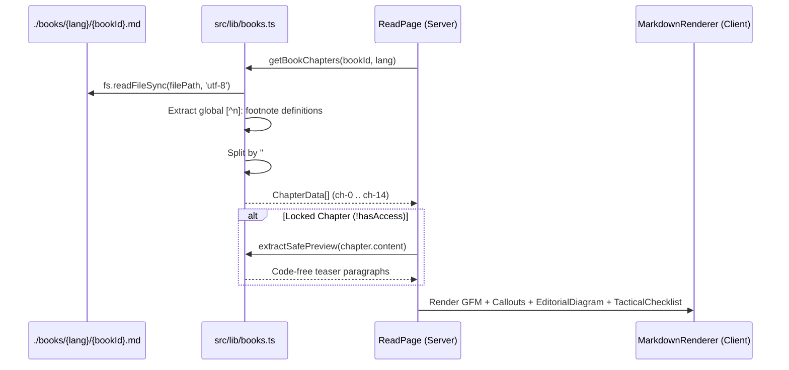

# Design Document — Spec 03: Markdown Parser & Interactive Reader Engine

## 1. Data Flow Diagram



---

## 2. Exact File Blueprints

### 2.1 `src/lib/books.ts`
```typescript
import fs from 'fs';
import path from 'path';
import { BookId, BookLang, ChapterData } from '@/types/books';

const LANG_DIR_MAP: Record<BookLang, string> = {
  'id-kasual': path.join('books', 'id', 'casual'),
  'id-standar': path.join('books', 'id', 'standar'),
  en: path.join('books', 'en'),
};

export { BOOK_CATALOG } from '@/types/books';

export function extractSafePreview(content: string): string {
  const withoutCodeAndDetails = content
    .replace(/```[\s\S]*?```/g, '')
    .replace(/<details[\s\S]*?<\/details>/gi, '');

  const paragraphs = withoutCodeAndDetails
    .split(/\r?\n\r?\n/)
    .map((p) => p.trim())
    .filter(
      (p) =>
        p.length > 0 &&
        !p.startsWith('|') &&
        !p.startsWith('[^') &&
        !p.startsWith('---')
    );

  return paragraphs.slice(0, 3).join('\n\n');
}

export function getBookChapters(bookId: BookId, lang: BookLang): ChapterData[] {
  const filePath = path.join(process.cwd(), LANG_DIR_MAP[lang], `${bookId}.md`);
  const raw = fs.readFileSync(filePath, 'utf-8');

  // 1. Extract all footnote definitions [^n]: ... from full manuscript
  const footnoteDefs: Record<string, string> = {};
  const fnDefRegex = /^\[\^([^\]]+)\]:\s*(.+)$/gm;
  let fnMatch: RegExpExecArray | null;
  while ((fnMatch = fnDefRegex.exec(raw)) !== null) {
    footnoteDefs[fnMatch[1]] = fnMatch[0];
  }

  // 2. Split manuscript by "## "
  const sections = raw.split(/\r?\n(?=## )/g);
  const chapters: ChapterData[] = [];

  for (const sec of sections) {
    const trimmed = sec.trim();
    if (!trimmed.startsWith('## ')) continue;
    const firstNewline = trimmed.indexOf('\n');
    const headingLine =
      firstNewline !== -1 ? trimmed.slice(3, firstNewline).trim() : trimmed.slice(3).trim();
    const body = firstNewline !== -1 ? trimmed.slice(firstNewline + 1).trim() : '';

    const lowerHeading = headingLine.toLowerCase();
    if (lowerHeading.includes('daftar isi') || lowerHeading.includes('table of contents')) {
      continue;
    }

    if (
      !lowerHeading.startsWith('lampiran') &&
      !lowerHeading.startsWith('appendix') &&
      (lowerHeading.includes('rujukan riset') ||
        lowerHeading.includes('primary research citations'))
    ) {
      if (chapters.length > 0) {
        chapters[chapters.length - 1].content += `\n\n## ${headingLine}\n\n${body}`;
      }
      continue;
    }

    // 3. Inject referenced footnote definitions into this chapter
    const usedRefs = new Set<string>();
    const refRegex = /\[\^([^\]]+)\](?!:)/g;
    let refMatch: RegExpExecArray | null;
    while ((refMatch = refRegex.exec(body)) !== null) {
      usedRefs.add(refMatch[1]);
    }

    let enrichedBody = body;
    const missingDefs: string[] = [];
    usedRefs.forEach((key) => {
      if (footnoteDefs[key] && !body.includes(`[^${key}]:`)) {
        missingDefs.push(footnoteDefs[key]);
      }
    });

    if (missingDefs.length > 0) {
      enrichedBody += '\n\n' + missingDefs.join('\n');
    }

    const idx = chapters.length;
    chapters.push({
      index: idx,
      slug: `ch-${idx}`,
      title: headingLine.replace(/\*/g, ''),
      isFreeSample: idx <= 1,
      content: enrichedBody,
    });
  }

  return chapters;
}

export function getChapter(
  bookId: BookId,
  lang: BookLang,
  slug: string
): ChapterData | undefined {
  const chapters = getBookChapters(bookId, lang);
  return chapters.find((ch) => ch.slug === slug);
}
```

### 2.2 `src/components/reader/EditorialDiagram.tsx`
```tsx
'use client';

import React, { useEffect, useId, useState } from 'react';
import mermaid from 'mermaid';
import { GitBranch } from 'lucide-react';

export function EditorialDiagram({ chart }: { chart: string }) {
  const [svg, setSvg] = useState<string>('');
  const [hasError, setHasError] = useState(false);
  const rawId = useId();
  const safeId = `mermaid-${rawId.replace(/[^a-zA-Z0-9]/g, '')}`;

  useEffect(() => {
    let mounted = true;
    const trimmed = chart.trim();
    if (!trimmed) return;

    if (typeof document !== 'undefined') {
      document.querySelectorAll('[id^="dmermaid-"]').forEach((el) => el.remove());
    }

    mermaid.initialize({
      startOnLoad: false,
      suppressErrorRendering: true,
      securityLevel: 'loose',
      look: 'classic',
      theme: 'neutral',
      fontFamily: 'var(--font-sans), system-ui, sans-serif',
    });

    mermaid
      .render(safeId, trimmed)
      .then(({ svg: renderedSvg }) => {
        if (mounted) {
          setSvg(renderedSvg);
          setHasError(false);
        }
      })
      .catch(() => {
        if (mounted) setHasError(true);
        if (typeof document !== 'undefined') {
          const stray =
            document.getElementById(`d${safeId}`) || document.getElementById(safeId);
          if (stray) stray.remove();
        }
      });

    return () => {
      mounted = false;
    };
  }, [chart, safeId]);

  if (hasError) {
    return (
      <div className="my-6 rounded-xl border border-[#E4E2DD] bg-[#FBF9F5] p-4">
        <div className="flex items-center gap-2 text-xs font-mono uppercase text-[#52525B] mb-2 pb-2 border-b border-[#E4E2DD]">
          <GitBranch className="w-3.5 h-3.5 text-[#EA580C]" />
          <span>SYSTEM FLOW SCHEMATIC</span>
        </div>
        <pre className="font-mono text-xs text-[#111113] whitespace-pre-wrap overflow-x-auto">
          {chart}
        </pre>
      </div>
    );
  }

  if (!svg) {
    return (
      <div className="my-6 rounded-xl border border-[#E4E2DD] bg-[#FBF9F5] p-6 text-center font-mono text-xs text-[#71717A]">
        Rendering architectural diagram...
      </div>
    );
  }

  return (
    <div className="my-8 rounded-xl border border-[#E4E2DD] bg-white overflow-hidden shadow-xs">
      <div className="flex items-center justify-between px-4 py-2 bg-[#F3F0E8]/70 border-b border-[#E4E2DD] font-mono text-[10px] uppercase tracking-wider text-[#52525B]">
        <span className="inline-flex items-center gap-1.5 font-semibold text-[#111113]">
          <GitBranch className="w-3.5 h-3.5 text-[#EA580C]" />
          TACTICAL WORKFLOW DIAGRAM
        </span>
        <span>SWISS SCHEMATIC VIEW</span>
      </div>
      <div
        className="p-5 sm:p-6 overflow-x-auto text-center bg-white [&_svg]:mx-auto [&_svg]:max-w-full [&_svg]:h-auto"
        dangerouslySetInnerHTML={{ __html: svg }}
      />
    </div>
  );
}
```

### 2.3 `src/components/reader/TacticalChecklist.tsx`
```tsx
'use client';

import React, { useEffect, useState } from 'react';
import { Check } from 'lucide-react';

interface TacticalChecklistProps {
  storageKey: string;
  children: React.ReactNode;
}

export function TacticalChecklist({ storageKey, children }: TacticalChecklistProps) {
  const [checked, setChecked] = useState(false);

  useEffect(() => {
    try {
      const saved = localStorage.getItem(storageKey);
      if (saved === 'true') setChecked(true);
    } catch {
      // Ignore storage error
    }
  }, [storageKey]);

  const toggle = () => {
    const next = !checked;
    setChecked(next);
    try {
      localStorage.setItem(storageKey, String(next));
      window.dispatchEvent(new CustomEvent('aiossan-checklist-change'));
    } catch {
      // Ignore storage error
    }
  };

  return (
    <div
      onClick={toggle}
      role="checkbox"
      aria-checked={checked}
      tabIndex={0}
      onKeyDown={(e) => {
        if (e.key === ' ' || e.key === 'Enter') {
          e.preventDefault();
          toggle();
        }
      }}
      className={`my-2 flex cursor-pointer items-start gap-3.5 rounded-xl border p-3.5 transition-all select-none ${
        checked
          ? 'border-[#0F766E]/40 bg-[#F0FDFA]/60 text-[#52525B]'
          : 'border-[#E4E2DD] bg-white/80 hover:border-[#111113]/40 text-[#111113]'
      }`}
    >
      <span
        className={`mt-0.5 flex h-5 w-5 shrink-0 items-center justify-center rounded border transition-colors ${
          checked
            ? 'border-[#0F766E] bg-[#0F766E] text-white'
            : 'border-[#71717A] bg-white text-transparent'
        }`}
      >
        <Check className="w-3.5 h-3.5 stroke-[3]" />
      </span>
      <div className={`text-sm sm:text-[15px] leading-relaxed ${checked ? 'line-through opacity-75' : ''}`}>
        {children}
      </div>
    </div>
  );
}
```

### 2.4 `src/components/reader/MarkdownRenderer.tsx`
```tsx
'use client';

import React, { useEffect, useState } from 'react';
import ReactMarkdown from 'react-markdown';
import remarkGfm from 'remark-gfm';
import rehypeRaw from 'rehype-raw';
import { EditorialDiagram } from './EditorialDiagram';
import { TacticalChecklist } from './TacticalChecklist';
import {
  Check,
  Copy,
  Info,
  AlertTriangle,
  Lightbulb,
  AlertCircle,
  ShieldAlert,
  ChevronDown,
  ListChecks,
  RotateCcw,
} from 'lucide-react';
import { cn } from '@/lib/utils';

interface MarkdownRendererProps {
  content: string;
  storagePrefix?: string;
}

export function MarkdownRenderer({ content, storagePrefix }: MarkdownRendererProps) {
  const totalTasks = React.useMemo(() => {
    const matches = content.match(/^\s*[-*]\s+\[[ xX]\]\s+/gm);
    return matches ? matches.length : 0;
  }, [content]);

  return (
    <div className="max-w-none font-sans text-[var(--reader-ink,#111113)]">
      {totalTasks > 0 && storagePrefix && (
        <ChecklistProgressBanner storagePrefix={storagePrefix} totalTasks={totalTasks} />
      )}

      <ReactMarkdown
        remarkPlugins={[remarkGfm]}
        rehypePlugins={[rehypeRaw]}
        components={{
          code({ className, children, ...props }) {
            const match = /language-(\w+)/.exec(className || '');
            const lang = match ? match[1] : '';
            const codeString = String(children).replace(/\n$/, '');

            if (lang === 'mermaid') {
              return <EditorialDiagram chart={codeString} />;
            }

            const isInline = !className;
            if (isInline) {
              return (
                <code
                  className="bg-[#F3F0E8] text-[#111113] border border-[#E4E2DD] px-1.5 py-0.5 rounded font-mono text-[0.84em] font-medium"
                  {...props}
                >
                  {children}
                </code>
              );
            }

            return (
              <CodeBlockWithCopy codeString={codeString} lang={lang}>
                <code className={className} {...props}>
                  {children}
                </code>
              </CodeBlockWithCopy>
            );
          },

          blockquote({ children }) {
            return <CalloutBlockquote>{children}</CalloutBlockquote>;
          },

          table({ children }) {
            return (
              <div className="my-7 overflow-x-auto rounded-xl border border-[#E4E2DD] bg-white shadow-xs">
                <table className="w-full text-left border-collapse text-[#111113]">
                  {children}
                </table>
              </div>
            );
          },
          thead({ children }) {
            return (
              <thead className="border-b border-[#111113] bg-[#F3F0E8]/80">{children}</thead>
            );
          },
          th({ children }) {
            return (
              <th className="py-3 px-4 font-mono text-xs font-bold uppercase tracking-wider text-[#111113] border-r border-[#E4E2DD] last:border-r-0">
                {children}
              </th>
            );
          },
          td({ children }) {
            return (
              <td className="py-3 px-4 text-sm leading-relaxed border-b border-r border-[#E4E2DD] last:border-r-0 text-[#27272A] align-top">
                {children}
              </td>
            );
          },

          details({ children, ...props }) {
            return (
              <details
                className="my-5 rounded-xl border border-[#E4E2DD] bg-[#FBF9F5] p-4 sm:p-5 group open:bg-white open:shadow-xs transition-all text-[#111113]"
                {...props}
              >
                {children}
              </details>
            );
          },
          summary({ children, ...props }) {
            return (
              <summary
                className="font-sans text-sm sm:text-base font-bold text-[#111113] cursor-pointer hover:text-[#EA580C] select-none list-none flex items-center justify-between gap-3"
                {...props}
              >
                <span>{children}</span>
                <span className="inline-flex items-center gap-1.5 text-[11px] font-mono uppercase tracking-wider border border-[#D4D0C8] px-2.5 py-1 bg-white rounded-md shrink-0">
                  <span>Script / Scenario</span>
                  <ChevronDown className="w-3.5 h-3.5 transition-transform group-open:rotate-180" />
                </span>
              </summary>
            );
          },

          h1({ children }) {
            return (
              <h1 className="font-serif text-2xl sm:text-3xl font-bold tracking-tight mt-10 mb-4 border-b border-[#E4E2DD] pb-3">
                {children}
              </h1>
            );
          },
          h2({ children }) {
            return (
              <h2 className="font-serif text-xl sm:text-2xl font-bold tracking-tight mt-10 mb-3.5 flex items-center gap-2.5">
                <span className="w-1.5 h-5 bg-[#EA580C] rounded-xs shrink-0" />
                <span>{children}</span>
              </h2>
            );
          },
          h3({ children }) {
            return (
              <h3 className="font-sans text-base sm:text-lg font-bold tracking-tight mt-7 mb-2.5">
                {children}
              </h3>
            );
          },

          p({ children }) {
            return (
              <p className="mb-4 leading-[1.82] text-[15.5px] sm:text-[16.5px] opacity-95">
                {children}
              </p>
            );
          },

          ul({ children }) {
            return <ul className="list-disc pl-6 mb-5 space-y-2">{children}</ul>;
          },
          ol({ children }) {
            return <ol className="list-decimal pl-6 mb-5 space-y-2">{children}</ol>;
          },
          li({ className, children, ...props }) {
            const isTaskItem =
              className?.includes('task-list-item') ||
              typeof (props as any).checked === 'boolean';

            if (isTaskItem) {
              const textContent = extractText(children);
              const key = storagePrefix
                ? `${storagePrefix}:${encodeURIComponent(textContent.slice(0, 40))}`
                : `checklist:${encodeURIComponent(textContent.slice(0, 40))}`;

              const cleanChildren = React.Children.toArray(children).filter((child) => {
                if (React.isValidElement(child) && (child.props as any)?.type === 'checkbox') {
                  return false;
                }
                return true;
              });

              return (
                <li className="list-none my-1.5 -ml-6">
                  <TacticalChecklist storageKey={key}>
                    <div className="flex-1">{cleanChildren}</div>
                  </TacticalChecklist>
                </li>
              );
            }

            return <li className="leading-[1.78] text-[15.5px] sm:text-[16.5px]">{children}</li>;
          },

          hr() {
            return <hr className="my-8 border-t border-[#E4E2DD]" />;
          },

          section({ className, children, ...props }) {
            if (className?.includes('footnotes')) {
              return (
                <section
                  className="mt-12 rounded-xl border border-[#E4E2DD] bg-[#F3F0E8]/60 p-5 text-xs text-[#52525B]"
                  {...props}
                >
                  <div className="font-mono text-[10px] font-bold uppercase tracking-widest text-[#111113] mb-2 pb-1.5 border-b border-[#D4D0C8]">
                    PRIMARY RESEARCH CITATIONS & FOOTNOTES
                  </div>
                  {children}
                </section>
              );
            }
            return (
              <section className={className} {...props}>
                {children}
              </section>
            );
          },
        }}
      >
        {content}
      </ReactMarkdown>
    </div>
  );
}

function ChecklistProgressBanner({
  storagePrefix,
  totalTasks,
}: {
  storagePrefix: string;
  totalTasks: number;
}) {
  const [completed, setCompleted] = useState(0);

  const recount = React.useCallback(() => {
    try {
      let count = 0;
      for (let i = 0; i < localStorage.length; i++) {
        const k = localStorage.key(i);
        if (k && k.startsWith(`${storagePrefix}:`) && localStorage.getItem(k) === 'true') {
          count++;
        }
      }
      setCompleted(Math.min(count, totalTasks));
    } catch {
      // Ignore
    }
  }, [storagePrefix, totalTasks]);

  useEffect(() => {
    recount();
    window.addEventListener('aiossan-checklist-change', recount);
    return () => window.removeEventListener('aiossan-checklist-change', recount);
  }, [recount]);

  const resetChecklist = () => {
    try {
      const keys: string[] = [];
      for (let i = 0; i < localStorage.length; i++) {
        const k = localStorage.key(i);
        if (k && k.startsWith(`${storagePrefix}:`)) keys.push(k);
      }
      keys.forEach((k) => localStorage.removeItem(k));
      recount();
      window.location.reload();
    } catch {
      // Ignore
    }
  };

  const pct = totalTasks > 0 ? Math.round((completed / totalTasks) * 100) : 0;

  return (
    <div className="mb-6 rounded-xl border border-[#E4E2DD] bg-[#FBF9F5] p-4 text-[#111113]">
      <div className="flex flex-wrap items-center justify-between gap-2 mb-2">
        <div className="flex items-center gap-2">
          <ListChecks className="w-4 h-4 text-[#0F766E]" />
          <span className="font-mono text-xs font-bold uppercase tracking-wider">
            TACTICAL CHECKLIST PROGRESS: {completed} / {totalTasks} ({pct}%)
          </span>
        </div>
        {completed > 0 && (
          <button
            type="button"
            onClick={resetChecklist}
            className="inline-flex items-center gap-1 text-xs font-mono text-[#71717A] hover:text-[#EA580C]"
          >
            <RotateCcw className="w-3 h-3" />
            <span>Reset</span>
          </button>
        )}
      </div>
      <div className="w-full h-1.5 bg-[#E4E2DD] rounded-full overflow-hidden">
        <div
          className="h-full bg-[#0F766E] transition-all duration-300"
          style={{ width: `${pct}%` }}
        />
      </div>
    </div>
  );
}

function CodeBlockWithCopy({
  codeString,
  lang,
  children,
}: {
  codeString: string;
  lang: string;
  children: React.ReactNode;
}) {
  const [copied, setCopied] = useState(false);

  const handleCopy = async () => {
    try {
      await navigator.clipboard.writeText(codeString);
      setCopied(true);
      setTimeout(() => setCopied(false), 2000);
    } catch {
      // Ignore
    }
  };

  return (
    <div className="my-6 overflow-hidden rounded-xl border border-[#27272A] bg-[#111113] text-white shadow-sm">
      <div className="flex items-center justify-between border-b border-[#27272A] bg-[#18181B] px-4 py-2">
        <span className="font-mono text-[11px] text-[#A1A1AA] uppercase tracking-wider">
          {lang || 'TACTICAL SCRIPT'}
        </span>
        <button
          type="button"
          onClick={handleCopy}
          className="inline-flex items-center gap-1.5 rounded-md bg-[#27272A] hover:bg-[#3F3F46] text-white px-2.5 py-1 text-xs font-mono transition-colors cursor-pointer"
        >
          {copied ? (
            <Check className="w-3.5 h-3.5 text-[#10B981]" />
          ) : (
            <Copy className="w-3.5 h-3.5" />
          )}
          <span>{copied ? 'Copied' : 'Copy Script'}</span>
        </button>
      </div>
      <pre className="p-4 sm:p-5 overflow-x-auto text-xs sm:text-sm font-mono leading-relaxed text-[#F4F4F5]">
        {children}
      </pre>
    </div>
  );
}

function CalloutBlockquote({ children }: { children: React.ReactNode }) {
  const validElements = React.Children.toArray(children).filter(React.isValidElement);
  const firstParagraph = validElements[0] as React.ReactElement | undefined;

  let calloutType: 'note' | 'tip' | 'important' | 'warning' | 'caution' | null = null;
  let titleText = '';
  let cleanedChildren: React.ReactNode = children;

  if (firstParagraph && (firstParagraph.props as any)?.children) {
    const pChildren = React.Children.toArray((firstParagraph.props as any).children);
    const firstNode = pChildren[0];

    if (typeof firstNode === 'string') {
      const match = firstNode.match(
        /^\s*\[!(NOTE|TIP|IMPORTANT|WARNING|CAUTION)\]\s*([^\n]*)(?:\n([\s\S]*))?$/i
      );
      if (match) {
        calloutType = match[1].toLowerCase() as any;
        titleText = match[2]?.trim() || '';
        const remainingFirstString = match[3] ?? '';

        const updatedPChildren = remainingFirstString
          ? [remainingFirstString, ...pChildren.slice(1)]
          : pChildren.slice(1);

        if (typeof updatedPChildren[0] === 'string') {
          updatedPChildren[0] = updatedPChildren[0].replace(/^\n+/, '');
        }

        const clonedFirstP =
          updatedPChildren.length > 0
            ? React.cloneElement(firstParagraph, {
                ...(firstParagraph.props as any),
                children: updatedPChildren,
              })
            : null;

        cleanedChildren = [clonedFirstP, ...validElements.slice(1)].filter(Boolean);
      }
    }
  }

  if (!calloutType) {
    return (
      <blockquote className="my-6 border-l-2 border-[#EA580C] bg-[#FBF9F5] py-3 px-5 font-serif italic text-[#3F3F46] rounded-r-lg">
        {children}
      </blockquote>
    );
  }

  const calloutStyles = {
    note: {
      border: 'border-l-4 border-l-[#1D4ED8] border-[#E4E2DD]',
      bg: 'bg-[#EFF6FF]/60',
      badge: 'text-[#1D4ED8]',
      icon: <Info className="w-4 h-4 text-[#1D4ED8] shrink-0" />,
      defaultTitle: 'Editorial Note',
    },
    tip: {
      border: 'border-l-4 border-l-[#0F766E] border-[#E4E2DD]',
      bg: 'bg-[#F0FDFA]/60',
      badge: 'text-[#0F766E]',
      icon: <Lightbulb className="w-4 h-4 text-[#0F766E] shrink-0" />,
      defaultTitle: 'Tactical Field Tip',
    },
    important: {
      border: 'border-l-4 border-l-[#111113] border-[#E4E2DD]',
      bg: 'bg-[#F3F0E8]/80',
      badge: 'text-[#111113]',
      icon: <AlertCircle className="w-4 h-4 text-[#111113] shrink-0" />,
      defaultTitle: 'Foundational Principle',
    },
    warning: {
      border: 'border-l-4 border-l-[#EA580C] border-[#E4E2DD]',
      bg: 'bg-[#FFF7ED]/80',
      badge: 'text-[#C2410C]',
      icon: <AlertTriangle className="w-4 h-4 text-[#EA580C] shrink-0" />,
      defaultTitle: 'Operational Warning',
    },
    caution: {
      border: 'border-l-4 border-l-[#E11D48] border-[#E4E2DD]',
      bg: 'bg-[#FFF1F2]/80',
      badge: 'text-[#BE123C]',
      icon: <ShieldAlert className="w-4 h-4 text-[#E11D48] shrink-0" />,
      defaultTitle: 'Strict Guardrail',
    },
  }[calloutType];

  return (
    <div
      className={cn(
        'my-6 rounded-r-xl border p-4 sm:p-5 text-[#111113]',
        calloutStyles.border,
        calloutStyles.bg
      )}
    >
      <div
        className={cn(
          'flex items-center gap-2 mb-2 font-mono text-xs font-bold uppercase tracking-wider',
          calloutStyles.badge
        )}
      >
        {calloutStyles.icon}
        <span>{titleText || calloutStyles.defaultTitle}</span>
      </div>
      <div className="text-sm sm:text-[15px] leading-relaxed [&>p:last-child]:mb-0">
        {cleanedChildren}
      </div>
    </div>
  );
}

function extractText(node: any): string {
  if (typeof node === 'string') return node;
  if (Array.isArray(node)) return node.map(extractText).join('');
  if (node?.props?.children) return extractText(node.props.children);
  return '';
}
```

### 2.5 `src/components/reader/RegisterSwitcher.tsx`
```tsx
'use client';

import React from 'react';
import Link from 'next/link';
import { BookId, BookLang, ReaderTheme } from '@/types/books';
import { cn } from '@/lib/utils';
import { Sun, BookOpen, Moon } from 'lucide-react';

export interface RegisterSwitcherProps {
  bookId: BookId;
  currentLang: BookLang;
  chapterSlug: string;
  theme?: ReaderTheme;
  onThemeChange?: (t: ReaderTheme) => void;
}

const REGISTERS: { lang: BookLang; label: string; sub: string }[] = [
  { lang: 'id-kasual', label: 'ID Kasual', sub: 'Gue/Lo' },
  { lang: 'id-standar', label: 'ID Standar', sub: 'Saya/Kamu' },
  { lang: 'en', label: 'EN', sub: 'Global' },
];

export function RegisterSwitcher({
  bookId,
  currentLang,
  chapterSlug,
  theme = 'paper',
  onThemeChange,
}: RegisterSwitcherProps) {
  return (
    <div className="flex flex-wrap items-center gap-2">
      {/* Language Register Selector */}
      <div className="flex items-center gap-1 p-1 bg-white border border-[#E4E2DD] rounded-lg">
        {REGISTERS.map((reg) => {
          const isActive = currentLang === reg.lang;
          return (
            <Link
              key={reg.lang}
              href={`/read/${bookId}/${reg.lang}/${chapterSlug}`}
              className={cn(
                'px-2.5 py-1 text-xs font-sans font-semibold rounded-md transition-all flex items-center gap-1',
                isActive
                  ? 'bg-[#111113] text-white'
                  : 'text-[#52525B] hover:bg-[#F3F0E8] hover:text-[#111113]'
              )}
            >
              <span>{reg.label}</span>
              <span className="text-[10px] font-mono opacity-75">({reg.sub})</span>
            </Link>
          );
        })}
      </div>

      {/* Reader Theme Selector (Paper / Sepia / Night) */}
      {onThemeChange && (
        <div className="flex items-center gap-0.5 p-1 bg-white border border-[#E4E2DD] rounded-lg">
          {(
            [
              { id: 'paper', label: 'Paper', icon: <Sun className="w-3.5 h-3.5" /> },
              { id: 'sepia', label: 'Sepia', icon: <BookOpen className="w-3.5 h-3.5" /> },
              { id: 'night', label: 'Night', icon: <Moon className="w-3.5 h-3.5" /> },
            ] as { id: ReaderTheme; label: string; icon: React.ReactNode }[]
          ).map((t) => (
            <button
              key={t.id}
              type="button"
              onClick={() => onThemeChange(t.id)}
              title={`Theme: ${t.label}`}
              className={cn(
                'px-2 py-1 rounded text-[11px] font-mono flex items-center gap-1 transition-colors cursor-pointer',
                theme === t.id
                  ? 'bg-[#EA580C] text-white font-bold'
                  : 'text-[#52525B] hover:bg-[#F3F0E8]'
              )}
            >
              {t.icon}
              <span className="hidden sm:inline">{t.label}</span>
            </button>
          ))}
        </div>
      )}
    </div>
  );
}
```
