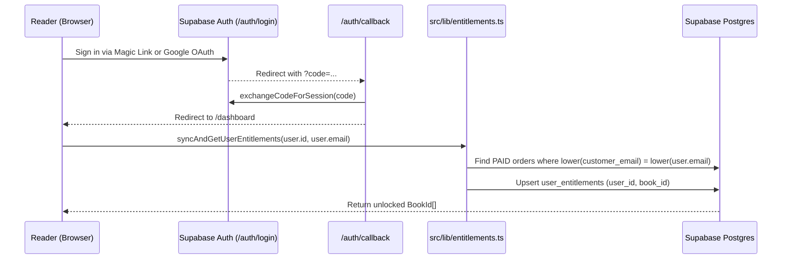

# Design Document — Spec 04: Supabase Auth, Database Schema & Auto-Claim Entitlements

## 1. Authentication & Entitlement Claim Flow



---

## 2. Exact File Blueprints

### 2.1 `supabase/migrations/001_initial_schema.sql`
```sql
CREATE EXTENSION IF NOT EXISTS "uuid-ossp";

CREATE TABLE IF NOT EXISTS public.profiles (
    id UUID PRIMARY KEY REFERENCES auth.users(id) ON DELETE CASCADE,
    email TEXT NOT NULL UNIQUE,
    full_name TEXT,
    preferred_language TEXT DEFAULT 'id-kasual' CHECK (preferred_language IN ('id-kasual', 'id-standar', 'en')),
    created_at TIMESTAMP WITH TIME ZONE DEFAULT timezone('utc'::text, now()) NOT NULL,
    updated_at TIMESTAMP WITH TIME ZONE DEFAULT timezone('utc'::text, now()) NOT NULL
);

CREATE TABLE IF NOT EXISTS public.books (
    id TEXT PRIMARY KEY,
    title_id_kasual TEXT NOT NULL,
    title_id_standar TEXT NOT NULL,
    title_en TEXT NOT NULL,
    price_single_idr INTEGER NOT NULL,
    is_active BOOLEAN DEFAULT true NOT NULL,
    created_at TIMESTAMP WITH TIME ZONE DEFAULT timezone('utc'::text, now()) NOT NULL
);

INSERT INTO public.books (id, title_id_kasual, title_id_standar, title_en, price_single_idr) VALUES
('book-1', 'Mahir Memimpin Tim: Strategi Bikin Tim Jadi Mandiri', 'Mahir Memimpin Tim: Strategi Menciptakan Tim yang Mandiri', 'Practical Team Leadership: Developing Autonomous Teams', 49000),
('book-2', 'Napas Panjang Memimpin Tim: Strategi Atasi Jenuh dan Bangun Sistem Kerja Otomatis', 'Napas Panjang Memimpin Tim: Strategi Mengatasi Kejenuhan dan Membangun Sistem Kerja Mandiri', 'Sustaining Your Leadership: Practical Strategies to Beat Burnout and Build Self-Running Teams', 49000),
('book-3', 'Memimpin Para Leader: Strategi Naik Kelas dari Mengatur Tim ke Menggerakkan Divisi', 'Memimpin Para Leader: Strategi Naik Kelas dari Mengarahkan Tim ke Menggerakkan Divisi', 'Leading Other Leaders: Practical Strategies for Moving from Team Lead to Manager of Managers', 99000)
ON CONFLICT (id) DO UPDATE SET
    title_id_kasual = EXCLUDED.title_id_kasual,
    title_id_standar = EXCLUDED.title_id_standar,
    title_en = EXCLUDED.title_en,
    price_single_idr = EXCLUDED.price_single_idr;

CREATE TABLE IF NOT EXISTS public.pricing_tiers (
    id TEXT PRIMARY KEY,
    name_id TEXT NOT NULL,
    name_en TEXT NOT NULL,
    price_idr INTEGER NOT NULL,
    strike_price_idr INTEGER,
    price_usd NUMERIC(6,2) NOT NULL,
    included_book_ids TEXT[] NOT NULL,
    badge_text TEXT,
    sort_order INTEGER NOT NULL,
    is_active BOOLEAN DEFAULT true NOT NULL
);

INSERT INTO public.pricing_tiers (id, name_id, name_en, price_idr, strike_price_idr, price_usd, included_book_ids, badge_text, sort_order) VALUES
('book-1', 'Buku 1: Mahir Memimpin Tim', 'Book 1: Practical Team Leadership', 49000, NULL, 4.99, ARRAY['book-1'], 'VOL. 01 • First-Time Lead', 1),
('book-2', 'Buku 2: Napas Panjang Memimpin Tim', 'Book 2: Sustaining Your Leadership', 49000, NULL, 4.99, ARRAY['book-2'], 'VOL. 02 • Anti-Burnout', 2),
('book-3', 'Buku 3: Memimpin Para Leader', 'Book 3: Leading Other Leaders', 99000, NULL, 9.99, ARRAY['book-3'], 'VOL. 03 • Manager of Managers', 3),
('bundle-1-2', 'Bundel 2 Buku (Volume 01 & 02)', '2-Book Bundle (Volumes 01 & 02)', 79000, 98000, 7.99, ARRAY['book-1', 'book-2'], 'Hemat Rp 19.000', 4),
('bundle-2-3', 'Bundel 2 Buku (Volume 02 & 03)', '2-Book Bundle (Volumes 02 & 03)', 129000, 148000, 12.99, ARRAY['book-2', 'book-3'], 'Hemat Rp 19.000', 5),
('bundle-trilogy', 'Complete Trilogy Box Set (Volume 01, 02 & 03)', 'Complete 3-Book Trilogy Box Set', 149000, 197000, 14.99, ARRAY['book-1', 'book-2', 'book-3'], 'BEST VALUE • Hemat Rp 48.000', 6)
ON CONFLICT (id) DO UPDATE SET
    name_id = EXCLUDED.name_id,
    name_en = EXCLUDED.name_en,
    price_idr = EXCLUDED.price_idr,
    strike_price_idr = EXCLUDED.strike_price_idr,
    price_usd = EXCLUDED.price_usd,
    included_book_ids = EXCLUDED.included_book_ids,
    badge_text = EXCLUDED.badge_text,
    sort_order = EXCLUDED.sort_order;

CREATE TABLE IF NOT EXISTS public.orders (
    id UUID PRIMARY KEY DEFAULT uuid_generate_v4(),
    order_number TEXT UNIQUE NOT NULL,
    user_id UUID REFERENCES public.profiles(id) ON DELETE SET NULL,
    customer_email TEXT NOT NULL,
    pricing_tier_id TEXT REFERENCES public.pricing_tiers(id) NOT NULL,
    amount_idr INTEGER NOT NULL,
    mayar_invoice_id TEXT UNIQUE,
    mayar_transaction_id TEXT,
    payment_link TEXT,
    payment_status TEXT DEFAULT 'PENDING' CHECK (payment_status IN ('PENDING', 'PAID', 'CLOSED', 'EXPIRED')),
    raw_webhook_payload JSONB,
    created_at TIMESTAMP WITH TIME ZONE DEFAULT timezone('utc'::text, now()) NOT NULL,
    paid_at TIMESTAMP WITH TIME ZONE
);

CREATE TABLE IF NOT EXISTS public.user_entitlements (
    id UUID PRIMARY KEY DEFAULT uuid_generate_v4(),
    user_id UUID REFERENCES public.profiles(id) ON DELETE CASCADE NOT NULL,
    book_id TEXT REFERENCES public.books(id) ON DELETE RESTRICT NOT NULL,
    order_id UUID REFERENCES public.orders(id) ON DELETE SET NULL,
    granted_at TIMESTAMP WITH TIME ZONE DEFAULT timezone('utc'::text, now()) NOT NULL,
    is_active BOOLEAN DEFAULT true NOT NULL,
    CONSTRAINT unique_user_book UNIQUE (user_id, book_id)
);

CREATE TABLE IF NOT EXISTS public.checklist_progress (
    id UUID PRIMARY KEY DEFAULT uuid_generate_v4(),
    user_id UUID REFERENCES public.profiles(id) ON DELETE CASCADE NOT NULL,
    book_id TEXT REFERENCES public.books(id) NOT NULL,
    chapter_slug TEXT NOT NULL,
    item_index INTEGER NOT NULL,
    is_completed BOOLEAN DEFAULT false NOT NULL,
    updated_at TIMESTAMP WITH TIME ZONE DEFAULT timezone('utc'::text, now()) NOT NULL,
    CONSTRAINT unique_user_checklist_item UNIQUE (user_id, book_id, chapter_slug, item_index)
);

ALTER TABLE public.profiles ENABLE ROW LEVEL SECURITY;
ALTER TABLE public.books ENABLE ROW LEVEL SECURITY;
ALTER TABLE public.pricing_tiers ENABLE ROW LEVEL SECURITY;
ALTER TABLE public.orders ENABLE ROW LEVEL SECURITY;
ALTER TABLE public.user_entitlements ENABLE ROW LEVEL SECURITY;
ALTER TABLE public.checklist_progress ENABLE ROW LEVEL SECURITY;

CREATE POLICY "Public read books" ON public.books FOR SELECT USING (true);
CREATE POLICY "Public read pricing tiers" ON public.pricing_tiers FOR SELECT USING (true);
CREATE POLICY "Users view own profile" ON public.profiles FOR SELECT USING (auth.uid() = id);
CREATE POLICY "Users update own profile" ON public.profiles FOR UPDATE USING (auth.uid() = id);
CREATE POLICY "Users view own orders" ON public.orders FOR SELECT USING (auth.uid() = user_id);
CREATE POLICY "Users view own entitlements" ON public.user_entitlements FOR SELECT USING (auth.uid() = user_id);
CREATE POLICY "Users manage own checklists" ON public.checklist_progress FOR ALL USING (auth.uid() = user_id);

CREATE OR REPLACE FUNCTION public.handle_new_user()
RETURNS TRIGGER AS $$
DECLARE
  rec RECORD;
  book_item TEXT;
BEGIN
  INSERT INTO public.profiles (id, email, full_name)
  VALUES (new.id, new.email, new.raw_user_meta_data->>'full_name')
  ON CONFLICT (id) DO UPDATE SET
    email = EXCLUDED.email,
    updated_at = timezone('utc'::text, now());

  UPDATE public.orders
  SET user_id = new.id
  WHERE lower(customer_email) = lower(new.email)
    AND user_id IS NULL;

  FOR rec IN
    SELECT o.id AS order_id, pt.included_book_ids
    FROM public.orders o
    JOIN public.pricing_tiers pt ON pt.id = o.pricing_tier_id
    WHERE (o.user_id = new.id OR lower(o.customer_email) = lower(new.email))
      AND o.payment_status = 'PAID'
  LOOP
    FOREACH book_item IN ARRAY rec.included_book_ids
    LOOP
      INSERT INTO public.user_entitlements (user_id, book_id, order_id, is_active)
      VALUES (new.id, book_item, rec.order_id, true)
      ON CONFLICT (user_id, book_id) DO UPDATE SET
        is_active = true,
        order_id = EXCLUDED.order_id;
    END LOOP;
  END LOOP;

  RETURN NEW;
END;
$$ LANGUAGE plpgsql SECURITY DEFINER;

DROP TRIGGER IF EXISTS on_auth_user_created ON auth.users;
CREATE TRIGGER on_auth_user_created
  AFTER INSERT ON auth.users
  FOR EACH ROW EXECUTE FUNCTION public.handle_new_user();
```

### 2.2 `src/utils/supabase/client.ts`, `server.ts`, `middleware.ts`, & `src/middleware.ts`
**File `src/utils/supabase/client.ts`:**
```typescript
import { createBrowserClient } from '@supabase/ssr';

const supabaseUrl = process.env.NEXT_PUBLIC_SUPABASE_URL || 'https://placeholder.supabase.co';
const supabaseKey =
  process.env.NEXT_PUBLIC_SUPABASE_PUBLISHABLE_KEY ||
  process.env.NEXT_PUBLIC_SUPABASE_ANON_KEY ||
  'placeholder-anon-key';

export const createClient = () => createBrowserClient(supabaseUrl, supabaseKey);
```

**File `src/utils/supabase/server.ts`:**
```typescript
import { createServerClient } from '@supabase/ssr';
import { createClient as createSupabaseClient } from '@supabase/supabase-js';
import { cookies } from 'next/headers';

const supabaseUrl = process.env.NEXT_PUBLIC_SUPABASE_URL || 'https://placeholder.supabase.co';
const supabaseKey =
  process.env.NEXT_PUBLIC_SUPABASE_PUBLISHABLE_KEY ||
  process.env.NEXT_PUBLIC_SUPABASE_ANON_KEY ||
  'placeholder-anon-key';

export const createClient = (cookieStore: Awaited<ReturnType<typeof cookies>>) => {
  return createServerClient(supabaseUrl, supabaseKey, {
    cookies: {
      getAll() {
        return cookieStore.getAll();
      },
      setAll(cookiesToSet: { name: string; value: string; options?: any }[]) {
        try {
          cookiesToSet.forEach(({ name, value, options }) =>
            cookieStore.set(name, value, options)
          );
        } catch {
          // Ignored when called from Server Component
        }
      },
    },
  });
};

export const createSupabaseAdmin = () => {
  const serviceRoleKey =
    process.env.SUPABASE_SERVICE_ROLE_KEY || 'placeholder-service-role-key';
  return createSupabaseClient(supabaseUrl, serviceRoleKey, {
    auth: {
      autoRefreshToken: false,
      persistSession: false,
    },
  });
};
```

**File `src/utils/supabase/middleware.ts`:**
```typescript
import { createServerClient } from '@supabase/ssr';
import { type NextRequest, NextResponse } from 'next/server';

const supabaseUrl = process.env.NEXT_PUBLIC_SUPABASE_URL || 'https://placeholder.supabase.co';
const supabaseKey =
  process.env.NEXT_PUBLIC_SUPABASE_PUBLISHABLE_KEY ||
  process.env.NEXT_PUBLIC_SUPABASE_ANON_KEY ||
  'placeholder-anon-key';

export async function updateSession(request: NextRequest) {
  let supabaseResponse = NextResponse.next({
    request: {
      headers: request.headers,
    },
  });

  const supabase = createServerClient(supabaseUrl, supabaseKey, {
    cookies: {
      getAll() {
        return request.cookies.getAll();
      },
      setAll(cookiesToSet: { name: string; value: string; options?: any }[]) {
        cookiesToSet.forEach(({ name, value }) => request.cookies.set(name, value));
        supabaseResponse = NextResponse.next({ request });
        cookiesToSet.forEach(({ name, value, options }) =>
          supabaseResponse.cookies.set(name, value, options)
        );
      },
    },
  });

  const {
    data: { user },
  } = await supabase.auth.getUser();

  return { response: supabaseResponse, user, supabase };
}
```

**File `src/middleware.ts`:**
```typescript
import { type NextRequest } from 'next/server';
import { updateSession } from '@/utils/supabase/middleware';

export async function middleware(request: NextRequest) {
  const { response } = await updateSession(request);
  return response;
}

export const config = {
  matcher: [
    '/((?!_next/static|_next/image|favicon.ico|.*\\.(?:svg|png|jpg|jpeg|gif|webp)$).*)',
  ],
};
```

### 2.3 `src/lib/entitlements.ts`
```typescript
import { createSupabaseAdmin } from '@/utils/supabase/server';
import { PRICING_TIERS, TierId } from '@/lib/pricing';
import { BookId } from '@/types/books';

export async function syncAndGetUserEntitlements(
  userId: string,
  userEmail?: string | null
): Promise<BookId[]> {
  const admin = createSupabaseAdmin();

  try {
    if (userEmail) {
      const normalizedEmail = userEmail.trim().toLowerCase();
      const { data: paidOrders } = await admin
        .from('orders')
        .select('id, pricing_tier_id, user_id')
        .ilike('customer_email', normalizedEmail)
        .eq('payment_status', 'PAID');

      if (paidOrders && paidOrders.length > 0) {
        for (const ord of paidOrders) {
          if (!ord.user_id) {
            await admin.from('orders').update({ user_id: userId }).eq('id', ord.id);
          }

          const tier = PRICING_TIERS.find((t) => t.id === (ord.pricing_tier_id as TierId));
          if (tier && tier.includedBooks.length > 0) {
            const rows = tier.includedBooks.map((bookId) => ({
              user_id: userId,
              book_id: bookId,
              order_id: ord.id,
              is_active: true,
            }));

            await admin
              .from('user_entitlements')
              .upsert(rows, { onConflict: 'user_id,book_id' });
          }
        }
      }
    }

    const { data: entitlements } = await admin
      .from('user_entitlements')
      .select('book_id')
      .eq('user_id', userId)
      .eq('is_active', true);

    return entitlements ? entitlements.map((e) => e.book_id as BookId) : [];
  } catch (err) {
    console.error('[ENTITLEMENTS SYNC ERROR]:', err);
    return [];
  }
}
```

### 2.4 `src/components/auth/LogoutButton.tsx`, `src/app/auth/callback/route.ts`, & `src/app/auth/login/page.tsx`
**File `src/components/auth/LogoutButton.tsx`:**
```tsx
'use client';

import React from 'react';
import { useRouter } from 'next/navigation';
import { createClient } from '@/utils/supabase/client';
import { TacticalButton } from '@/components/ui/TacticalButton';
import { LogOut } from 'lucide-react';

export function LogoutButton() {
  const router = useRouter();

  const handleLogout = async () => {
    const supabase = createClient();
    await supabase.auth.signOut();
    router.push('/');
    router.refresh();
  };

  return (
    <TacticalButton variant="secondary" size="sm" onClick={handleLogout}>
      <LogOut className="w-3.5 h-3.5 text-[#E11D48]" />
      <span>Sign Out</span>
    </TacticalButton>
  );
}
```

**File `src/app/auth/callback/route.ts`:**
```typescript
import { createClient } from '@/utils/supabase/server';
import { NextResponse } from 'next/server';
import { cookies } from 'next/headers';

export async function GET(request: Request) {
  const { searchParams, origin } = new URL(request.url);
  const code = searchParams.get('code');
  const next = searchParams.get('next') ?? '/dashboard';

  if (code) {
    const cookieStore = cookies();
    const supabase = createClient(cookieStore);
    const { error } = await supabase.auth.exchangeCodeForSession(code);
    if (!error) {
      return NextResponse.redirect(`${origin}${next}`);
    }
  }

  return NextResponse.redirect(`${origin}/auth/login?error=auth-failed`);
}
```

**File `src/app/auth/login/page.tsx`:**
```tsx
'use client';

import React, { useState } from 'react';
import Link from 'next/link';
import { createClient } from '@/utils/supabase/client';
import { EditorialHeader } from '@/components/ui/EditorialHeader';
import { EditorialCard } from '@/components/ui/EditorialCard';
import { TacticalButton } from '@/components/ui/TacticalButton';
import { Mail, ArrowRight, CheckCircle2, AlertCircle } from 'lucide-react';

export default function LoginPage() {
  const [email, setEmail] = useState('');
  const [loading, setLoading] = useState(false);
  const [sentMessage, setSentMessage] = useState(false);
  const [errorMessage, setErrorMessage] = useState('');

  const supabase = createClient();

  const handleMagicLink = async (e: React.FormEvent) => {
    e.preventDefault();
    if (!email) return;

    setLoading(true);
    setErrorMessage('');
    setSentMessage(false);

    try {
      const origin = window.location.origin;
      const { error } = await supabase.auth.signInWithOtp({
        email: email.trim(),
        options: {
          emailRedirectTo: `${origin}/auth/callback`,
        },
      });

      if (error) {
        setErrorMessage(error.message);
      } else {
        setSentMessage(true);
      }
    } catch (err: any) {
      setErrorMessage(err.message || 'Gagal mengirim tautan Magic Link.');
    } finally {
      setLoading(false);
    }
  };

  const handleGoogleLogin = async () => {
    setLoading(true);
    setErrorMessage('');
    try {
      const origin = window.location.origin;
      const { error } = await supabase.auth.signInWithOAuth({
        provider: 'google',
        options: {
          redirectTo: `${origin}/auth/callback`,
        },
      });
      if (error) {
        setErrorMessage(error.message);
        setLoading(false);
      }
    } catch (err: any) {
      setErrorMessage(err.message || 'Gagal masuk dengan Google.');
      setLoading(false);
    }
  };

  return (
    <div className="min-h-screen flex flex-col bg-[#FBF9F5] swiss-grid-bg">
      <EditorialHeader />

      <main className="flex-1 flex items-center justify-center p-4 py-16">
        <EditorialCard
          variant="featured"
          indexLabel="AIOSSAN // READER AUTHENTICATION"
          badgeText="PASSWORDLESS ACCESS"
          accentColor="orange"
          className="w-full max-w-md"
        >
          <div className="mb-6">
            <h1 className="font-serif text-3xl font-bold text-[#111113] mb-2">
              Masuk ke Perpustakaan Pembaca
            </h1>
            <p className="text-sm text-[#52525B] font-sans leading-relaxed">
              Gunakan alamat email saat pembelian untuk mengakses seluruh bab playbook dan mengunduh Master PDF A5.
            </p>
          </div>

          {errorMessage && (
            <div className="rounded-lg bg-[#FFF1F2] border border-[#FECDD3] p-3 mb-4 flex items-start gap-2 text-xs text-[#BE123C]">
              <AlertCircle className="w-4 h-4 shrink-0 mt-0.5" />
              <span>{errorMessage}</span>
            </div>
          )}

          {sentMessage ? (
            <div className="rounded-xl bg-[#F0FDFA] border border-[#99F6E4] p-5 text-center my-4">
              <CheckCircle2 className="w-8 h-8 text-[#0F766E] mx-auto mb-2" />
              <h2 className="font-serif text-xl font-bold text-[#111113] mb-1">
                Tautan Masuk Terkirim
              </h2>
              <p className="text-xs text-[#52525B] leading-relaxed mb-4">
                Kami telah mengirimkan tautan masuk instan (*Magic Link*) ke{' '}
                <strong>{email}</strong>. Klik tautan di kotak masuk email kamu untuk langsung masuk.
              </p>
              <button
                type="button"
                onClick={() => setSentMessage(false)}
                className="text-xs font-mono font-bold text-[#1D4ED8] underline cursor-pointer"
              >
                Gunakan alamat email lain
              </button>
            </div>
          ) : (
            <div className="space-y-4">
              <TacticalButton
                type="button"
                variant="secondary"
                size="md"
                onClick={handleGoogleLogin}
                disabled={loading}
                className="w-full"
              >
                <span>Lanjutkan dengan Google</span>
              </TacticalButton>

              <div className="flex items-center my-4">
                <hr className="flex-1 border-t border-[#E4E2DD]" />
                <span className="px-3 text-[10px] font-mono uppercase tracking-wider text-[#71717A]">
                  atau magic link email
                </span>
                <hr className="flex-1 border-t border-[#E4E2DD]" />
              </div>

              <form onSubmit={handleMagicLink} className="space-y-3.5">
                <div>
                  <label
                    htmlFor="email"
                    className="block text-xs font-mono font-bold uppercase text-[#111113] mb-1.5"
                  >
                    Alamat Email Pembelian
                  </label>
                  <div className="relative">
                    <input
                      id="email"
                      type="email"
                      required
                      placeholder="nama@perusahaan.com"
                      value={email}
                      onChange={(e) => setEmail(e.target.value)}
                      className="w-full bg-[#FBF9F5] border border-[#D4D0C8] rounded-lg px-3.5 py-2.5 text-sm text-[#111113] font-mono placeholder:text-[#A1A1AA] focus:outline-none focus:border-[#111113]"
                    />
                    <Mail className="w-4 h-4 text-[#71717A] absolute right-3.5 top-3" />
                  </div>
                </div>

                <TacticalButton
                  type="submit"
                  variant="primary"
                  size="md"
                  disabled={loading}
                  className="w-full"
                >
                  <span>{loading ? 'Mengirim Tautan...' : 'Kirim Magic Link ke Email'}</span>
                  <ArrowRight className="w-4 h-4" />
                </TacticalButton>
              </form>
            </div>
          )}

          <div className="mt-6 pt-4 border-t border-[#E4E2DD] text-center">
            <p className="text-xs text-[#52525B]">
              Belum memiliki akses?{' '}
              <Link href="/#pricing" className="font-semibold text-[#EA580C] hover:underline">
                Lihat Paket Trilogy Box Set
              </Link>
            </p>
          </div>
        </EditorialCard>
      </main>
    </div>
  );
}
```
