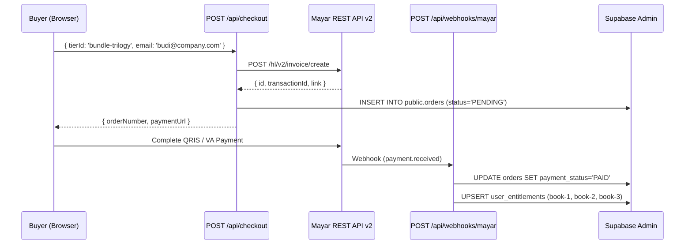

# Design Document — Spec 05: Mayar v2 Checkout, Idempotent Webhook & R2 PDF Delivery

## 1. Checkout & Webhook Sequence



---

## 2. Exact File Blueprints

### 2.1 `src/lib/mayar.ts` & `src/lib/r2.ts`
**File `src/lib/mayar.ts`:**
```typescript
export interface MayarCreateInvoiceParams {
  name: string;
  email: string;
  mobile?: string;
  description: string;
  redirectUrl: string;
  amountIdr: number;
  itemDescription: string;
  extraData?: Record<string, string>;
}

export interface MayarInvoiceResult {
  invoiceId: string;
  transactionId: string;
  paymentUrl: string;
}

export async function createMayarInvoice(
  params: MayarCreateInvoiceParams
): Promise<MayarInvoiceResult> {
  const baseUrl = process.env.MAYAR_API_URL || 'https://api.mayar.id';
  const apiKey = process.env.MAYAR_API_KEY;

  if (!apiKey || apiKey === 'your-mayar-api-key') {
    if (process.env.NODE_ENV === 'development') {
      console.warn('MAYAR_API_KEY not set. Returning development mock invoice.');
      return {
        invoiceId: `mock-inv-${Date.now()}`,
        transactionId: `mock-tx-${Date.now()}`,
        paymentUrl: params.redirectUrl,
      };
    }
    throw new Error('MAYAR_API_KEY belum dikonfigurasi di environment variables.');
  }

  const res = await fetch(`${baseUrl}/hl/v2/invoice/create`, {
    method: 'POST',
    headers: {
      Authorization: `Bearer ${apiKey}`,
      'Content-Type': 'application/json',
    },
    body: JSON.stringify({
      name: params.name || params.email.split('@')[0],
      email: params.email,
      mobile: params.mobile || '081200000000',
      description: params.description,
      redirectUrl: params.redirectUrl,
      items: [
        {
          quantity: 1,
          rate: params.amountIdr,
          description: params.itemDescription,
        },
      ],
      extraData: params.extraData || {},
    }),
  });

  const json = await res.json();
  if (!res.ok || !json.data?.link) {
    const errorMsg = json.messages || json.message || 'Gagal membuat invoice Mayar.';
    throw new Error(typeof errorMsg === 'string' ? errorMsg : JSON.stringify(errorMsg));
  }

  return {
    invoiceId: json.data.id as string,
    transactionId: (json.data.transactionId || json.data.id) as string,
    paymentUrl: json.data.link as string,
  };
}
```

**File `src/lib/r2.ts`:**
```typescript
import { S3Client, GetObjectCommand } from '@aws-sdk/client-s3';
import { getSignedUrl } from '@aws-sdk/s3-request-presigner';
import { BookId, BookLang } from '@/types/books';

export async function getPresignedPdfUrl(bookId: BookId, lang: BookLang): Promise<string> {
  const endpoint = process.env.R2_ENDPOINT;
  const accessKeyId = process.env.R2_ACCESS_KEY_ID;
  const secretAccessKey = process.env.R2_SECRET_ACCESS_KEY;
  const bucketName = process.env.R2_BUCKET_NAME || 'aiossan-ebook-assets';

  if (!endpoint || !accessKeyId || !secretAccessKey) {
    throw new Error('Kredensial Cloudflare R2 belum dikonfigurasi.');
  }

  const client = new S3Client({
    region: 'auto',
    endpoint,
    credentials: { accessKeyId, secretAccessKey },
  });

  const command = new GetObjectCommand({
    Bucket: bucketName,
    Key: `pdf/${bookId}/${lang}.pdf`,
    ResponseContentDisposition: `attachment; filename="aiossan-${bookId}-${lang}.pdf"`,
  });

  return getSignedUrl(client, command, { expiresIn: 900 });
}
```

### 2.2 `src/app/api/checkout/route.ts`, `src/app/api/webhooks/mayar/route.ts`, & `src/app/api/download/route.ts`
**File `src/app/api/checkout/route.ts`:**
```typescript
import { NextRequest, NextResponse } from 'next/server';
import { getTier, TierId } from '@/lib/pricing';
import { createMayarInvoice } from '@/lib/mayar';
import { createSupabaseAdmin, createClient } from '@/utils/supabase/server';
import { cookies } from 'next/headers';

export async function POST(req: NextRequest) {
  try {
    const body = await req.json();
    const { tierId, name, mobile } = body;
    const rawEmail = body.email || body.customerEmail;

    if (!tierId) {
      return NextResponse.json(
        { error: 'Paket pembelian (tierId) wajib dipilih.' },
        { status: 400 }
      );
    }

    const tier = getTier(tierId as TierId);
    if (!tier) {
      return NextResponse.json(
        { error: `Paket pembelian "${tierId}" tidak valid.` },
        { status: 400 }
      );
    }

    let userId: string | null = null;
    let sessionEmail: string | null = null;
    try {
      const cookieStore = cookies();
      const supabaseUser = createClient(cookieStore);
      const {
        data: { user },
      } = await supabaseUser.auth.getUser();
      if (user) {
        userId = user.id;
        sessionEmail = user.email ?? null;
      }
    } catch {
      // Guest checkout
    }

    const finalEmail =
      (typeof rawEmail === 'string' && rawEmail.trim()) || sessionEmail || '';

    if (!finalEmail || !finalEmail.includes('@')) {
      return NextResponse.json(
        {
          error: 'Masukkan alamat email aktif kamu untuk pengiriman akses buku & invoice.',
          requiresEmail: true,
        },
        { status: 400 }
      );
    }

    const normalizedEmail = finalEmail.trim().toLowerCase();
    const timestamp = Date.now();
    const randomSuffix = Math.random().toString(36).slice(2, 6).toUpperCase();
    const orderNumber = `ORD-${timestamp}-${randomSuffix}`;

    const siteUrl =
      process.env.NEXT_PUBLIC_SITE_URL || req.nextUrl.origin || 'http://localhost:3000';
    const redirectUrl = `${siteUrl}/checkout/success?order=${orderNumber}`;

    const invoice = await createMayarInvoice({
      name: name?.trim() || normalizedEmail.split('@')[0],
      email: normalizedEmail,
      mobile: mobile?.trim(),
      description: `Pembelian ${tier.nameId} — aiossan.com`,
      redirectUrl,
      amountIdr: tier.priceIdr,
      itemDescription: `Akses Playbook: ${tier.nameId}`,
      extraData: {
        orderNumber,
        tierId: tier.id,
        email: normalizedEmail,
      },
    });

    try {
      const adminClient = createSupabaseAdmin();
      await adminClient.from('orders').insert({
        order_number: orderNumber,
        user_id: userId,
        customer_email: normalizedEmail,
        pricing_tier_id: tier.id,
        amount_idr: tier.priceIdr,
        mayar_invoice_id: invoice.invoiceId,
        mayar_transaction_id: invoice.transactionId,
        payment_link: invoice.paymentUrl,
        payment_status: 'PENDING',
      });
    } catch (dbErr) {
      console.error('Warning: Failed to save order to Supabase:', dbErr);
    }

    return NextResponse.json({
      orderNumber,
      paymentUrl: invoice.paymentUrl,
    });
  } catch (err: any) {
    console.error('Checkout API error:', err);
    return NextResponse.json(
      { error: err.message || 'Terjadi kesalahan saat memproses pesanan.' },
      { status: 500 }
    );
  }
}
```

**File `src/app/api/webhooks/mayar/route.ts`:**
```typescript
import { NextRequest, NextResponse } from 'next/server';
import { createSupabaseAdmin } from '@/utils/supabase/server';
import { PRICING_TIERS, TierId } from '@/lib/pricing';

export async function POST(req: NextRequest) {
  try {
    const webhookSecret = process.env.MAYAR_WEBHOOK_SECRET;
    if (webhookSecret && webhookSecret !== 'your-mayar-webhook-secret') {
      const authHeader =
        req.headers.get('authorization') ||
        req.headers.get('x-mayar-signature') ||
        req.headers.get('x-callback-token');
      if (!authHeader || !authHeader.includes(webhookSecret)) {
        return NextResponse.json({ error: 'Unauthorized webhook request' }, { status: 401 });
      }
    }

    const payload = await req.json();
    const event = payload.event;
    const data = payload.data;

    const isPaid =
      event === 'payment.received' ||
      data?.status === 'SUCCESS' ||
      data?.status === 'PAID' ||
      data?.status === true;

    if (!isPaid || !data) {
      return NextResponse.json({ received: true, action: 'ignored' });
    }

    const supabaseAdmin = createSupabaseAdmin();
    let order: any = null;

    const extraOrderNumber = data.extraData?.orderNumber;
    if (extraOrderNumber) {
      const { data: byOrderNumber } = await supabaseAdmin
        .from('orders')
        .select('*')
        .eq('order_number', extraOrderNumber)
        .maybeSingle();
      if (byOrderNumber) order = byOrderNumber;
    }

    if (!order && data.id) {
      const { data: byMayarId } = await supabaseAdmin
        .from('orders')
        .select('*')
        .or(`mayar_invoice_id.eq.${data.id},mayar_transaction_id.eq.${data.id}`)
        .maybeSingle();
      if (byMayarId) order = byMayarId;
    }

    const customerEmail = (data.customerEmail || data.email || '')?.trim().toLowerCase();
    const amount = data.amount || data.totalAmount;
    if (!order && customerEmail && amount) {
      const { data: byEmailAndAmount } = await supabaseAdmin
        .from('orders')
        .select('*')
        .ilike('customer_email', customerEmail)
        .eq('amount_idr', Number(amount))
        .eq('payment_status', 'PENDING')
        .order('created_at', { ascending: false })
        .limit(1)
        .maybeSingle();
      if (byEmailAndAmount) order = byEmailAndAmount;
    }

    if (!order) {
      return NextResponse.json({ error: 'Order not found' }, { status: 404 });
    }

    await supabaseAdmin
      .from('orders')
      .update({
        payment_status: 'PAID',
        mayar_transaction_id: data.id || order.mayar_transaction_id,
        paid_at: new Date().toISOString(),
        raw_webhook_payload: payload,
      })
      .eq('id', order.id);

    let finalUserId = order.user_id;
    if (!finalUserId && order.customer_email) {
      const { data: profile } = await supabaseAdmin
        .from('profiles')
        .select('id')
        .ilike('email', order.customer_email.trim())
        .maybeSingle();
      if (profile) {
        finalUserId = profile.id;
        await supabaseAdmin
          .from('orders')
          .update({ user_id: finalUserId })
          .eq('id', order.id);
      }
    }

    const tier = PRICING_TIERS.find((t) => t.id === (order.pricing_tier_id as TierId));
    const includedBooks = tier ? tier.includedBooks : [];

    if (finalUserId && includedBooks.length > 0) {
      const entitlements = includedBooks.map((bookId) => ({
        user_id: finalUserId,
        book_id: bookId,
        order_id: order.id,
        is_active: true,
      }));

      await supabaseAdmin
        .from('user_entitlements')
        .upsert(entitlements, { onConflict: 'user_id,book_id' });
    }

    return NextResponse.json({
      received: true,
      orderNumber: order.order_number,
      unlocked: includedBooks,
    });
  } catch (err: any) {
    return NextResponse.json({ error: err.message }, { status: 500 });
  }
}
```

**File `src/app/api/download/route.ts`:**
```typescript
import { NextRequest, NextResponse } from 'next/server';
import { cookies } from 'next/headers';
import { createClient } from '@/utils/supabase/server';
import { syncAndGetUserEntitlements } from '@/lib/entitlements';
import { getPresignedPdfUrl } from '@/lib/r2';
import { BookId, BookLang } from '@/types/books';

const VALID_BOOKS: BookId[] = ['book-1', 'book-2', 'book-3'];
const VALID_LANGS: BookLang[] = ['id-kasual', 'id-standar', 'en'];

export const dynamic = 'force-dynamic';

export async function GET(req: NextRequest) {
  try {
    const { searchParams } = req.nextUrl;
    const bookId = (searchParams.get('book') || searchParams.get('bookId')) as BookId;
    const lang = (searchParams.get('lang') || 'id-kasual') as BookLang;

    if (!bookId || !VALID_BOOKS.includes(bookId)) {
      return NextResponse.json({ error: 'Invalid book parameter.' }, { status: 400 });
    }

    if (!VALID_LANGS.includes(lang)) {
      return NextResponse.json({ error: 'Invalid lang parameter.' }, { status: 400 });
    }

    const cookieStore = cookies();
    const supabase = createClient(cookieStore);
    const {
      data: { user },
    } = await supabase.auth.getUser();

    if (!user) {
      return NextResponse.json(
        { error: 'Silakan masuk terlebih dahulu untuk mengunduh Master PDF.' },
        { status: 401 }
      );
    }

    const unlockedBooks = await syncAndGetUserEntitlements(user.id, user.email);
    if (!unlockedBooks.includes(bookId)) {
      return NextResponse.json(
        { error: 'Buku ini belum termasuk dalam hak akses akun kamu.' },
        { status: 403 }
      );
    }

    const downloadUrl = await getPresignedPdfUrl(bookId, lang);
    return NextResponse.redirect(downloadUrl, 307);
  } catch (err: any) {
    return NextResponse.json(
      { error: err.message || 'Gagal menyiapkan tautan unduh PDF.' },
      { status: 500 }
    );
  }
}
```

### 2.3 `src/components/ui/PricingMatrix.tsx`, `src/components/reader/PaywallCard.tsx`, & `src/app/checkout/success/page.tsx`
**File `src/components/ui/PricingMatrix.tsx`:**
```tsx
'use client';

import React, { useState } from 'react';
import { PRICING_TIERS, PricingTier } from '@/lib/pricing';
import { BookLang } from '@/types/books';
import { EditorialCard } from './EditorialCard';
import { TacticalButton } from './TacticalButton';
import {
  Check,
  Sparkles,
  ArrowRight,
  Loader2,
  ShieldCheck,
  Download,
  BookOpen,
  X,
  Mail,
} from 'lucide-react';

interface PricingMatrixProps {
  lang?: BookLang;
}

export function PricingMatrix({ lang = 'id-kasual' }: PricingMatrixProps) {
  const [loadingTier, setLoadingTier] = useState<string | null>(null);
  const [selectedTierForEmail, setSelectedTierForEmail] = useState<PricingTier | null>(null);
  const [guestEmail, setGuestEmail] = useState('');
  const [guestName, setGuestName] = useState('');
  const [guestMobile, setGuestMobile] = useState('');
  const [errorMsg, setErrorMsg] = useState('');

  const isEn = lang === 'en';

  const handleCheckout = async (
    tier: PricingTier,
    contact?: { email: string; name?: string; mobile?: string }
  ) => {
    try {
      setLoadingTier(tier.id);
      setErrorMsg('');

      const res = await fetch('/api/checkout', {
        method: 'POST',
        headers: { 'Content-Type': 'application/json' },
        body: JSON.stringify({
          tierId: tier.id,
          email: contact?.email || undefined,
          name: contact?.name || undefined,
          mobile: contact?.mobile || undefined,
        }),
      });

      const data = await res.json();

      if (!res.ok) {
        if (data.requiresEmail) {
          setSelectedTierForEmail(tier);
          setLoadingTier(null);
          return;
        }
        throw new Error(data.error || 'Gagal membuat sesi pembayaran.');
      }

      if (data.paymentUrl) {
        window.location.href = data.paymentUrl;
      }
    } catch (err: any) {
      setErrorMsg(err.message || 'Terjadi kesalahan sistem.');
      setLoadingTier(null);
    }
  };

  const handleGuestSubmit = (e: React.FormEvent) => {
    e.preventDefault();
    if (!guestEmail || !selectedTierForEmail) return;
    handleCheckout(selectedTierForEmail, {
      email: guestEmail,
      name: guestName,
      mobile: guestMobile,
    });
  };

  const bundles = PRICING_TIERS.filter((t) => t.id.startsWith('bundle-')).sort((a, b) =>
    a.id === 'bundle-trilogy' ? -1 : b.id === 'bundle-trilogy' ? 1 : 0
  );
  const singles = PRICING_TIERS.filter((t) => !t.id.startsWith('bundle-'));

  return (
    <section id="pricing" className="py-24 px-4 max-w-7xl mx-auto">
      {/* Header */}
      <div className="max-w-3xl mx-auto text-center mb-16">
        <span className="font-mono text-[11px] uppercase tracking-widest px-3 py-1 rounded-full bg-[#F3F0E8] border border-[#D4D0C8] text-[#111113] font-semibold">
          {isEn ? 'PERPETUAL LICENSE // ONE-TIME PAYMENT' : 'LISENSI PERMANEN // SEKali BAYAR SELAMANYA'}
        </span>
        <h2 className="font-serif text-3xl sm:text-5xl font-bold tracking-tight text-[#111113] mt-4 mb-4">
          {isEn ? (
            <>
              Acquire Individual Volumes or{' '}
              <mark>The Complete Trilogy Box Set</mark>
            </>
          ) : (
            <>
              Miliki Volume Satuan atau{' '}
              <mark>Paket Lengkap Trilogi (Hemat Rp 48.000)</mark>
            </>
          )}
        </h2>
        <p className="font-sans text-base text-[#52525B] leading-relaxed">
          {isEn
            ? 'Every edition includes lifetime access to the interactive web reader, all 3 language registers (Casual, Formal, & English), and official A5 Master PDFs.'
            : 'Setiap pembelian langsung membuka akses pembaca web interaktif selamanya, 3 edisi gaya bahasa sekaligus (Kasual, Standar, & English), serta Master PDF A5 resmi.'}
        </p>

        {errorMsg && (
          <div className="mt-6 p-3.5 rounded-xl bg-[#FFF1F2] border border-[#FECDD3] text-[#BE123C] text-xs font-mono max-w-lg mx-auto">
            {errorMsg}
          </div>
        )}
      </div>

      {/* Top Row: Bundles */}
      <div className="grid grid-cols-1 lg:grid-cols-3 gap-7 mb-10 items-stretch">
        {bundles.map((tier) => {
          const isTrilogy = tier.id === 'bundle-trilogy';
          const title = isEn ? tier.nameEn : tier.nameId;
          const badge = isEn ? tier.badgeEn : tier.badgeId;

          return (
            <EditorialCard
              key={tier.id}
              variant={isTrilogy ? 'featured' : 'surface'}
              indexLabel={`TIER // ${tier.id.toUpperCase()}`}
              badgeText={badge}
              accentColor={isTrilogy ? 'orange' : 'cobalt'}
              className="flex flex-col justify-between"
            >
              <div className="flex flex-col h-full justify-between">
                <div>
                  {isTrilogy && (
                    <div className="inline-flex items-center gap-1.5 px-2.5 py-1 rounded bg-[#FFF7ED] border border-[#FED7AA] text-[#EA580C] font-mono text-[10px] font-bold uppercase tracking-wider mb-3">
                      <Sparkles className="w-3.5 h-3.5" />
                      <span>
                        {isEn
                          ? 'RECOMMENDED EDITION • ALL 45 CHAPTERS'
                          : 'EDISI REKOMENDASI UTAMA • LENGKAP 45 BAB'}
                      </span>
                    </div>
                  )}

                  <h3 className="font-serif text-2xl font-bold text-[#111113] mb-3 leading-snug">
                    {title}
                  </h3>

                  <div className="flex items-baseline gap-2.5 mb-4 pb-4 border-b border-[#E4E2DD]">
                    <span className="font-mono text-3xl sm:text-4xl font-bold text-[#111113]">
                      Rp {tier.priceIdr.toLocaleString('id-ID')}
                    </span>
                    {tier.strikePriceIdr && (
                      <span className="font-mono text-sm line-through text-[#71717A]">
                        Rp {tier.strikePriceIdr.toLocaleString('id-ID')}
                      </span>
                    )}
                  </div>

                  <ul className="space-y-2.5 text-sm text-[#27272A] mb-8 font-sans">
                    <li className="flex items-start gap-2.5">
                      <Check className="w-4 h-4 text-[#0F766E] shrink-0 mt-0.5 stroke-[2.5]" />
                      <span>
                        {isEn
                          ? `Full interactive web access to ${tier.includedBooks.length} volumes (${tier.includedBooks.length * 15} chapters)`
                          : `Akses penuh pembaca web untuk ${tier.includedBooks.length} volume (${tier.includedBooks.length * 15} bab)`}
                      </span>
                    </li>
                    <li className="flex items-start gap-2.5">
                      <Check className="w-4 h-4 text-[#0F766E] shrink-0 mt-0.5 stroke-[2.5]" />
                      <span>
                        {isEn
                          ? 'Includes all 3 registers: Casual (Gue/Lo), Standard, & English'
                          : 'Termasuk 3 gaya bahasa: Kasual (Gue/Lo), Standar, & English'}
                      </span>
                    </li>
                    <li className="flex items-start gap-2.5">
                      <Check className="w-4 h-4 text-[#0F766E] shrink-0 mt-0.5 stroke-[2.5]" />
                      <span>
                        {isEn
                          ? 'Official A5 Master PDFs via Cloudflare R2'
                          : 'Unduhan Master PDF A5 resmi via Cloudflare R2'}
                      </span>
                    </li>
                  </ul>
                </div>

                <TacticalButton
                  variant={isTrilogy ? 'accent' : 'primary'}
                  size="lg"
                  className="w-full"
                  onClick={() => handleCheckout(tier)}
                  disabled={loadingTier === tier.id}
                >
                  {loadingTier === tier.id ? (
                    <>
                      <Loader2 className="w-4 h-4 animate-spin" />
                      <span>{isEn ? 'Preparing Invoice...' : 'Menyiapkan Invoice...'}</span>
                    </>
                  ) : (
                    <>
                      <span>
                        {isTrilogy
                          ? isEn
                            ? 'Get Complete Trilogy Box Set'
                            : 'Ambil Paket Trilogi Lengkap'
                          : isEn
                          ? 'Select This Bundle'
                          : 'Pilih Bundel Ini'}
                      </span>
                      <ArrowRight className="w-4 h-4" />
                    </>
                  )}
                </TacticalButton>
              </div>
            </EditorialCard>
          );
        })}
      </div>

      {/* Bottom Row: Individual Volumes */}
      <div className="grid grid-cols-1 md:grid-cols-3 gap-6">
        {singles.map((tier) => (
          <EditorialCard
            key={tier.id}
            variant="subtle"
            indexLabel={`SINGLE VOLUME // ${tier.id.toUpperCase()}`}
            badgeText={isEn ? tier.badgeEn : tier.badgeId}
            accentColor="neutral"
          >
            <div className="flex flex-col justify-between h-full">
              <div>
                <h4 className="font-serif text-xl font-bold text-[#111113] mb-2">
                  {isEn ? tier.nameEn : tier.nameId}
                </h4>
                <div className="font-mono text-2xl font-bold text-[#111113] mb-4">
                  Rp {tier.priceIdr.toLocaleString('id-ID')}{' '}
                  <span className="text-xs font-normal text-[#71717A]">/ 15 Chapters</span>
                </div>
              </div>
              <TacticalButton
                variant="secondary"
                size="md"
                className="w-full"
                onClick={() => handleCheckout(tier)}
                disabled={loadingTier === tier.id}
              >
                <span>{isEn ? 'Buy Single Volume' : 'Beli Volume Satuan'}</span>
                <ArrowRight className="w-4 h-4" />
              </TacticalButton>
            </div>
          </EditorialCard>
        ))}
      </div>

      {/* Guest Email Modal */}
      {selectedTierForEmail && (
        <div className="fixed inset-0 z-50 bg-[#111113]/60 backdrop-blur-xs flex items-center justify-center p-4">
          <div className="w-full max-w-md rounded-2xl bg-white border border-[#111113] shadow-2xl overflow-hidden">
            <div className="flex items-center justify-between px-6 py-4 bg-[#FBF9F5] border-b border-[#E4E2DD]">
              <span className="font-mono text-xs font-bold uppercase tracking-wider text-[#111113]">
                {isEn ? 'INSTANT ACCESS DELIVERY' : 'PENGIRIMAN AKSES INSTAN'}
              </span>
              <button
                type="button"
                onClick={() => setSelectedTierForEmail(null)}
                className="p-1 rounded-lg hover:bg-[#E4E2DD]/50"
              >
                <X className="w-4 h-4" />
              </button>
            </div>

            <form onSubmit={handleGuestSubmit} className="p-6 space-y-4">
              <div>
                <div className="font-mono text-xs font-semibold text-[#EA580C]">
                  {isEn ? selectedTierForEmail.nameEn : selectedTierForEmail.nameId}
                </div>
                <h3 className="font-serif text-2xl font-bold text-[#111113] mt-0.5">
                  {isEn ? 'Enter Your Email Address' : 'Masukkan Email Penerima Akses'}
                </h3>
                <p className="text-xs text-[#52525B] mt-1 leading-relaxed">
                  {isEn
                    ? 'Your books and PDFs will automatically unlock for this email address as soon as payment completes.'
                    : 'Akses seluruh bab dan Master PDF otomatis aktif pada alamat email ini begitu pembayaran selesai.'}
                </p>
              </div>

              <div>
                <label className="block text-xs font-mono font-bold uppercase text-[#111113] mb-1">
                  {isEn ? 'Email Address (Required)' : 'Alamat Email Aktif (Wajib)'}
                </label>
                <div className="relative">
                  <input
                    type="email"
                    required
                    placeholder="nama@perusahaan.com"
                    value={guestEmail}
                    onChange={(e) => setGuestEmail(e.target.value)}
                    className="w-full px-3.5 py-2.5 pr-9 rounded-lg border border-[#D4D0C8] bg-[#FBF9F5] text-sm font-mono focus:outline-none focus:border-[#111113]"
                  />
                  <Mail className="w-4 h-4 text-[#71717A] absolute right-3 top-3" />
                </div>
              </div>

              <div className="grid grid-cols-2 gap-3">
                <div>
                  <label className="block text-xs font-mono uppercase text-[#52525B] mb-1">
                    {isEn ? 'Name (Optional)' : 'Nama (Opsional)'}
                  </label>
                  <input
                    type="text"
                    placeholder="Budi"
                    value={guestName}
                    onChange={(e) => setGuestName(e.target.value)}
                    className="w-full px-3 py-2 rounded-lg border border-[#D4D0C8] text-sm"
                  />
                </div>
                <div>
                  <label className="block text-xs font-mono uppercase text-[#52525B] mb-1">
                    WhatsApp (Opsional)
                  </label>
                  <input
                    type="tel"
                    placeholder="0812xxxx"
                    value={guestMobile}
                    onChange={(e) => setGuestMobile(e.target.value)}
                    className="w-full px-3 py-2 rounded-lg border border-[#D4D0C8] text-sm font-mono"
                  />
                </div>
              </div>

              <div className="pt-2 flex justify-end gap-2">
                <TacticalButton
                  type="button"
                  variant="secondary"
                  size="sm"
                  onClick={() => setSelectedTierForEmail(null)}
                >
                  {isEn ? 'Cancel' : 'Batal'}
                </TacticalButton>
                <TacticalButton
                  type="submit"
                  variant="accent"
                  size="md"
                  disabled={loadingTier === selectedTierForEmail.id}
                >
                  <span>
                    {isEn
                      ? `Proceed to Payment (Rp ${selectedTierForEmail.priceIdr.toLocaleString('id-ID')})`
                      : `Lanjut ke Pembayaran (Rp ${selectedTierForEmail.priceIdr.toLocaleString('id-ID')})`}
                  </span>
                  <ArrowRight className="w-4 h-4" />
                </TacticalButton>
              </div>
            </form>
          </div>
        </div>
      )}
    </section>
  );
}
```

**File `src/components/reader/PaywallCard.tsx`:**
```tsx
'use client';

import React, { useState } from 'react';
import { BookId, BookLang } from '@/types/books';
import { PRICING_TIERS, TierId } from '@/lib/pricing';
import { formatIDR } from '@/lib/utils';
import { TacticalButton } from '@/components/ui/TacticalButton';
import { Lock, ArrowRight, AlertCircle, CheckCircle2 } from 'lucide-react';

export interface PaywallCardProps {
  bookId: BookId;
  lang: BookLang;
  chapterTitle?: string;
}

export function PaywallCard({ bookId, lang, chapterTitle }: PaywallCardProps) {
  const [selectedTierId, setSelectedTierId] = useState<TierId>('bundle-trilogy');
  const [email, setEmail] = useState('');
  const [name, setName] = useState('');
  const [loading, setLoading] = useState(false);
  const [errorMsg, setErrorMsg] = useState('');

  const isEn = lang === 'en';

  const handleUnlock = async () => {
    if (!email || !email.includes('@')) {
      setErrorMsg(
        isEn
          ? 'Please enter a valid email address to unlock instant access.'
          : 'Masukkan alamat email aktif kamu untuk membuka akses instan.'
      );
      return;
    }

    setLoading(true);
    setErrorMsg('');

    try {
      const res = await fetch('/api/checkout', {
        method: 'POST',
        headers: { 'Content-Type': 'application/json' },
        body: JSON.stringify({
          tierId: selectedTierId,
          email: email.trim(),
          name: name.trim() || undefined,
        }),
      });
      const data = await res.json();
      if (!res.ok) throw new Error(data.error || 'Checkout error');
      if (data.paymentUrl) window.location.href = data.paymentUrl;
    } catch (err: any) {
      setErrorMsg(err.message || 'Gagal menghubungkan ke kasir Mayar.');
      setLoading(false);
    }
  };

  return (
    <div className="my-10 rounded-2xl border-2 border-[#111113] bg-[#FBF9F5] p-6 sm:p-8 text-[#111113] shadow-lg">
      <div className="max-w-xl mx-auto text-center mb-8">
        <div className="inline-flex items-center justify-center w-12 h-12 rounded-xl bg-[#111113] text-white mb-3">
          <Lock className="w-5 h-5" />
        </div>
        <h2 className="font-serif text-2xl sm:text-3xl font-bold mb-2">
          {isEn ? 'Continue Reading with Full Edition Access' : 'Buka Bab Ini & Seluruh Playbook Lengkap'}
        </h2>
        <p className="text-sm text-[#52525B] font-sans">
          {isEn
            ? `Unlock "${chapterTitle || 'this chapter'}" plus all 1-on-1 scripts, checklists, and A5 Master PDFs.`
            : `Buka "${chapterTitle || 'bab ini'}" beserta seluruh contekan skrip 1-on-1, simulasi latihan, dan Master PDF A5.`}
        </p>
      </div>

      {errorMsg && (
        <div className="max-w-xl mx-auto mb-6 p-3 rounded-lg bg-[#FFF1F2] border border-[#FECDD3] text-xs text-[#BE123C] flex items-center gap-2">
          <AlertCircle className="w-4 h-4 shrink-0" />
          <span>{errorMsg}</span>
        </div>
      )}

      <div className="max-w-xl mx-auto bg-white border border-[#E4E2DD] rounded-xl p-4 mb-6 grid grid-cols-1 sm:grid-cols-2 gap-3">
        <div>
          <label className="block text-[11px] font-mono font-bold uppercase text-[#111113] mb-1">
            {isEn ? 'Your Email (Required)' : 'Email Aktif (Wajib)'}
          </label>
          <input
            type="email"
            required
            placeholder="nama@email.com"
            value={email}
            onChange={(e) => setEmail(e.target.value)}
            className="w-full px-3 py-2 rounded-lg border border-[#D4D0C8] text-sm font-mono"
          />
        </div>
        <div>
          <label className="block text-[11px] font-mono uppercase text-[#52525B] mb-1">
            {isEn ? 'Your Name (Optional)' : 'Nama Lengkap (Opsional)'}
          </label>
          <input
            type="text"
            placeholder="Harry"
            value={name}
            onChange={(e) => setName(e.target.value)}
            className="w-full px-3 py-2 rounded-lg border border-[#D4D0C8] text-sm"
          />
        </div>
      </div>

      <div className="grid grid-cols-1 md:grid-cols-3 gap-3 mb-6">
        {PRICING_TIERS.filter((t) =>
          ['book-1', 'book-2', 'book-3'].includes(bookId)
            ? [bookId, 'bundle-1-2', 'bundle-trilogy'].includes(t.id)
            : true
        ).map((tier) => {
          const active = selectedTierId === tier.id;
          return (
            <div
              key={tier.id}
              onClick={() => setSelectedTierId(tier.id)}
              className={`rounded-xl border p-4 cursor-pointer transition-all flex flex-col justify-between ${
                active
                  ? 'border-2 border-[#111113] bg-white shadow-sm'
                  : 'border-[#E4E2DD] bg-white/60 hover:bg-white'
              }`}
            >
              <div>
                <div className="font-mono text-[10px] font-bold uppercase text-[#EA580C] mb-1">
                  {isEn ? tier.badgeEn : tier.badgeId}
                </div>
                <div className="font-serif font-bold text-base text-[#111113] mb-1">
                  {isEn ? tier.nameEn : tier.nameId}
                </div>
                <div className="font-mono text-xl font-bold text-[#111113]">
                  {formatIDR(tier.priceIdr)}
                </div>
              </div>
              <div className="mt-3 pt-2 border-t border-[#E4E2DD] flex items-center justify-between text-[11px] font-mono text-[#0F766E]">
                <span className="flex items-center gap-1">
                  <CheckCircle2 className="w-3.5 h-3.5" />
                  {tier.includedBooks.length} Vol + PDF
                </span>
                <input
                  type="radio"
                  checked={active}
                  onChange={() => setSelectedTierId(tier.id)}
                  className="accent-[#111113]"
                />
              </div>
            </div>
          );
        })}
      </div>

      <div className="max-w-md mx-auto text-center">
        <TacticalButton
          variant="accent"
          size="lg"
          disabled={loading}
          onClick={handleUnlock}
          className="w-full"
        >
          <span>
            {loading
              ? isEn
                ? 'Redirecting to Mayar...'
                : 'Menghubungkan Kasir Mayar...'
              : isEn
              ? 'Unlock Instant Access via Mayar (QRIS / VA)'
              : 'Buka Akses Instan via Mayar (QRIS / VA)'}
          </span>
          <ArrowRight className="w-4 h-4" />
        </TacticalButton>
      </div>
    </div>
  );
}
```

**File `src/app/checkout/success/page.tsx`:**
```tsx
'use client';

import React, { Suspense } from 'react';
import Link from 'next/link';
import { useSearchParams } from 'next/navigation';
import { EditorialHeader } from '@/components/ui/EditorialHeader';
import { EditorialCard } from '@/components/ui/EditorialCard';
import { TacticalButton } from '@/components/ui/TacticalButton';
import { CheckCircle2, BookOpen, ArrowRight, User } from 'lucide-react';

function SuccessContent() {
  const searchParams = useSearchParams();
  const orderNumber = searchParams.get('order') || 'ORD-COMPLETED';

  return (
    <EditorialCard
      variant="featured"
      indexLabel="AIOSSAN // ORDER CONFIRMATION"
      badgeText="PAYMENT VERIFIED"
      accentColor="emerald"
      className="w-full max-w-lg text-center"
    >
      <div className="w-14 h-14 rounded-2xl bg-[#F0FDFA] border border-[#99F6E4] text-[#0F766E] flex items-center justify-center mx-auto mb-4">
        <CheckCircle2 className="w-8 h-8" />
      </div>

      <h1 className="font-serif text-3xl font-bold text-[#111113] mb-2">
        Akses Playbook Telah Aktif
      </h1>
      <p className="text-sm text-[#52525B] leading-relaxed mb-6">
        Terima kasih atas pembelian kamu. Seluruh bab digital, template skrip 1-on-1, dan tautan unduh Master PDF A5 telah dibuka untuk email kamu.
      </p>

      <div className="rounded-xl bg-[#FBF9F5] border border-[#E4E2DD] p-4 mb-6 text-left font-mono text-xs space-y-2">
        <div className="flex justify-between">
          <span className="text-[#71717A]">NOMOR PESANAN:</span>
          <span className="font-bold text-[#111113]">{orderNumber}</span>
        </div>
        <div className="flex justify-between">
          <span className="text-[#71717A]">STATUS LISENSI:</span>
          <span className="font-bold text-[#0F766E]">AKTIF SELAMANYA (LUNAS)</span>
        </div>
      </div>

      <div className="flex flex-col sm:flex-row gap-3 justify-center">
        <Link href="/read/book-1/id-kasual/ch-0">
          <TacticalButton variant="primary" size="md" className="w-full sm:w-auto">
            <BookOpen className="w-4 h-4" />
            <span>Mulai Baca Volume 01</span>
            <ArrowRight className="w-4 h-4" />
          </TacticalButton>
        </Link>
        <Link href="/dashboard">
          <TacticalButton variant="secondary" size="md" className="w-full sm:w-auto">
            <User className="w-4 h-4" />
            <span>Buka Perpustakaan & PDF</span>
          </TacticalButton>
        </Link>
      </div>
    </EditorialCard>
  );
}

export default function CheckoutSuccessPage() {
  return (
    <div className="min-h-screen flex flex-col bg-[#FBF9F5] swiss-grid-bg">
      <EditorialHeader />
      <main className="flex-1 flex items-center justify-center p-4 py-16">
        <Suspense fallback={<div className="font-mono text-xs">Loading receipt...</div>}>
          <SuccessContent />
        </Suspense>
      </main>
    </div>
  );
}
```
