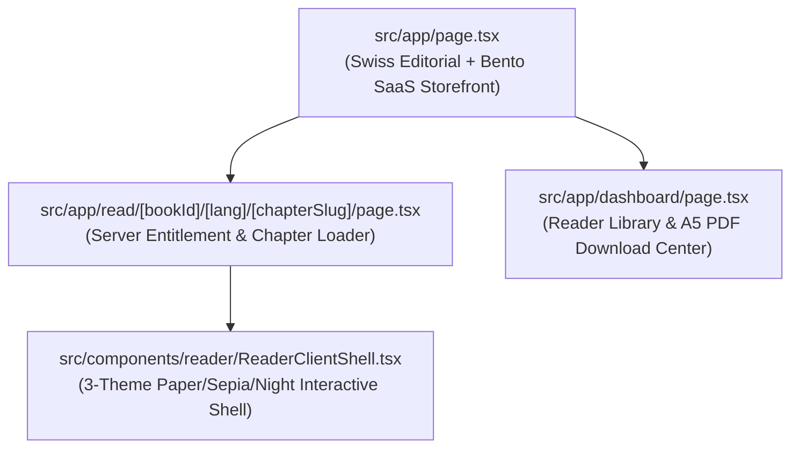

# Design Document — Spec 06: Swiss Editorial Landing Page, 3-Theme Web Reader & Dashboard

## 1. Page Architecture



---

## 2. Exact File Blueprints

### 2.1 `src/components/reader/ReaderClientShell.tsx`
```tsx
'use client';

import React, { useEffect, useState } from 'react';
import Link from 'next/link';
import { BookId, BookLang, BOOK_CATALOG, ChapterMeta, ReaderTheme } from '@/types/books';
import { RegisterSwitcher } from './RegisterSwitcher';
import { ChapterBlueprintCard } from '@/components/ui/ChapterBlueprintCard';
import { MarkdownRenderer } from './MarkdownRenderer';
import { PaywallCard } from './PaywallCard';
import { TacticalButton } from '@/components/ui/TacticalButton';
import {
  ChevronLeft,
  ArrowLeft,
  ArrowRight,
  Lock,
  CheckCircle2,
  User,
} from 'lucide-react';

interface ReaderClientShellProps {
  bookId: BookId;
  lang: BookLang;
  chapterSlug: string;
  chapterTitle: string;
  chapterIndex: number;
  isFreeSample: boolean;
  hasAccess: boolean;
  isLoggedIn: boolean;
  fullContent: string;
  previewContent: string;
  chapters: ChapterMeta[];
}

export function ReaderClientShell({
  bookId,
  lang,
  chapterSlug,
  chapterTitle,
  chapterIndex,
  isFreeSample,
  hasAccess,
  isLoggedIn,
  fullContent,
  previewContent,
  chapters,
}: ReaderClientShellProps) {
  const [theme, setTheme] = useState<ReaderTheme>('paper');
  const isEn = lang === 'en';

  useEffect(() => {
    try {
      const saved = localStorage.getItem('aiossan:reader-theme') as ReaderTheme | null;
      if (saved && ['paper', 'sepia', 'night'].includes(saved)) {
        setTheme(saved);
      }
    } catch {
      // Ignore
    }
  }, []);

  const handleThemeChange = (next: ReaderTheme) => {
    setTheme(next);
    try {
      localStorage.setItem('aiossan:reader-theme', next);
    } catch {
      // Ignore
    }
  };

  const catalogItem = BOOK_CATALOG.find((b) => b.id === bookId);
  const prevChapter = chapterIndex > 0 ? chapters[chapterIndex - 1] : null;
  const nextChapter = chapterIndex < chapters.length - 1 ? chapters[chapterIndex + 1] : null;
  const progressPct = Math.round(((chapterIndex + 1) / chapters.length) * 100);

  return (
    <div
      data-reader-theme={theme}
      className="min-h-screen flex flex-col bg-[var(--reader-bg,#FBF9F5)] text-[var(--reader-ink,#111113)] transition-colors duration-200"
    >
      {/* Top Sticky Reader Control Bar */}
      <header className="sticky top-0 z-30 border-b border-[var(--reader-border,#E4E2DD)] bg-[var(--reader-bg,#FBF9F5)]/90 backdrop-blur-md px-4 py-2.5">
        <div className="max-w-7xl mx-auto flex flex-col sm:flex-row items-center justify-between gap-2.5">
          <div className="flex items-center gap-3 w-full sm:w-auto justify-between sm:justify-start">
            <Link
              href="/"
              className="inline-flex items-center gap-1.5 font-mono text-xs font-bold uppercase tracking-wider px-2.5 py-1.5 rounded-lg border border-[var(--reader-border,#E4E2DD)] bg-[var(--reader-surface,#FFFFFF)] hover:border-[#EA580C]"
            >
              <ChevronLeft className="w-3.5 h-3.5" />
              <span>{isEn ? 'Index' : 'Beranda'}</span>
            </Link>

            {/* Volume Switcher */}
            <div className="flex items-center gap-1 p-0.5 rounded-lg border border-[var(--reader-border,#E4E2DD)] bg-[var(--reader-surface,#FFFFFF)]">
              {BOOK_CATALOG.map((b) => {
                const active = b.id === bookId;
                return (
                  <Link
                    key={b.id}
                    href={`/read/${b.id}/${lang}/ch-0`}
                    className={`px-2 py-1 rounded text-[11px] font-mono font-bold transition-colors ${
                      active
                        ? 'bg-[#111113] text-white'
                        : 'text-[var(--reader-muted,#52525B)] hover:text-[var(--reader-ink,#111113)]'
                    }`}
                  >
                    VOL.0{b.number}
                  </Link>
                );
              })}
            </div>
          </div>

          <div className="flex items-center justify-between sm:justify-end gap-2 w-full sm:w-auto">
            <RegisterSwitcher
              bookId={bookId}
              currentLang={lang}
              chapterSlug={chapterSlug}
              theme={theme}
              onThemeChange={handleThemeChange}
            />
            <Link
              href={isLoggedIn ? '/dashboard' : '/auth/login'}
              className="hidden xl:inline-flex items-center gap-1.5 px-3 py-1.5 rounded-lg border border-[var(--reader-border,#E4E2DD)] bg-[var(--reader-surface,#FFFFFF)] font-mono text-xs font-semibold"
            >
              <User className="w-3.5 h-3.5 text-[#EA580C]" />
              <span>{isLoggedIn ? 'Library' : 'Login'}</span>
            </Link>
          </div>
        </div>
      </header>

      {/* Main Layout */}
      <div className="flex-1 max-w-7xl mx-auto w-full flex flex-col lg:flex-row">
        {/* Left Sidebar: Architectural Chapter Index */}
        <aside className="w-full lg:w-80 border-b lg:border-b-0 lg:border-r border-[var(--reader-border,#E4E2DD)] p-4 lg:p-5 bg-[var(--reader-surface,#FFFFFF)] shrink-0 lg:max-h-[calc(100vh-57px)] lg:sticky lg:top-[57px] lg:overflow-y-auto">
          <div className="mb-4 pb-3 border-b border-[var(--reader-border,#E4E2DD)]">
            <span className="font-mono text-[10px] font-bold uppercase tracking-widest text-[#EA580C] block mb-0.5">
              {catalogItem?.volumeCode} // TABLE OF CONTENTS
            </span>
            <h2 className="font-serif font-bold text-base leading-snug mb-2">
              {catalogItem?.titles[lang]}
            </h2>
            <div className="flex items-center justify-between text-[11px] font-mono text-[var(--reader-muted,#52525B)] mb-1.5">
              <span>
                CH {chapterIndex + 1} / {chapters.length}
              </span>
              <span className="font-bold">{progressPct}%</span>
            </div>
            <div className="w-full h-1 bg-[var(--reader-subtle,#F3F0E8)] rounded-full overflow-hidden">
              <div className="h-full bg-[#EA580C]" style={{ width: `${progressPct}%` }} />
            </div>
          </div>

          <nav className="flex flex-col gap-1 max-h-56 lg:max-h-none overflow-y-auto">
            {chapters.map((ch) => {
              const isActive = ch.slug === chapterSlug;
              const unlocked = ch.isFreeSample || hasAccess;
              return (
                <Link
                  key={ch.slug}
                  href={`/read/${bookId}/${lang}/${ch.slug}`}
                  className={`px-3 py-2 rounded-lg text-xs font-sans transition-all flex items-start justify-between gap-2 ${
                    isActive
                      ? 'bg-[#111113] text-white font-semibold'
                      : 'hover:bg-[var(--reader-subtle,#F3F0E8)] text-[var(--reader-muted,#52525B)]'
                  }`}
                >
                  <span className="line-clamp-2 leading-snug">
                    <span className="font-mono text-[10px] opacity-70 mr-1.5">
                      {ch.index < 10 ? `0${ch.index}` : ch.index}
                    </span>
                    {ch.title
                      .replace(/^Bab\s+\d+:\s*/i, '')
                      .replace(/^Chapter\s+\d+:\s*/i, '')}
                  </span>
                  {ch.isFreeSample ? (
                    <span className="text-[9px] font-mono uppercase px-1.5 py-0.5 rounded bg-[#F0FDFA] text-[#0F766E] border border-[#99F6E4] shrink-0">
                      Free
                    </span>
                  ) : unlocked ? (
                    <CheckCircle2 className="w-3.5 h-3.5 text-[#0F766E] shrink-0 mt-0.5" />
                  ) : (
                    <Lock className="w-3.5 h-3.5 opacity-40 shrink-0 mt-0.5" />
                  )}
                </Link>
              );
            })}
          </nav>
        </aside>

        {/* Reading Pane */}
        <main className="flex-1 p-4 sm:p-8 lg:p-12 max-w-4xl mx-auto w-full">
          <article className="rounded-2xl border border-[var(--reader-border,#E4E2DD)] bg-[var(--reader-surface,#FFFFFF)] p-6 sm:p-12 mb-8 shadow-xs">
            <header className="mb-8 pb-6 border-b border-[var(--reader-border,#E4E2DD)]">
              <div className="flex flex-wrap items-center gap-2 mb-3 font-mono text-[11px] uppercase tracking-wider">
                <span className="px-2 py-0.5 rounded bg-[var(--reader-subtle,#F3F0E8)] font-bold">
                  {catalogItem?.volumeCode} • {chapterSlug.toUpperCase()}
                </span>
                {isFreeSample ? (
                  <span className="px-2 py-0.5 rounded bg-[#F0FDFA] text-[#0F766E] border border-[#99F6E4] font-bold">
                    {isEn ? 'FREE SAMPLE EDITION' : 'BAB SAMPEL GRATIS'}
                  </span>
                ) : hasAccess ? (
                  <span className="px-2 py-0.5 rounded bg-[#F0FDFA] text-[#0F766E] border border-[#99F6E4] font-bold">
                    {isEn ? 'FULL LICENSE ACTIVE' : 'AKSES PENUH TERBUKA'}
                  </span>
                ) : (
                  <span className="px-2 py-0.5 rounded bg-[#FFF7ED] text-[#EA580C] border border-[#FED7AA] font-bold">
                    {isEn ? 'LOCKED PLAYBOOK CHAPTER' : 'BAB PLAYBOOK BERBAYAR'}
                  </span>
                )}
              </div>
              <h1 className="font-serif text-3xl sm:text-4xl font-bold tracking-tight leading-tight">
                {chapterTitle}
              </h1>
            </header>

            <ChapterBlueprintCard
              bookId={bookId}
              chapterSlug={chapterSlug}
              lang={lang}
            />

            {hasAccess ? (
              <MarkdownRenderer
                content={fullContent}
                storagePrefix={`checklist:${bookId}:${chapterSlug}`}
              />
            ) : (
              <div>
                <div className="relative mb-6">
                  <MarkdownRenderer content={previewContent} />
                </div>
                <PaywallCard
                  bookId={bookId}
                  lang={lang}
                  chapterTitle={chapterTitle}
                />
              </div>
            )}
          </article>

          {/* Prev / Next Footer Navigation */}
          <nav className="flex flex-col sm:flex-row items-center justify-between gap-4 mb-16">
            {prevChapter ? (
              <Link href={`/read/${bookId}/${lang}/${prevChapter.slug}`}>
                <TacticalButton variant="secondary" size="md">
                  <ArrowLeft className="w-4 h-4" />
                  <span>
                    {prevChapter.index === 0
                      ? isEn
                        ? 'Introduction'
                        : 'Pendahuluan'
                      : `CH 0${prevChapter.index}`}
                  </span>
                </TacticalButton>
              </Link>
            ) : (
              <div />
            )}

            {nextChapter ? (
              <Link href={`/read/${bookId}/${lang}/${nextChapter.slug}`}>
                <TacticalButton variant="primary" size="md">
                  <span>
                    {nextChapter.index === 14
                      ? isEn
                        ? 'Appendix & Citations'
                        : 'Lampiran & Riset'
                      : `Next: CH ${nextChapter.index < 10 ? `0${nextChapter.index}` : nextChapter.index}`}
                  </span>
                  <ArrowRight className="w-4 h-4" />
                </TacticalButton>
              </Link>
            ) : (
              <div />
            )}
          </nav>
        </main>
      </div>
    </div>
  );
}
```

### 2.2 `src/app/read/[bookId]/[lang]/[chapterSlug]/page.tsx`
```tsx
import React from 'react';
import { notFound } from 'next/navigation';
import { cookies } from 'next/headers';
import { createClient } from '@/utils/supabase/server';
import { getBookChapters, extractSafePreview } from '@/lib/books';
import { syncAndGetUserEntitlements } from '@/lib/entitlements';
import { BookId, BookLang } from '@/types/books';
import { ReaderClientShell } from '@/components/reader/ReaderClientShell';

interface ReadPageProps {
  params: {
    bookId: string;
    lang: string;
    chapterSlug: string;
  };
}

export const dynamic = 'force-dynamic';

export default async function ReadPage({ params }: ReadPageProps) {
  const { bookId, lang, chapterSlug } = params;

  const validBooks: BookId[] = ['book-1', 'book-2', 'book-3'];
  const validLangs: BookLang[] = ['id-kasual', 'id-standar', 'en'];

  if (!validBooks.includes(bookId as BookId) || !validLangs.includes(lang as BookLang)) {
    notFound();
  }

  const typedBookId = bookId as BookId;
  const typedLang = lang as BookLang;

  const chapters = getBookChapters(typedBookId, typedLang);
  const currentChapter = chapters.find((c) => c.slug === chapterSlug);

  if (!currentChapter) {
    notFound();
  }

  let hasAccess = currentChapter.isFreeSample;
  let isLoggedIn = false;

  try {
    const cookieStore = cookies();
    const supabase = createClient(cookieStore);
    const {
      data: { user },
    } = await supabase.auth.getUser();

    if (user) {
      isLoggedIn = true;
      if (!hasAccess) {
        const unlocked = await syncAndGetUserEntitlements(user.id, user.email);
        if (unlocked.includes(typedBookId)) {
          hasAccess = true;
        }
      }
    }
  } catch {
    // Guest reader
  }

  const previewContent = !hasAccess ? extractSafePreview(currentChapter.content) : '';
  const chapterMetaList = chapters.map(({ index, slug, title, isFreeSample }) => ({
    index,
    slug,
    title,
    isFreeSample,
  }));

  return (
    <ReaderClientShell
      bookId={typedBookId}
      lang={typedLang}
      chapterSlug={currentChapter.slug}
      chapterTitle={currentChapter.title}
      chapterIndex={currentChapter.index}
      isFreeSample={currentChapter.isFreeSample}
      hasAccess={hasAccess}
      isLoggedIn={isLoggedIn}
      fullContent={hasAccess ? currentChapter.content : ''}
      previewContent={previewContent}
      chapters={chapterMetaList}
    />
  );
}
```

### 2.3 `src/app/dashboard/page.tsx`
```tsx
import React from 'react';
import Link from 'next/link';
import { cookies } from 'next/headers';
import { createClient } from '@/utils/supabase/server';
import { BOOK_CATALOG } from '@/lib/books';
import { syncAndGetUserEntitlements } from '@/lib/entitlements';
import { EditorialHeader } from '@/components/ui/EditorialHeader';
import { EditorialCard } from '@/components/ui/EditorialCard';
import { TacticalButton } from '@/components/ui/TacticalButton';
import { BookCover3D } from '@/components/ui/BookCover3D';
import { LogoutButton } from '@/components/auth/LogoutButton';
import {
  BookOpen,
  Download,
  Lock,
  CheckCircle2,
  User,
  ArrowRight,
  Receipt,
} from 'lucide-react';

export const dynamic = 'force-dynamic';

export default async function DashboardPage() {
  const cookieStore = cookies();
  const supabase = createClient(cookieStore);

  const {
    data: { user },
  } = await supabase.auth.getUser();

  if (!user) {
    return (
      <div className="min-h-screen flex flex-col bg-[#FBF9F5] swiss-grid-bg">
        <EditorialHeader />
        <main className="flex-1 flex items-center justify-center p-4 py-16">
          <EditorialCard
            variant="featured"
            indexLabel="AIOSSAN // READER LIBRARY"
            badgeText="AUTH REQUIRED"
            accentColor="orange"
            className="w-full max-w-md text-center"
          >
            <div className="w-12 h-12 rounded-xl bg-[#111113] text-white flex items-center justify-center mx-auto mb-4">
              <User className="w-6 h-6" />
            </div>
            <h1 className="font-serif text-2xl sm:text-3xl font-bold text-[#111113] mb-2">
              Perpustakaan Pembaca
            </h1>
            <p className="text-xs sm:text-sm text-[#52525B] mb-6 leading-relaxed">
              Masuk dengan email pembelian kamu untuk membaca seluruh bab dan mengunduh Master PDF A5.
            </p>
            <div className="space-y-2.5">
              <Link href="/auth/login" className="block">
                <TacticalButton variant="primary" size="lg" className="w-full">
                  <span>Masuk ke Akun</span>
                  <ArrowRight className="w-4 h-4" />
                </TacticalButton>
              </Link>
              <Link href="/" className="block">
                <TacticalButton variant="secondary" size="md" className="w-full">
                  <span>Kembali ke Beranda</span>
                </TacticalButton>
              </Link>
            </div>
          </EditorialCard>
        </main>
      </div>
    );
  }

  const activeBookIds = await syncAndGetUserEntitlements(user.id, user.email);

  const { data: orders } = await supabase
    .from('orders')
    .select('*')
    .or(`user_id.eq.${user.id},customer_email.ilike.${user.email}`)
    .order('created_at', { ascending: false });

  return (
    <div className="min-h-screen flex flex-col bg-[#FBF9F5]">
      <EditorialHeader />

      <main className="flex-1 max-w-7xl mx-auto w-full px-4 py-10">
        {/* Account Header Bar */}
        <div className="rounded-xl border border-[#E4E2DD] bg-white p-6 mb-10 flex flex-col sm:flex-row items-start sm:items-center justify-between gap-4">
          <div>
            <span className="font-mono text-[10px] font-bold uppercase tracking-widest text-[#0F766E] block mb-1">
              VERIFIED READER ACCOUNT // {activeBookIds.length} OF 3 VOLUMES UNLOCKED
            </span>
            <h1 className="font-serif text-2xl sm:text-3xl font-bold text-[#111113]">
              {user.email}
            </h1>
          </div>
          <div className="flex items-center gap-2.5">
            <Link href="/#pricing">
              <TacticalButton variant="accent" size="sm">
                <span>Upgrade / Complete Trilogy</span>
              </TacticalButton>
            </Link>
            <LogoutButton />
          </div>
        </div>

        {/* 3 Volumes Grid */}
        <div className="grid grid-cols-1 lg:grid-cols-3 gap-7 mb-12">
          {BOOK_CATALOG.map((book) => {
            const hasAccess = activeBookIds.includes(book.id);
            return (
              <EditorialCard
                key={book.id}
                variant={hasAccess ? 'featured' : 'surface'}
                indexLabel={`${book.volumeCode} // 15 CHAPTERS`}
                badgeText={hasAccess ? 'UNLOCKED' : 'SAMPLE ONLY'}
                accentColor={hasAccess ? 'emerald' : 'neutral'}
              >
                <div className="flex flex-col justify-between h-full">
                  <div>
                    <div className="py-4 mb-5 border-b border-[#E4E2DD]">
                      <BookCover3D bookId={book.id} lang="id-kasual" size="sm" />
                    </div>
                    <h2 className="font-serif text-2xl font-bold text-[#111113] mb-1">
                      {book.titles['id-kasual']}
                    </h2>
                    <p className="font-mono text-xs text-[#71717A] mb-3">
                      EN: {book.titles['en']}
                    </p>
                    <p className="text-xs sm:text-sm text-[#52525B] leading-relaxed mb-6">
                      {book.subtitles['id-kasual']}
                    </p>
                  </div>

                  {hasAccess ? (
                    <div className="space-y-3 pt-4 border-t border-[#E4E2DD]">
                      <Link href={`/read/${book.id}/id-kasual/ch-0`} className="block">
                        <TacticalButton variant="primary" size="md" className="w-full">
                          <BookOpen className="w-4 h-4" />
                          <span>Buka Interactive Web Reader</span>
                          <ArrowRight className="w-4 h-4" />
                        </TacticalButton>
                      </Link>
                      <div className="rounded-lg bg-[#FBF9F5] border border-[#E4E2DD] p-3">
                        <span className="font-mono text-[10px] font-bold uppercase text-[#52525B] block mb-2">
                          Download Official A5 Master PDF:
                        </span>
                        <div className="grid grid-cols-3 gap-1.5">
                          {(['id-kasual', 'id-standar', 'en'] as const).map((l) => (
                            <a
                              key={l}
                              href={`/api/download?book=${book.id}&lang=${l}`}
                              className="px-2 py-1.5 rounded border border-[#D4D0C8] bg-white hover:bg-[#111113] hover:text-white font-mono text-[10px] font-bold text-center flex items-center justify-center gap-1 transition-colors"
                            >
                              <Download className="w-3 h-3" />
                              <span>{l.replace('id-', '').toUpperCase()}</span>
                            </a>
                          ))}
                        </div>
                      </div>
                    </div>
                  ) : (
                    <div className="space-y-2 pt-4 border-t border-[#E4E2DD]">
                      <Link href={`/read/${book.id}/id-kasual/ch-0`} className="block">
                        <TacticalButton variant="secondary" size="sm" className="w-full">
                          <span>Baca Bab 0 & 1 Gratis</span>
                        </TacticalButton>
                      </Link>
                      <Link href="/#pricing" className="block">
                        <TacticalButton variant="accent" size="sm" className="w-full">
                          <span>Buka Akses Volume Ini</span>
                        </TacticalButton>
                      </Link>
                    </div>
                  )}
                </div>
              </EditorialCard>
            );
          })}
        </div>

        {/* Order History Ledger */}
        {orders && orders.length > 0 && (
          <EditorialCard
            variant="surface"
            indexLabel="AIOSSAN // TRANSACTION LEDGER"
            badgeText={`${orders.length} ORDERS`}
          >
            <div className="overflow-x-auto">
              <table className="w-full text-left font-mono text-xs">
                <thead>
                  <tr className="border-b border-[#111113] text-[#71717A] uppercase">
                    <th className="py-2.5 px-3">Order Number</th>
                    <th className="py-2.5 px-3">Edition / Tier</th>
                    <th className="py-2.5 px-3">Amount</th>
                    <th className="py-2.5 px-3">Status</th>
                    <th className="py-2.5 px-3">Date</th>
                  </tr>
                </thead>
                <tbody className="divide-y divide-[#E4E2DD]">
                  {orders.map((o) => (
                    <tr key={o.id}>
                      <td className="py-2.5 px-3 font-bold text-[#111113]">
                        {o.order_number}
                      </td>
                      <td className="py-2.5 px-3 uppercase">{o.pricing_tier_id}</td>
                      <td className="py-2.5 px-3">
                        Rp {Number(o.amount_idr).toLocaleString('id-ID')}
                      </td>
                      <td className="py-2.5 px-3">
                        <span
                          className={`px-2 py-0.5 rounded text-[10px] font-bold ${
                            o.payment_status === 'PAID'
                              ? 'bg-[#F0FDFA] text-[#0F766E] border border-[#99F6E4]'
                              : 'bg-[#FFF7ED] text-[#EA580C]'
                          }`}
                        >
                          {o.payment_status}
                        </span>
                      </td>
                      <td className="py-2.5 px-3 text-[#71717A]">
                        {new Date(o.created_at).toLocaleDateString('id-ID')}
                      </td>
                    </tr>
                  ))}
                </tbody>
              </table>
            </div>
          </EditorialCard>
        )}
      </main>
    </div>
  );
}
```

### 2.4 `src/app/page.tsx` (Swiss Editorial + Tactical SaaS Bento Landing Page)
```tsx
'use client';

import React, { useState, useEffect } from 'react';
import Link from 'next/link';
import { EditorialHeader } from '@/components/ui/EditorialHeader';
import { EditorialCard } from '@/components/ui/EditorialCard';
import { TacticalButton } from '@/components/ui/TacticalButton';
import { BookCover3D } from '@/components/ui/BookCover3D';
import { PricingMatrix } from '@/components/ui/PricingMatrix';
import { BookLang, BOOK_CATALOG } from '@/types/books';
import {
  BookOpen,
  ArrowRight,
  Check,
  Copy,
  Terminal,
  Globe,
  Layers,
  ShieldCheck,
  FileText,
  Sparkles,
} from 'lucide-react';

export default function HomePage() {
  const [lang, setLang] = useState<BookLang>('id-kasual');
  const [activeScenario, setActiveScenario] = useState(0);
  const [copied, setCopied] = useState(false);

  useEffect(() => {
    try {
      const saved = localStorage.getItem('aiossan:lang') as BookLang | null;
      if (saved && ['id-kasual', 'id-standar', 'en'].includes(saved)) {
        setLang(saved);
      }
    } catch {
      // Ignore
    }
  }, []);

  const handleLangChange = (next: BookLang) => {
    setLang(next);
    try {
      localStorage.setItem('aiossan:lang', next);
    } catch {
      // Ignore
    }
  };

  const isEn = lang === 'en';
  const isStandar = lang === 'id-standar';

  const scenarios = [
    {
      code: 'SCRIPT // 01 • PRIVATE COURSE CORRECTION',
      title: isEn
        ? 'Correcting Mistakes Without Crushing Morale'
        : isStandar
        ? 'Menegur Kekeliruan Tanpa Merusak Semangat Tim'
        : 'Negur Kerjaan Salah Tanpa Bikin Anak Tim Baper',
      situation: isEn
        ? '1-on-1 behind closed doors when a deliverable misses agreed criteria'
        : isStandar
        ? 'Empat mata saat draf laporan melenceng dari kriteria selesai 3K'
        : 'Empat mata pas draf kerjaan melenceng dari kesepakatan 3K',
      lines:
        lang === 'id-kasual'
          ? [
              {
                role: 'LO (TEAM LEAD)',
                text: 'Budi, gue lihat ada dua bagian di draf ini yang belum sesuai kesepakatan 3K kita kemarin. Menurut lo, bagian mana yang paling bikin mentok waktu ngerjain ini?',
              },
              {
                role: 'BUDI (ANGGOTA TIM)',
                text: 'Iya Mas, kemarin saya ragu di bagian skema datanya karena contoh referensinya ada dua versi.',
              },
              {
                role: 'LO (TEAM LEAD)',
                text: 'Masuk akal. Yuk kita kunci format bakunya sekarang 5 menit, terus lo sesuaikan sampai jam 3 sore nanti ya. Gue percaya lo bisa beresin ini dengan tajam.',
              },
            ]
          : lang === 'id-standar'
          ? [
              {
                role: 'ANDA (PEMIMPIN TIM)',
                text: 'Budi, saya mencermati ada dua bagian pada dokumen ini yang belum sesuai kriteria selesai kita kemarin. Menurut kamu, apa kendala utama saat menyusun bagian tersebut?',
              },
              {
                role: 'BUDI (ANGGOTA TIM)',
                text: 'Baik Pak/Bu, kemarin saya sempat ragu pada format datanya karena acuan referensinya belum tunggal.',
              },
              {
                role: 'ANDA (PEMIMPIN TIM)',
                text: 'Dapat dipahami. Mari kita sepakati acuan bakunya sekarang, lalu kamu selesaikan revisinya sebelum pukul 15.00.',
              },
            ]
          : [
              {
                role: 'YOU (TEAM LEAD)',
                text: 'Alex, I noticed two sections in this draft differ from our 3C brief yesterday. What felt most ambiguous as you put this together?',
              },
              {
                role: 'ALEX (TEAMMATE)',
                text: 'Honestly, I wasn’t sure which data schema to follow since the spec had two conflicting examples.',
              },
              {
                role: 'YOU (TEAM LEAD)',
                text: 'Totally fair. Let’s lock the exact schema right now in 5 minutes so you can wrap up the revision cleanly by 3 PM.',
              },
            ],
    },
    {
      code: 'SCRIPT // 02 • ANTI-MONKEY MANAGEMENT',
      title: isEn
        ? 'Deflecting Task Monkeys Back to Their Owner'
        : isStandar
        ? 'Mengembalikan Masalah ke Pemilik Tugas'
        : 'Nolak Monyet Tugas yang Mau Lompat ke Meja Lo',
      situation: isEn
        ? 'When a teammate tries to dump an unanalyzed problem onto your desk'
        : isStandar
        ? 'Ketika anggota tim menyerahkan masalah mentah agar diputuskan oleh Anda'
        : 'Waktu anak tim nanya "Enaknya gimana?" biar lo yang mikirin solusinya',
      lines:
        lang === 'id-kasual'
          ? [
              {
                role: 'ANGGOTA TIM',
                text: 'Mas/Mbak, bingung nih milih opsi vendor A atau B buat fitur ini. Enaknya kita pakai yang mana ya?',
              },
              {
                role: 'LO (TEAM LEAD)',
                text: 'Pertanyaan bagus. Sebelum gue jawab, kalau dari bedah data lo sendiri, plus-minus terbesar opsi A vs B apa?',
              },
              {
                role: 'ANGGOTA TIM',
                text: 'Opsi A lebih cepat 3 hari tapi biaya naik 10%, kalau opsi B hemat tapi rilisnya mundur sedikit.',
              },
              {
                role: 'LO (TEAM LEAD)',
                text: 'Pemetaan lo udah tajam. Pilih opsi yang paling ngamanin target rilis kuartal ini, jalanin, terus kabari gue hasilnya sore nanti.',
              },
            ]
          : lang === 'id-standar'
          ? [
              {
                role: 'ANGGOTA TIM',
                text: 'Pak/Bu, saya bingung menentukan opsi vendor A atau B untuk proyek ini. Menurut Bapak/Ibu sebaiknya bagaimana?',
              },
              {
                role: 'ANDA (PEMIMPIN TIM)',
                text: 'Pertanyaan yang baik. Berdasarkan analisis kamu sejauh ini, apa kelebihan dan risiko utama dari masing-masing opsi?',
              },
              {
                role: 'ANGGOTA TIM',
                text: 'Opsi A lebih cepat tiga hari namun biaya naik 10%, sedangkan opsi B sesuai anggaran tetapi butuh tambahan waktu.',
              },
              {
                role: 'ANDA (PEMIMPIN TIM)',
                text: 'Analisis kamu sudah lengkap. Saya percayakan keputusannya kepada kamu—ambil opsi yang paling mengamankan target kuartal kita.',
              },
            ]
          : [
              {
                role: 'TEAMMATE',
                text: 'Hey, I’m torn between Vendor A and Vendor B for this sprint. Which one should we go with?',
              },
              {
                role: 'YOU (TEAM LEAD)',
                text: 'Good question. Walk me through the trade-offs you see between Option A and Option B first.',
              },
              {
                role: 'TEAMMATE',
                text: 'Option A ships three days faster at a 10% premium; Option B stays on budget but slips the timeline.',
              },
              {
                role: 'YOU (TEAM LEAD)',
                text: 'You’ve done the analysis. Make the call that best protects our quarterly milestone and update me once it’s rolling.',
              },
            ],
    },
    {
      code: 'SCRIPT // 03 • CROSS-TEAM SILO MEDIATION',
      title: isEn
        ? 'Ending Cross-Team Finger-Pointing in 15 Minutes'
        : isStandar
        ? 'Meredakan Konflik Silo Antar-Tim dalam 15 Menit'
        : 'Melerai 2 Leader Tim yang Saling Lempar Salah',
      situation: isEn
        ? 'When two sub-team leads blame each other over a delayed release'
        : isStandar
        ? 'Saat dua pemimpin tim berdebat mengenai keterlambatan serah-terima kerja'
        : 'Pas 2 team lead di bawah lo saling tuduh gara-gara integrasi molor',
      lines:
        lang === 'id-kasual'
          ? [
              {
                role: 'LO (MANAJER DIVISI)',
                text: 'Kita rem dulu debat soal siapa yang telat. Pelanggan di luar nggak peduli tim mana yang salah, mereka peduli fiturnya jalan.',
              },
              {
                role: 'LEADER FRONTEND',
                text: 'Tapi tim gue nggak bisa jalanin pengujian kalau kontrak API mereka berubah terus.',
              },
              {
                role: 'LO (MANAJER DIVISI)',
                text: 'Paham. Sekarang kita kunci Piagam 3S: Backend kunci mock payload jam 1 siang, Frontend jalanin tes integrasi jam 2. Sepakat berdua?',
              },
            ]
          : lang === 'id-standar'
          ? [
              {
                role: 'ANDA (MANAJER DIVISI)',
                text: 'Mari kita hentikan perdebatan mengenai siapa yang terlambat. Fokus bersama kita adalah memastikan layanan berjalan bagi pengguna.',
              },
              {
                role: 'LEADER FRONTEND',
                text: 'Namun tim kami memerlukan kontrak API yang stabil untuk menuntaskan pengujian.',
              },
              {
                role: 'ANDA (MANAJER DIVISI)',
                text: 'Dapat dipahami. Mari kita kunci kesepakatan 3S hari ini: Backend membekukan mock data pukul 13.00, dan Frontend memulai integrasi pukul 14.00.',
              },
            ]
          : [
              {
                role: 'YOU (DEPT MANAGER)',
                text: 'Let’s pause pointing fingers over whose API was late. Customers only care that the release works seamlessly.',
              },
              {
                role: 'FRONTEND LEAD',
                text: 'We couldn’t run end-to-end tests without a frozen payload schema.',
              },
              {
                role: 'YOU (DEPT MANAGER)',
                text: 'Understood. Let’s lock our 3S seam rule right now: Backend freezes mock payloads by 1 PM, Frontend runs integration at 2 PM. Agreed?',
              },
            ],
    },
  ];

  const copyActiveScenario = async () => {
    const active = scenarios[activeScenario];
    const text = active.lines.map((l) => `${l.role}: "${l.text}"`).join('\n\n');
    try {
      await navigator.clipboard.writeText(text);
      setCopied(true);
      setTimeout(() => setCopied(false), 2000);
    } catch {
      // Ignore
    }
  };

  return (
    <div className="min-h-screen flex flex-col bg-[#FBF9F5] swiss-grid-bg">
      <EditorialHeader lang={lang} onLangChange={handleLangChange} />

      {/* 1. SWISS EDITORIAL HERO SECTION */}
      <section className="py-16 sm:py-24 px-4 max-w-7xl mx-auto border-b border-[#E4E2DD]">
        <div className="grid grid-cols-1 lg:grid-cols-12 gap-12 items-center">
          {/* Left 7 Cols: Editorial Statement */}
          <div className="lg:col-span-7">
            <div className="inline-flex items-center gap-2 px-3 py-1 rounded-full bg-white border border-[#E4E2DD] font-mono text-[11px] uppercase tracking-wider text-[#111113] mb-6 shadow-2xs">
              <span className="w-2 h-2 rounded-full bg-[#EA580C]" />
              <span>
                {isEn
                  ? 'AIOSSAN PRESS // TACTICAL LEADERSHIP TRILOGY'
                  : 'AIOSSAN PRESS // TRILOGI PLAYBOOK KEPEMIMPINAN TAKTIS'}
              </span>
            </div>

            <h1 className="font-serif text-4xl sm:text-6xl font-bold text-[#111113] tracking-tight leading-[1.08] mb-6">
              {lang === 'id-kasual' && (
                <>
                  Baru Diangkat Jadi Leader, Tapi Malah{' '}
                  <mark>Lembur Benerin Kerjaan Tim Sendirian?</mark>
                </>
              )}
              {lang === 'id-standar' && (
                <>
                  Transisi Menjadi Pemimpin Tim Tanpa{' '}
                  <mark>Lembur Memperbaiki Pekerjaan Tim.</mark>
                </>
              )}
              {lang === 'en' && (
                <>
                  Promoted to Team Lead, Yet Secretly{' '}
                  <mark>Fixing Everyone’s Drafts at 10 PM?</mark>
                </>
              )}
            </h1>

            <p className="font-sans text-base sm:text-lg text-[#52525B] leading-relaxed mb-8 max-w-2xl">
              {lang === 'id-kasual' &&
                'Bukan buku teori manajemen yang abstrak. Ini sistem operasi meja kerja berisi 45 bab taktis: skrip 1-on-1 siap salin, Rumus Delegasi 3K, protokol anti-burnout jam 6 sore, hingga cara memimpin para manajer.'}
              {lang === 'id-standar' &&
                'Bukan sekadar teori akademik. Trilogi panduan meja kerja ini merangkum 45 bab taktis: skrip percakapan 1-on-1, Rumus Delegasi 3K, protokol ketahanan energi, hingga strategi penyelarasan lintas divisi.'}
              {lang === 'en' &&
                'Zero abstract fluff. A 45-chapter field manual featuring copy-paste 1-on-1 scripts, the 3C delegation brief, 6 PM detachment rituals, and divisional alignment playbooks.'}
            </p>

            <div className="flex flex-col sm:flex-row items-stretch sm:items-center gap-3.5 mb-10">
              <Link href={`/read/book-1/${lang}/ch-0`}>
                <TacticalButton variant="primary" size="lg" className="w-full sm:w-auto">
                  <BookOpen className="w-4 h-4" />
                  <span>
                    {isEn ? 'Read Free Sample (Ch. 0 & 1)' : 'Baca Sampel Gratis (Bab 0 & 1)'}
                  </span>
                  <ArrowRight className="w-4 h-4" />
                </TacticalButton>
              </Link>
              <a href="#pricing">
                <TacticalButton variant="secondary" size="lg" className="w-full sm:w-auto">
                  <span>
                    {isEn
                      ? 'Acquire Complete Trilogy (Rp 149k)'
                      : 'Lihat Paket Trilogi (Mulai Rp 49rb)'}
                  </span>
                </TacticalButton>
              </a>
            </div>

            {/* Technical Specs Strip */}
            <div className="grid grid-cols-3 gap-4 pt-6 border-t border-[#E4E2DD] font-mono text-xs">
              <div>
                <div className="text-lg sm:text-xl font-bold text-[#111113]">3 VOLUMES</div>
                <div className="text-[11px] text-[#71717A]">45 Tactical Chapters</div>
              </div>
              <div>
                <div className="text-lg sm:text-xl font-bold text-[#111113]">3 REGISTERS</div>
                <div className="text-[11px] text-[#71717A]">Casual, Formal & EN</div>
              </div>
              <div>
                <div className="text-lg sm:text-xl font-bold text-[#111113]">WEB + PDF</div>
                <div className="text-[11px] text-[#71717A]">Interactive + A5 Master</div>
              </div>
            </div>
          </div>

          {/* Right 5 Cols: 3D Hardcover Trilogy Showcase */}
          <div className="lg:col-span-5">
            <EditorialCard
              variant="featured"
              indexLabel="TRILOGY COLLECTION // VOL. 01—03"
              badgeText="STRIPE-PRESS EDITION"
              accentColor="orange"
            >
              <div className="grid grid-cols-3 gap-3 py-4 items-end">
                <Link
                  href={`/read/book-1/${lang}/ch-0`}
                  className="hover:-translate-y-1.5 transition-transform"
                >
                  <BookCover3D
                    bookId="book-1"
                    lang={lang}
                    size="sm"
                    className="!w-full !h-52 sm:!h-60"
                  />
                </Link>
                <Link
                  href={`/read/book-2/${lang}/ch-0`}
                  className="-translate-y-2 hover:-translate-y-3.5 transition-transform z-10"
                >
                  <BookCover3D
                    bookId="book-2"
                    lang={lang}
                    size="sm"
                    className="!w-full !h-52 sm:!h-60"
                  />
                </Link>
                <Link
                  href={`/read/book-3/${lang}/ch-0`}
                  className="hover:-translate-y-1.5 transition-transform"
                >
                  <BookCover3D
                    bookId="book-3"
                    lang={lang}
                    size="sm"
                    className="!w-full !h-52 sm:!h-60"
                  />
                </Link>
              </div>

              <div className="mt-4 pt-4 border-t border-[#E4E2DD] flex items-center justify-between text-xs font-mono text-[#52525B]">
                <span>RESEARCH BACKED: CCL • HARVARD • GALLUP</span>
                <span className="font-bold text-[#111113]">CLICK COVER TO PREVIEW</span>
              </div>
            </EditorialCard>
          </div>
        </div>
      </section>

      {/* 2. TACTICAL BENTO FEATURE GRID */}
      <section className="py-16 px-4 max-w-7xl mx-auto border-b border-[#E4E2DD]">
        <div className="grid grid-cols-1 md:grid-cols-4 gap-5">
          <EditorialCard
            variant="surface"
            indexLabel="01 // REGISTER ENGINE"
            badgeText="3 EDITIONS"
            accentColor="cobalt"
            className="md:col-span-2"
          >
            <div className="flex items-start gap-3.5">
              <Globe className="w-6 h-6 text-[#1D4ED8] shrink-0 mt-1" />
              <div>
                <h3 className="font-serif text-xl font-bold text-[#111113] mb-1.5">
                  {isEn
                    ? 'Instant 3-Register Language Switching'
                    : 'Satu Pembelian, Langsung Dapat 3 Edisi Gaya Bahasa'}
                </h3>
                <p className="text-sm text-[#52525B] leading-relaxed">
                  {isEn
                    ? 'Switch seamlessly between Casual Indonesian (Gue/Lo), Formal Corporate Indonesian (Saya/Kamu), and Global English across all 45 chapters.'
                    : 'Bebas berpindah antara gaya Kasual akrab (Gue/Lo), Standar korporasi (Saya/Kamu), dan Global English kapan saja dengan satu klik.'}
                </p>
              </div>
            </div>
          </EditorialCard>

          <EditorialCard
            variant="surface"
            indexLabel="02 // READER MODES"
            badgeText="3 THEMES"
            accentColor="orange"
          >
            <Layers className="w-5 h-5 text-[#EA580C] mb-2" />
            <h3 className="font-serif text-lg font-bold text-[#111113] mb-1">
              {isEn ? 'Paper, Sepia & Night Modes' : 'Mode Baca Paper, Sepia & Night'}
            </h3>
            <p className="text-xs text-[#52525B] leading-relaxed">
              {isEn
                ? 'Read comfortably on desktop or mobile with persistent checklists and interactive diagrams.'
                : 'Dilengkapi progress checklist otomatis dan 3 mode pencahayaan ramah mata.'}
            </p>
          </EditorialCard>

          <EditorialCard
            variant="surface"
            indexLabel="03 // CLOUDFLARE R2"
            badgeText="A5 PDF"
            accentColor="emerald"
          >
            <FileText className="w-5 h-5 text-[#0F766E] mb-2" />
            <h3 className="font-serif text-lg font-bold text-[#111113] mb-1">
              {isEn ? 'Official A5 Master PDFs' : 'Termasuk Master PDF Ukuran A5'}
            </h3>
            <p className="text-xs text-[#52525B] leading-relaxed">
              {isEn
                ? 'Download high-resolution A5 PDFs formatted specifically for smartphones and tablets.'
                : 'Unduh berkas PDF resmi ukuran A5 yang dirancang khusus agar nyaman dibaca di layar HP.'}
            </p>
          </EditorialCard>
        </div>
      </section>

      {/* 3. THE 3 VOLUMES CATALOG */}
      <section id="books" className="py-20 px-4 max-w-7xl mx-auto border-b border-[#E4E2DD]">
        <div className="max-w-3xl mx-auto text-center mb-16">
          <span className="font-mono text-[11px] uppercase tracking-widest px-3 py-1 rounded-full bg-white border border-[#E4E2DD] text-[#111113] font-semibold">
            {isEn ? 'ARCHITECTURAL CURRICULUM // 45 CHAPTERS' : 'KURIKULUM KEPEMIMPINAN // TOTAL 45 BAB'}
          </span>
          <h2 className="font-serif text-3xl sm:text-5xl font-bold tracking-tight text-[#111113] mt-4 mb-3">
            {isEn
              ? 'Three Volumes Built for Every Stage of Your Leadership'
              : 'Tiga Volume Sesuai Tangga Tanggung Jawab Kamu'}
          </h2>
        </div>

        <div className="grid grid-cols-1 lg:grid-cols-3 gap-8 items-stretch">
          {BOOK_CATALOG.map((book, idx) => (
            <EditorialCard
              key={book.id}
              variant={idx === 1 ? 'featured' : 'surface'}
              indexLabel={`${book.volumeCode} // 15 CHAPTERS`}
              badgeText={`Rp ${book.priceIdr.toLocaleString('id-ID')}`}
              accentColor={idx === 0 ? 'cobalt' : idx === 1 ? 'orange' : 'emerald'}
            >
              <div className="flex flex-col justify-between h-full">
                <div>
                  <div className="py-4 mb-6 border-b border-[#E4E2DD]">
                    <BookCover3D bookId={book.id} lang={lang} size="md" />
                  </div>

                  <div className="font-mono text-[11px] font-bold uppercase tracking-wider text-[#EA580C] mb-1">
                    {book.targetRole[lang]}
                  </div>
                  <h3 className="font-serif text-2xl font-bold text-[#111113] mb-2">
                    {book.titles[lang]}
                  </h3>
                  <p className="text-sm text-[#52525B] leading-relaxed mb-5">
                    {book.subtitles[lang]}
                  </p>

                  <div className="space-y-2 mb-6">
                    {book.keyFrameworks[lang].map((fw, fIdx) => (
                      <div
                        key={fIdx}
                        className="p-2.5 rounded-lg bg-[#FBF9F5] border border-[#E4E2DD] text-xs font-mono text-[#111113] flex items-start gap-2"
                      >
                        <Check className="w-3.5 h-3.5 text-[#0F766E] shrink-0 mt-0.5" />
                        <span>{fw}</span>
                      </div>
                    ))}
                  </div>
                </div>

                <Link href={`/read/${book.id}/${lang}/ch-0`} className="block">
                  <TacticalButton
                    variant={idx === 1 ? 'accent' : 'secondary'}
                    size="md"
                    className="w-full"
                  >
                    <BookOpen className="w-4 h-4" />
                    <span>
                      {isEn ? 'Read Free Chapters (Ch. 0 & 1)' : 'Baca Bab 0 & 1 Gratis'}
                    </span>
                  </TacticalButton>
                </Link>
              </div>
            </EditorialCard>
          ))}
        </div>
      </section>

      {/* 4. INTERACTIVE 1-ON-1 SCRIPT SIMULATOR */}
      <section id="scripts" className="py-20 px-4 bg-[#F3F0E8]/60 border-b border-[#E4E2DD]">
        <div className="max-w-4xl mx-auto">
          <div className="text-center mb-10">
            <span className="font-mono text-[11px] uppercase tracking-widest px-3 py-1 rounded-full bg-white border border-[#E4E2DD] text-[#111113] font-semibold">
              {isEn ? 'INTERACTIVE SCRIPT ENGINE' : 'SIMULATOR SKRIP PERCAKAPAN 1-ON-1'}
            </span>
            <h2 className="font-serif text-3xl sm:text-4xl font-bold text-[#111113] mt-4 mb-2">
              {isEn
                ? 'Word-for-Word Workplace Scripts Ready to Copy'
                : 'Bukan Teori: Contekan Kalimat Siap Salin untuk Rapat & 1-on-1'}
            </h2>
          </div>

          <div className="flex flex-wrap justify-center gap-2 mb-6">
            {scenarios.map((sc, i) => (
              <button
                key={i}
                type="button"
                onClick={() => setActiveScenario(i)}
                className={`px-4 py-2 rounded-lg text-xs font-mono font-bold transition-all cursor-pointer border ${
                  activeScenario === i
                    ? 'bg-[#111113] text-white border-[#111113]'
                    : 'bg-white text-[#52525B] border-[#E4E2DD] hover:text-[#111113]'
                }`}
              >
                {sc.title}
              </button>
            ))}
          </div>

          <EditorialCard
            variant="featured"
            indexLabel={scenarios[activeScenario].code}
            badgeText={lang.toUpperCase()}
            accentColor="orange"
          >
            <div className="flex flex-col sm:flex-row sm:items-center justify-between gap-3 pb-4 mb-5 border-b border-[#E4E2DD]">
              <div>
                <h3 className="font-serif text-xl font-bold text-[#111113]">
                  {scenarios[activeScenario].title}
                </h3>
                <p className="font-mono text-xs text-[#71717A] mt-0.5">
                  {scenarios[activeScenario].situation}
                </p>
              </div>
              <TacticalButton
                type="button"
                variant="secondary"
                size="sm"
                onClick={copyActiveScenario}
              >
                {copied ? (
                  <>
                    <Check className="w-3.5 h-3.5 text-[#0F766E]" />
                    <span>{isEn ? 'Copied!' : 'Tersalin!'}</span>
                  </>
                ) : (
                  <>
                    <Copy className="w-3.5 h-3.5" />
                    <span>{isEn ? 'Copy Script' : 'Salin Skrip'}</span>
                  </>
                )}
              </TacticalButton>
            </div>

            <div className="space-y-3">
              {scenarios[activeScenario].lines.map((line, idx) => (
                <div
                  key={idx}
                  className={`p-4 rounded-xl border ${
                    idx % 2 === 0
                      ? 'bg-[#FBF9F5] border-[#111113]/20'
                      : 'bg-white border-[#E4E2DD]'
                  }`}
                >
                  <div className="font-mono text-[10px] font-bold uppercase tracking-wider text-[#EA580C] mb-1">
                    {line.role}
                  </div>
                  <p className="font-sans text-sm sm:text-base text-[#111113] leading-relaxed">
                    &ldquo;{line.text}&rdquo;
                  </p>
                </div>
              ))}
            </div>
          </EditorialCard>
        </div>
      </section>

      {/* 5. PRICING MATRIX */}
      <PricingMatrix lang={lang} />

      {/* 6. COLOPHON FOOTER */}
      <footer className="border-t border-[#111113] bg-[#111113] text-white py-12 px-4 mt-auto">
        <div className="max-w-7xl mx-auto flex flex-col sm:flex-row items-center justify-between gap-6">
          <div>
            <span className="font-serif text-2xl font-bold tracking-tight">
              aiossan<span className="text-[#EA580C]">.com</span>
            </span>
            <p className="text-xs text-[#A1A1AA] font-mono mt-1">
              SWISS EDITORIAL LEADERSHIP PLAYBOOK PRESS • INTERACTIVE WEB & A5 PDF
            </p>
          </div>
          <div className="flex flex-wrap gap-6 text-xs font-mono text-[#D4D4D8]">
            <Link href="#books" className="hover:text-white">
              VOLUMES 01—03
            </Link>
            <Link href="#scripts" className="hover:text-white">
              1-ON-1 SCRIPTS
            </Link>
            <Link href="#pricing" className="hover:text-white">
              PRICING
            </Link>
            <Link href="/dashboard" className="hover:text-white">
              READER LIBRARY
            </Link>
          </div>
        </div>
      </footer>
    </div>
  );
}
```
